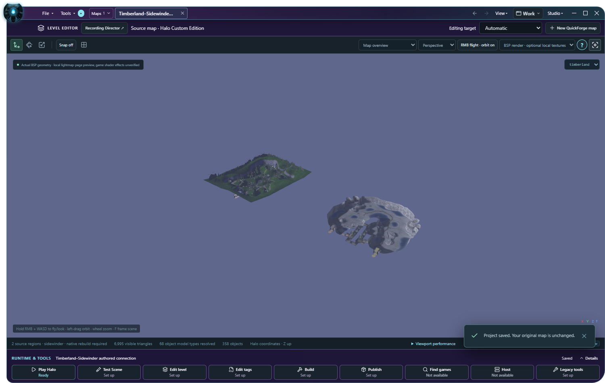

# PROJECT GUILTY SPARK

### ALL THE TOOLS, AND THEN SOME.

**One Halo. Every World. Every Tool. Together.**

An open-source **Halo: Combat Evolved modding studio** bringing maps, tags, worldbuilding, native tools, gameplay creation, and testing into one modern workspace.

**[Get started](docs/GETTING_STARTED.md) · [Features](docs/CURRENT_FEATURES.md) · [Roadmap](ROADMAP.md) · [Contribute](CONTRIBUTING.md)**

*Real Spark desktop capture. Editor previews and successful compilation do not, by themselves, prove gameplay compatibility.*

## One studio. More Halo.

**Inspect. Edit. Create. Build. Playtest.** Instead of bouncing between disconnected editors, Guilty Spark aims to connect the Halo 1 modding workflow behind a single interface.

- **Maps and tags:** inspect supported Halo formats, edit validated properties, manage assets, and preserve original sources.
- **Worldbuilding:** create geometry, rooms, ramps, materials, supported native objects, and HaloScript-driven interactions.
- **Your tools, connected:** use supported native editing/build tools through reviewed handoffs, compilation, and readback.
- **One workspace, many views:** detachable windows, multi-map editing, Undo history, and experimental creator collaboration.
- **Build toward gameplay:** produce standard Halo output for compatible targets, then test it in the real engine.

Capabilities vary by Halo edition, source availability, and installed tools. **Not every operation is complete or available in every runtime.** See the [verified feature status](docs/CURRENT_FEATURES.md).

## The ambitious roadmap

We're building toward a place where the Halo 1 community can do far more:

- **Cross-Halo 1 play and interoperability** across compatible classic, MCC, legacy Mac, Xbox, and community-engine experiences.
- **19-map MegaWorld:** author all 13 original Xbox multiplayer maps plus the six Halo PC additions in one planned world, with natural BSP seams, mountain roads, caves, sniper routes and a randomized teleporter web. All-region gameplay, vehicle traversal and 128-player battles remain unverified research/engineering goals.
- **Synchronized AI and custom Firefight:** shared encounters, survival modes, and the original **Zombie Apocalypse** revival.
- **Full creation in one place:** maps, BSPs, tags, assets, scripts, gametypes, campaigns, machinima, and multiplayer hosting.
- **Chupathingy + OpenH1 VR:** prefer Chupathingy for standard gameplay integration; research a native Spark VR Forge editor and playtesting through OpenH1. No in-headset editing or Windows OpenH1 VR acceptance is claimed.
- **Windows, macOS, and Linux:** a genuinely useful native editor with fewer mandatory external tools.

**These are development and research goals—not promises of working cross-engine multiplayer, 128-player gameplay, complete AI synchronization, or finished cross-platform releases.** Each needs its own native and in-game acceptance.

## Where things stand

This is **active development**, not a finished game or published release. Every release candidate records its exact source commit, test receipts and binary hashes; see the [current release handoff](docs/RELEASE_CANDIDATE_20261107.md). The upstream README update `5095e9b` is preserved in this history.

| Area | Evidence and current scope |
| --- | --- |
| Map/tag inspection, supported source edits, native builds and external-tool handoffs | Working in validated, target-specific workflows; not universally available across engines |
| [19-map MegaWorld Atlas](docs/ACTIVE_TASK.md) | All 19 CE multiplayer source identities checked; hex-cluster planning, transform/yaw, overlap warnings and native UI Undo/Save/restart verified. **Planning only:** no complete 19-map BSP/gameplay build |
| [Timberland–Sidewinder prototype](docs/DOUBLE_ACTION_20261107.md) | Natural three-route CE609 seam compiled, independently sampled and loaded in Chupathingy. Warthog driving, human crossings/ridge traversal, sniper combat and randomized teleporting **not yet accepted** |
| [Chupathingy integration and Machinima](docs/CURRENT_FEATURES.md) | Preferred fresh-setup runtime; verified editor source rendering, reversible greenscreen and camera Save/restart. In-game live writes, co-op and gameplay acceptance remain pending |
| [Native lighting bake](docs/NATIVE_LIGHTING_20261108.md) | Explicit sun/ambient/fog authoring, Halo Tool radiosity, independent standard-tag/cache readback and Chupathingy load verified for a single-sky Draft/Final CE609 Workshop map, including explicit Save and failed-build recovery. Human appearance, MCC and wider cases remain open |
| [Private Windows Chupathingy hosting](docs/CHUPATHINGY_DEDICATED_20261108.md) | Verified dedicated package, native CE compile/readback, two real clients spawning, guarded map restart and source preservation. Human gameplay, AI Apocalypse and persistent Extraction remain open |
| [OpenH1 VR](docs/ENGINE_SOURCE_ATLAS.md) | Source/interface research only. In-headset Spark VR editing and Windows OpenH1 VR playback have **not** been verified |
| [Arena Evolved](docs/fixtures/arena-evolved-0.7.7.json) | Separate version-pinned setup/profile; installed game, launch and peer acceptance remain open |
| Firefight, Zombie Apocalypse, AI sync, dual wield, sprint and cross-engine multiplayer | Target-specific implementation/research; **not** claimed as fully playable or interoperable |
| Shared Halo library and runtime setup | Publisher-pinned Windows x64 engine packages, separate profiles, shared content paths, local presentation-pack import and optional guided walkthrough. See [native acceptance and limits](docs/SHARED_RUNTIMES_AND_PACKS_20261107.md). No destructive executable swapping |
| Downloads and release builds | C49 Windows 0.4.1 is preserved separately. The current candidate has its own source manifest and acceptance report; no public Release download is claimed before attachment/publication |

*Development screenshot: two regions rendered in the editor. It is not evidence of a playable 19-map world.*

### Development maps and downloads

Source-bound authoring projects and evidence are tracked in this repository; **original Halo game maps, textures, editing-kit files, and proprietary content are not distributed here**. A compiled experimental MegaWorld test map has been retained privately for validation, not published as a downloadable, gameplay-accepted demo.

**Downloads:** use the [GitHub Releases page](https://github.com/LeftoverProductionsTeam/Project-Guilty-Spark/releases) after a release is published. There are currently no verified public assets to link directly. Local packages and Actions artifacts are not public downloads.

For desktop candidates, the existing [Release candidate workflow](.github/workflows/release.yml) can create **Windows NSIS installer and portable ZIP candidates** and optionally attempt **Linux AppImage and DEB candidates** from a pinned, pushed commit. Candidates require automated gates, native startup checks and artifact verification. A GitHub Actions artifact is **not** automatically a public GitHub Release; publishing remains a separate approval step. A macOS release package is still a future validation target.

Read the [current engineering checkpoint](docs/ACTIVE_TASK.md), [verified feature status](docs/CURRENT_FEATURES.md), [full feature ledger](docs/MASTER_FEATURE_LEDGER.md), and [native evidence](docs/DOUBLE_ACTION_20261107.md) for precise scope and open acceptance gates.

## Join the project

Guilty Spark is **open-source under the [MIT License](LICENSE)**. Builders, modders, testers, designers, and community tool authors are welcome.

**[Report a bug or suggest a feature](https://github.com/LeftoverProductionsTeam/Project-Guilty-Spark/issues/new/choose)** · **[Contribution guide](CONTRIBUTING.md)** · **[Build on Windows](docs/BUILD_WINDOWS.md)** · **[Community credits](COMMUNITY_CREDITS.md)**

Halo, its game assets, and associated trademarks belong to their respective owners. **Guilty Spark is an independent community project and does not bundle commercial Halo games or proprietary editing-kit content.** Use legitimately obtained game files and respect the [asset and copyright policy](docs/ASSET_AND_COPYRIGHT_POLICY.md).

---

**MAKE HALO YOURS.**

*One Halo. Every World. Every Tool. Together.*

