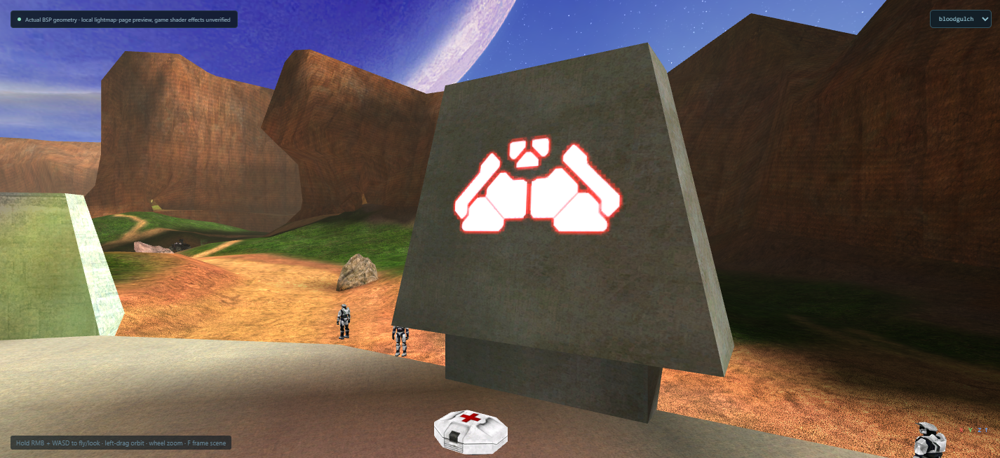
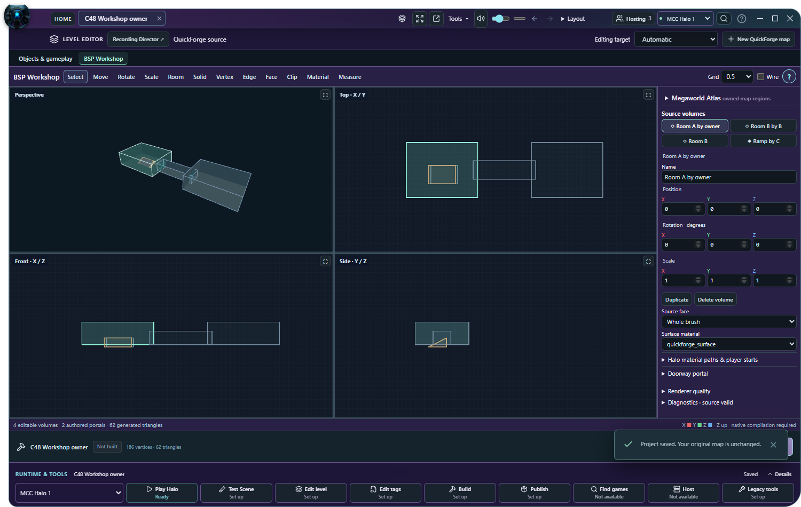

# PROJECT GUILTY SPARK

**One Halo. Every World. Every Tool. Together.**

An open-source Halo 1 creation and interoperability studio combining native modding, worldbuilding, collaborative editing and experimental gameplay enhancement.

**Available Now** means a validated operation within its stated boundaries. **In Development** means important native gameplay or compatibility gates remain. **Research** means feasibility and acceptance are still unproven. These statuses describe current source; the preserved C49 Windows preview is an earlier snapshot.

## Build the Halo worlds we imagined

| Flagship | Status | Proven scope and next gate |
| --- | --- | --- |
| **1. Halo Megaworld** | In Development | Atlas, source reconstruction and connected Timberland–Sidewinder native compilation. Collision routes and portals pass automated checks; a CE client joined. **0 region connections have a returned two-way player test.** Four-region expansion remains gated. [Evidence](docs/CONTINUATION_57_MEGAWORLD.md). |
| **2. Native Forge / BSP Workshop** | Available Now, scoped | Four linked views, brushes, materials/UVs, rooms, ramps and native collision compilation/readback. Drop supported native doors and trigger volumes, connect Logic / Events and build ordinary HaloScript. A player verified the two-room CE corridor/ramp and the C63 H1A Standalone door in both directions. General imported-terrain sculpting remains unfinished. [Door workflow and evidence](docs/CONTINUATION_63_NATIVE_LOGIC.md). |
| **3. Multiplayer AI synchronization** | In Development | Real OpenCE peers observe native movement, combat, damage/death and cleanup. Full state/lifecycle parity, vehicles, shared round globals and cross-computer acceptance remain open. [AI evidence](docs/CONTINUATION_56_NATIVE_AI.md). |
| **4. Firefight & Zombie Apocalypse** | In Development | A solo native controller completes two AI-cleared waves. Human engagement remains pending. Original Zombie carrier/rider creation and controlled release work; automatic release and complete Zombie gameplay remain open. |
| **5. Universal Halo editing & conversion** | In Development | Format-specific readers, native loose tags, bounded compiled-map edits, recursive staging and real CE → MCC rebuilding. Each target still needs its own game/asset acceptance; a compile is not playable-conversion proof. [Compatibility](docs/CONTINUATION_58_COMPATIBILITY.md). |
| **6. Live Link** | Available Now, scoped | Supported exact-build MCC object transforms, scaling and readback. Non-MCC write adapters and arbitrary live spawning/BSP replacement remain unverified. |
| **7. Real-time collaborative modding** | Available Now, scoped | Private SparkLink native-tag/validated-asset/BSP transactions, author Undo, conflict handling, crash recovery and session rollover. Three independent native processes are tested on one PC. Two-computer acceptance remains open; this is source editing, separate from game replication. |
| **8. Multiplayer Hub** | Available Now, scoped | Choose a runtime, then Host, Join or Collaborate. Managed CE hosting/joining and player movement/collision have evidence. Games retain their own protocols; no universal MCC-to-community lobby bridge is claimed. |
| **9. Campaign creation & machinima** | In Development | Mission/HaloScript sources, camera paths, detached native recording cameras and takes. First Contact needs a full mission playthrough. |

**Research stays visible:** expanded campaign co-op, accepted 128-player gameplay, four-region engine streaming, PC split-screen, VR and tracked interactions. These remain requirements, not advertised production capabilities.

**C59 workspace acceptance:** eligible drawers and map tabs detach into native windows with original-window return, saved placement and durable history. Minimized/inactive editors stop drawing; two warm map renderers per window retain document state while older GPU contexts can be released. Online separates Host, Join and source collaboration. Three independent Spark processes pass native BSP compilation, host-crash/offline-edit recovery and explicit durable session rollover with fresh invitations. The 23-route native layout audit passes; physical multi-monitor removal and two-computer LAN/VPN remain unverified. Release builds refuse the Spacewar test bridge. [Exact evidence and limits](docs/CONTINUATION_59_WORKSPACE.md).

**C60 maintenance and release closure:** stale library replies can no longer overwrite newer snapshots; real 40-event bursts drop from 40 to 2 library reads, with the same reduction for focused-map metadata. Window lifecycle commands and QuickForge source-resource resolution reuse dedicated owners. Full native regression and rendering-quality checks pass; broad load-time and memory results are mixed. The original C49 portable and newly installed NSIS application both start successfully, but GitHub upload is still blocked by missing authenticated access. [Exact findings, timings and release handoff](docs/CONTINUATION_60_RELEASE_MAINTENANCE.md).

**C62 preservation cleanup:** the complete measured development footprint drops from **314.67 to 95.21 GiB allocated**, including recovery archives and new verification evidence. The first pass left 218.59 GiB; deeper verified archival reclaims another 123.37 GiB. Original runtimes, dirty worktrees, canonical SDK tags, accepted caches, diagnostic executables and the C49 release stay intact. Current-source three-process BSP/editor acceptance and post-cleanup native readback pass. [Measured storage, recovery instructions and limits](docs/CONTINUATION_62_SAFE_CLEANUP.md).

**C66 native storage containment:** Forge/BSP builds stage verified dependencies and reuse unchanged validated jobs. A real 23-tag imported door compiled with 1,774 base tags instead of the 11,538-tag SDK; ten unchanged requests added no native trees. Missing Demo resources stop before extraction, and an actual Invader edit/reconcile/rebuild passed. Settings → Storage & Cache adds reviewed limits, cleanup and connected Halo folder sizes with a combined total. Historical data and broader dependency coverage still need review. [Evidence and remaining limits](docs/CONTINUATION_66_STORAGE_AND_RECOVERY.md). [Active engineering checkpoint](docs/ACTIVE_TASK.md).

**C67 Source Guardian recovery:** Preservation → Recover a Halo Project reviews a map before creating separate standard tags and supported reconstructed source files. Actual desktop recovery, independent native parsing and a recovered 1,795-tag MCC scenario compile/readback pass. Original authoring history, complete visual/audio fidelity, other-runtime acceptance and gameplay of that recovered cache remain unverified. [Workflow, measurements and limitations](docs/CONTINUATION_67_SOURCE_GUARDIAN.md).

## Real accomplishments

- Native geometry/collision compilation and a user-verified Custom Edition Workshop playthrough.
- Three separate Spark processes sharing native/BSP edits, validated assets, author undo, conflicts, crash recovery and a frozen native build.
- MCC looping-sound dependency/sample recovery, sound-scenery attachment and compiled placement readback. In-game listening remains pending.
- Actual installed Xbox `a10` decoding: **364,774 render triangles, nine BSP parts, 70 model types, 425 requested images with no failures, 17 reflection cubes and three sound previews** in the C51 reader run. Full engine rendering/audio parity is not claimed.
- C52 repairs native Custom Edition indexed bitmap bodies: automatic CE Blood Gulch previews now recover **159 shader bindings, 15 lightmaps, 233 detail slots and 73 reflection assignments** from its own verified bitmaps.map. Native source identities are checked across MCC, CE, OpenCE and Chupathingy. [Pinned engine-source atlas and integration gates](docs/ENGINE_SOURCE_ATLAS.md).
- C53 adds exact native CE indexed-sound previews and one-click audition. Actual Windows output is measured for CE, Demo, MCC and Xbox samples. Tag details now sit beside a large interactive model; native tag drawers and dragged map tabs retain their acknowledged editing history. [Results and remaining gates](docs/CONTINUATION_53_ENGINEERING.md).
- C54 adds searchable open-map and grouped Tools menus, remembered compact settings, and saved Home characters with one source-verified greeting per launch. Native rig rotations, Johnson's actual variation, campaign Chief's armor color and Cortana's transparent shaders are corrected. A paired UI-preference workload improves **36.4→30.0 ms (17.6%)**; this is not a general startup/map/GPU benchmark. [Acceptance and limits](docs/CONTINUATION_54_ENGINEERING.md).
- C55 adds source-authored model emission, valid diffuse-free glass, Xbox zero-range fog handling, all 17 tested `a10` reflection cubes, and source-scoped resource reuse. QuickForge Alt-drag/copy/paste passes recursive import, native MCC compilation and placement readback. Landscape clicks reach source shader and connection tools; imported-terrain sculpting remains unfinished. [Native evidence and limits](docs/CONTINUATION_55_NATIVE_ASSETS.md).
- C56 fixes native round corpse ownership and proves actual infantry combat, two AI-cleared waves and OpenCE actor reconstruction after reconnecting. A separate Chupathingy CE multiplayer candidate loads on two processes; shared Firefight, original Zombie release and MCC compilation retain specific blockers. [Native evidence and runtime boundaries](docs/CONTINUATION_56_NATIVE_AI.md).
- C58 shares one native source contract across preview discovery, imported-cache build admission and portability reports. Registered custom-map folders participate in resource/provenance discovery, and runtime changes cannot relabel a source. A fresh CE → MCC Blood Gulch rebuild retains the inspected world and has 121 decoded images and 12 reflection cubes. Separate OpenCE/Chupathingy two-peer CE-world trials load, but sampled state disagreements and retail MCC gameplay remain open. [Compatibility matrix, native launch repairs and exact limits](docs/CONTINUATION_58_COMPATIBILITY.md).
- A zombie exits its original carrier alive, moves under active AI, advances animation, takes damage, dies and is cleaned up in two independent three-cycle native runs. One animation reference is repaired; automatic release and visual/combat acceptance remain open.
- Source-preserving external-tool handoff and semantic reconciliation, supported custom native tag names, Smart Edit copies and recoverable revisions.
- Incremental map saves with author history retained; unchanged periodic snapshots reuse their verified checkpoint. Two matched native runs reduced median save completion from **34.5 to 23.2 ms**, with no full-library bootstrap per save.
- Two warm map renderers per window, with older GPU views released while the editor, camera, selection and undo stay available. Whole-process RAM budgeting remains unfinished.
- A real owned Halo monitor for the corner menu, independent of the Home showcase. Solid model coverage, curved-corner placement and window-transparency separation are verified in the native app.
- A native Windows application and a sealed, locally accepted **0.4.1 C49 installer/portable candidate**. Public release upload and approval remain pending.

[C51 system audit, repairs and measured limits](docs/C51_SYSTEM_REPAIR.md) · [C51 native gameplay results](docs/CONTINUATION_51_ENGINEERING.md) · [C50 regressions/performance](docs/CONTINUATION_50_ENGINEERING.md) · [BSP Workshop](docs/BSP_WORKSHOP.md) · [C48 collaboration evidence](docs/CONTINUATION_48_ENGINEERING.md).

C61 makes native build-status updates source-bound and lightweight, puts selected transforms first, compacts the shared renderer controls and gives Home neutral studio lighting so Johnson is visible. Real native tests cover 16 character/runtime selections and 126 workspace states. Native player/AI trials retain the failed wave and incomplete shared-state gates. [C61 evidence, measurements and remaining work](docs/CONTINUATION_61_WORKFLOW_NATIVE.md) · [Push/upload handoff](docs/C61_PUSH_NOTES.md).

## Four Halo runtimes, explicit capabilities

| Capability | MCC Halo 1 | Custom Edition | OpenCE | ChupathingyCE |
| --- | --- | --- | --- | --- |
| Installation discovery | Tested locally | Tested locally | Tested locally | Tested locally |
| Maps/BSPs/textures/tags | Cache 13 reader and compatible resources | Native metadata/geometry plus indexed bitmap bodies from pinned resources | Owned Xbox/CE sources; Xbox preview path | Actual installed Xbox `a10` verified; internal pixels need no `bitmaps.map` |
| Sound previews | Exact supported classic bank samples; other codecs limited | Embedded and native indexed CE samples from exact pinned banks | Supported original Xbox samples | Supported original Xbox samples |
| Editing/builds | Supported direct scalar/placement copies and native source builds | Native loose tags, geometry and Tool builds | Compatible source toolchain; engine-specific validation | Format-specific source work; broad conversion unfinished |
| Converted gameplay | Map-specific builds; full Zombie gameplay open | Original conversion loads; original spawning gameplay open | Commanded actor lifecycle and native round tests; full restoration open | Broad converted gameplay not accepted |
| Hosting/joining | Official MCC session handoff | Private host/client join and movement verified | Private native process trials; content/protocol faults retained | Discovery/launch and scoped trials; converted-map faults remain |
| Live Link | Bounded object edits/readback | No validated Spark write adapter | Read-only exact-build AI diagnostics; no validated general write adapter | No validated Spark write adapter |
| AI/co-op | Full shared AI open; C56 candidate has a solo UI build blocker | Native actor/round source builds; multiplayer AI remains separate | Actual native combat/death/cleanup and reconnect observations; full parity/shared score/vehicles open | Native CE multiplayer research map loads; typed AI/co-op acceptance open |

A runtime selector does not translate networking protocols. [Detailed compatibility](docs/COMPATIBILITY_MATRIX.md) · [C51 runtime/flagship gates](docs/C51_RUNTIME_AND_FLAGSHIPS.md).

## Download / install

**[GitHub Releases — Windows upload pending](https://github.com/LeftoverProductionsTeam/Project-Guilty-Spark/releases).** A public release must attach an x64 `_Setup.exe`, complete `_Portable.zip`, SHA-256 checksums and the exact source/version manifest.

The fresh anonymous API check on **November 3, 2026, 14:59 UTC** returned **no public releases**. C49's accepted installer/portable/source set was rechecked and its two Windows applications launched again; those local files are not public downloads. Its exact source is `cb07581597de11e83d1c10bafad526e8b031f27e`. C50–C61 source improvements are not retroactively included in that candidate. The draft-only [release workflow](.github/workflows/release.yml) requires known pushed source, regression/package checks, verified asset downloads and owner approval before publication. Actions artifacts are not Release assets. [Exact files and draft-upload instructions](docs/C60_PUSH_NOTES.md).

Windows 10/11 x64 requires [Microsoft Edge WebView2](https://developer.microsoft.com/microsoft-edge/webview2/); the installer can offer it when missing. **No Linux package is advertised as verified:** AppImage and `.deb` builds must compile and launch first. macOS also has no accepted native package/startup test. No Halo game, maps, models, SDK, proprietary bank or optional Steam bridge is bundled.

## Inside the workbench

**Reproduce the demos:** open **Learning center → Guides** for searchable steps, requirements and workspace buttons. Rooms, corridors and ramps can be drawn and named through **Level editor → BSP Workshop → Named volumes**. [User workflows and acceptance boundaries](docs/DEMO_WORKFLOWS.md).

Genuine native application captures. Editor/compiler previews are work in progress; they do not prove game combat or multiplayer parity.





These are actual Windows app captures from C60 tests, using owned content. The BSP image shows editable source before compilation; neither capture proves gameplay parity. Earlier [Home](docs/screenshots/c51/home.png) and [runtime tools](docs/screenshots/c51/runtimes.png) captures remain historical.

## Edit, build, test and keep your source

1. Connect an owned Halo runtime once. Spark discovers known directories and verifies resource identities; only missing resources need selection.
2. Open a preserved map or author geometry in Level Editor / QuickForge. Per-map source, camera, selections, tools and history stay independent. Inactive level views pause instead of clearing.
3. Use typed tag drawers and supported recursive imports. Smart Edit reviews supported existing MCC scalar/placement changes into a separate cache; structural/source changes need the matching native build.
4. Optional Editing Kit, Invader and Baboon handoffs use isolated source copies. Reviewed external saves are reconciled semantically; corruption is refused and recovery source retained. Peers cannot request arbitrary raw patches or remote tools.
5. Inspect the validated build, then test that exact output in Halo. Source validation, compilation, startup, gameplay and user confirmation are separate gates.

Back/Forward preserves workflow; Ctrl+Z/Ctrl+Y edit history defaults to 100. F11, movable drawers and workspace/Recording Director pop-outs support focused and multi-monitor work. [Get started](docs/GETTING_STARTED.md) · [Smart Edit](docs/SMART_EDIT_WORKFLOWS.md) · [Native transactions](docs/CONTINUATION_38_ENGINEERING.md) · [External-tool integrity](docs/CONTINUATION_37_ENGINEERING.md).

## Roadmap and engineering evidence

[Flagship roadmap](ROADMAP.md) · [All twelve flagship gates](docs/C51_RUNTIME_AND_FLAGSHIPS.md) · [Current features](docs/CURRENT_FEATURES.md) · [Original 92 requirements](docs/ORIGINAL_92_REQUIREMENTS_RECONSTRUCTION.md) · [Cumulative ledger](docs/MASTER_FEATURE_LEDGER.md) · [Engineering backlog](docs/UNIVERSAL_WORKBENCH_BACKLOG.md).

Direct compiled-map structural editing, arbitrary live spawning/BSP replacement, native audio listening, complete rendering parity, expanded player counts and cross-computer/Steam collaboration remain explicit. Local processes do not prove a two-computer LAN/VPN session. Steam production integration needs an authorized app identity; Spacewar is not a production shortcut.

## Community and preservation

Built on more than twenty years of Halo community research, tools, documentation and preservation. The original MacGamingMods community and Patrick Davis/Fonzie/AnonDavis Zombie Apocalypse history remain part of the restoration record. [Community credits](COMMUNITY_CREDITS.md).

Spark metadata stays in sidecars; native Halo files retain standard formats. Halo content belongs to its respective owners and is supplied by the user.

## Build, contribute and get help

Tauri 2, Rust, React and Three.js. Use Node 24, pnpm 11.25.0, stable Rust, MSVC build tools and WebView2 on Windows. Native tests also need matching owned Halo content/tools.

```powershell
pnpm install --frozen-lockfile
cargo test --workspace --locked
pnpm check
pnpm test
pnpm test:offline
pnpm exec playwright install msedge
pnpm test:ui
node scripts/desktop.mjs build
```

[Windows build guide](docs/BUILD_WINDOWS.md) · [Contributing](CONTRIBUTING.md) · [Report a problem](https://github.com/LeftoverProductionsTeam/Project-Guilty-Spark/issues/new/choose) · [Release procedure](docs/RELEASING.md).

Local master consolidation does not imply a push, updated GitHub metadata or published release. Repository protections and source history remain unchanged.
