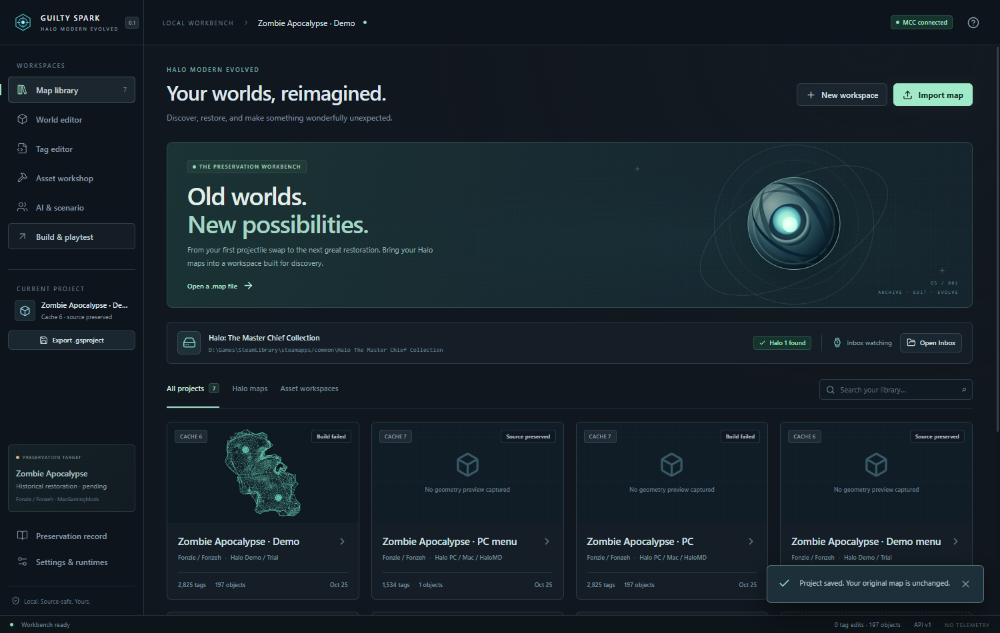

# Project Guilty Spark

**Halo Modern Evolved · desktop workbench 0.1.0**

A running Tauri 2 / Rust / React application for preserving and inspecting Halo 1 maps, editing audited fields and scenario transforms, previewing real collision geometry, and preparing source-safe builds.

This is an initial implementation of the larger vision. **Zombie Apocalypse end-to-end acceptance is pending.** The owner-supplied variants are imported and inspected; real conversion attempts stop on unresolved resource errors. No playable conversion is claimed.



## Open the application

**First manual instruction: open `target/release/GuiltySpark.exe`.**

The build also produces a Windows installer under `target/release/bundle/nsis/` when packaging succeeds. The app uses the installed WebView2 runtime. Normal use does not require administrator privileges.

The project’s local QA library is isolated under `.local/qa-data`; the normal application uses its own per-user app data directory. No game assets are bundled into the executable or repository.

## Implemented

- Steam discovery through the registry/default locations, `libraryfolders.vdf`, and app manifests, including other drives.
- An owned `<MCC>/halo1/GuiltySpark/Inbox` and `Mods` root. Stable file detection imports Inbox maps and attempts a build when enabled.
- Header detection for Xbox 5, reordered Demo/Trial 6, PC/Mac/HaloMD-family 7, MCC 13, and Custom Edition 609. Xbox zlib decompression has bounds limits. OpenSauce/extended maps are read-only or rejected when structures cannot be safely interpreted.
- Actual tag indexes, audited weapon/projectile fields, class-checked projectile reference swaps, selected dependency links, scenario placements, encounters/squads, and compiled script names.
- Real BSP collision meshes, per-BSP selection, perspective/orthographic cameras, orbit/free flight, selection/gizmos, snap, visibility, duplication, undo/redo and persistent transforms. Markers represent scenario placements; full object models and textured BSP rendering are not decoded.
- SQLite library, SHA-256 identity/deduplication, preserved source copies, versioned `.gsproject` descriptors, autosave, exact backups, edit history and creator/provenance records.
- OBJ ingestion, bounded triangulation, mesh previews, material-name and UV-presence indexing, and persistent workshop scenes.
- A real separately installed Invader extraction → rebuild → output inspection/CRC pipeline, with cancellation, timeouts, isolated job directories and structured logs. Incomplete extraction is rejected even when the tool exits with code zero.
- An unchanged-MCC-cache validation path: tag/index, protection, stub count, CRC and SHA checks followed by a byte-identical output copy. This is explicitly not legacy conversion.
- MCC packaging using **an unpublished, exact-scenario Excession metadata template**. Official map metadata is preserved; unknown schemas are not invented. Owned package receipts, hash verification, safe removal, manifest preservation/backups and registration rollback are implemented. Full schema validation and in-game package enumeration remain unverified.
- Steam’s normal `-applaunch 976730` workflow with clear instructions to select the official anti-cheat-disabled launch option. The app does not assert that it selected or verified that mode.
- Optional launching of an already installed native runtime. No runtime code is embedded and no map deployment or live bridge is connected.

## Verified on this machine

Windows x64 builds and automated tests were run. An owner-installed MCC `a10.map` was inspected read-only: 3,747 tags, 506 placements, 39 encounters, 189 scripts and 367,004 collision triangles. Actual native UI interactions and screenshots were captured.

All supplied Zombie Apocalypse variants were inspected, including real reordered Demo cache 6 and PC/HaloMD cache 7 files. Seven distinct source hashes are in the local application library. The Demo map has 2,825 tags, 197 placements and 5,940 collision triangles. Its automatic Inbox conversion attempt extracts 2,823 tags, then stops on two referenced sound records with out-of-bounds data. The other gameplay variants stop on 196 or 237 resource extraction errors with the supplied resource set. Originals remain unchanged. See the [restoration report](docs/RESTORATION_REPORT.md).

Existing-cache validation passed for that map. A real Invader rebuild attempt correctly failed because 1,471 tags lacked extractable resources from the installed remastered map. No successful rebuilt or playable cache was claimed from that attempt. The original and preserved source checksums were unchanged.

See [verification details](docs/TESTING.md), [compatibility](docs/COMPATIBILITY.md), [limitations](docs/KNOWN_LIMITATIONS.md), [architecture](docs/ARCHITECTURE.md), [setup/build](docs/BUILD.md), [research](docs/RESEARCH.md), and [third-party provenance](docs/THIRD_PARTY.md).

## Development

Requires Node 22.12+ (tested with Node 24), pnpm, stable Rust, and [Tauri platform prerequisites](https://v2.tauri.app/start/prerequisites/).

```powershell
pnpm install --frozen-lockfile
pnpm test
cargo test -p spark-core
pnpm desktop
```

The optional `scripts/bootstrap-rust.mjs` installs Rust only under `.toolchain/`, without changing system PATH. `node scripts/cargo.mjs ...` and `node scripts/desktop.mjs ...` use that installation when present. The optional Invader development installer writes a separate tool copy under `.local/tools/`; that tool is not bundled or redistributed by the release build.

No telemetry, automatic publishing, process memory modification, stock map replacement, executable patching, or anti-cheat configuration changes are performed by Guilty Spark.
