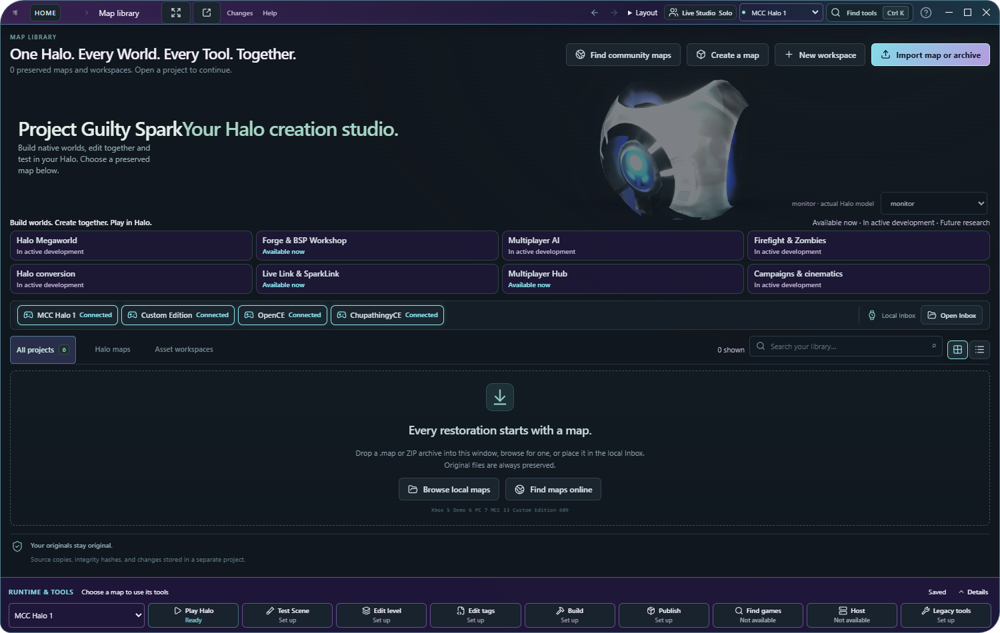
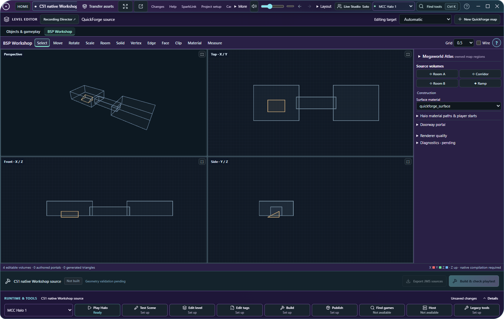
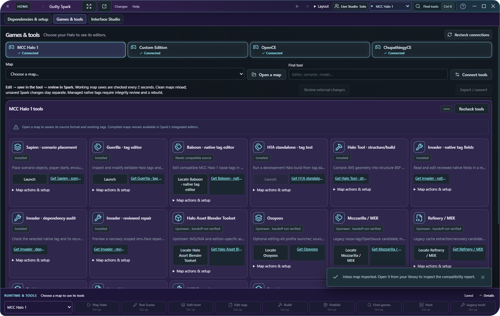

# PROJECT GUILTY SPARK

**One Halo. Every World. Every Tool. Together.**

An open-source Halo 1 creation and interoperability studio combining native modding, worldbuilding, collaborative editing and experimental gameplay enhancement.

**Available now** means a validated operation within its stated boundaries. **In active development** means source exists but important native gameplay or compatibility gates remain. **Future research** means feasibility and acceptance are still unproven.

## Build the Halo worlds we imagined

| Flagship | Status today | Working foundation and next gate |
| --- | --- | --- |
| **Halo Megaworld** | In active development | Original-map Atlas, BSP reconstruction and connected Timberland–Sidewinder compilation. A joined CE player is recorded; the new tunnel's two-way walkthrough is still unaccepted. Four-region gameplay and streaming have separate gates. |
| **Forge & BSP Workshop** | Available now, scoped | Four linked views, brushes, face materials/UVs, rooms, ramps, collision and native compilation. A player verified the two-room CE Workshop corridor/ramp. General imported-terrain sculpting and arbitrary live BSP replacement remain open. |
| **Multiplayer AI synchronization** | In active development | Real OpenCE peers observe native actor movement, combat, damage/death and cleanup, including a hostile created after reconnection. Exact-tick discrepancies remain visible; full lifecycle parity, vehicles, shared round globals and cross-computer acceptance remain open. |
| **Firefight & Zombie Apocalypse** | In active development | The existing solo controller completes two waves through native AI combat, reaches 400 wave-clear points and removes owned corpses. Human player engagement remains pending. The original weapon creates its carrier/rider; automatic release and full Zombie gameplay remain open. |
| **Universal Halo conversion** | In active development | Original-source recovery, recursive staging and native MCC/CE build paths. Xbox, PC, Demo/MD and extended sources retain format-specific limits. Compilation and renamed headers do not prove playable conversion. |
| **Live Link & collaborative modding** | Available now, scoped | Supported MCC object edits/readback; private SparkLink native tag, asset and BSP sharing with author undo, conflicts and recovery. Three independent processes on one PC are proven. Editor sharing, game editing and gameplay networking are distinct. |
| **Multiplayer Hub** | Available now, scoped | Runtime-aware discovery and managed private CE hosting/client joining. CE movement/collision is user-verified. Each engine retains its own protocol; no universal MCC-to-community lobby bridge is claimed. |
| **Campaign & cinematic creator** | In active development | Mission/HaloScript sources, camera paths, Recording Director and named takes. First Contact still needs a complete mission playthrough. |

**Future research stays visible:** expanded campaign co-op, accepted 128-player gameplay, four-region engine streaming, PC split-screen, VR and tracked interactions. These remain requirements, not advertised production capabilities.

## Real accomplishments

- Native geometry/collision compilation and a user-verified Custom Edition Workshop playthrough.
- Three separate Spark processes sharing native/BSP edits, validated assets, author undo, conflicts, crash recovery and a frozen native build.
- MCC looping-sound dependency/sample recovery, sound-scenery attachment and compiled placement readback. In-game listening remains pending.
- Actual installed Xbox `a10` decoding: **364,774 render triangles, nine BSP parts, 70 model types, 425 requested images with no failures, 17 reflection cubes and three sound previews** in the C51 reader run. Full engine rendering/audio parity is not claimed.
- C52 repairs native Custom Edition indexed bitmap bodies: automatic CE Blood Gulch previews now recover **159 shader bindings, 15 lightmaps, 233 detail slots and 73 reflection assignments** from its own verified bitmaps.map. Native source identities are checked across MCC, CE, OpenCE and Chupathingy. [Pinned engine-source atlas and integration gates](docs/ENGINE_SOURCE_ATLAS.md).
- C53 adds exact native CE indexed-sound previews and one-click audition. Actual Windows output is measured for CE, Demo, MCC and Xbox samples. Tag details now sit beside a large interactive model; native tag drawers and dragged map tabs retain their acknowledged editing history. [Results and remaining gates](docs/CONTINUATION_53_ENGINEERING.md).
- C54 adds searchable open-map and grouped Tools menus, remembered compact settings, and saved Home characters with one source-verified greeting per launch. Native rig rotations, Johnson's actual variation, campaign Chief's armor color and Cortana's transparent shaders are corrected. A paired UI-preference workload improves **36.4→30.0 ms (17.6%)**; this is not a general startup/map/GPU benchmark. [Acceptance and limits](docs/CONTINUATION_54_ENGINEERING.md).
- C55 adds source-authored model emission, valid diffuse-free glass, Xbox zero-range fog handling, all 17 tested `a10` reflection cubes, and source-scoped resource reuse. QuickForge Alt-drag/copy/paste passes recursive import, native MCC compilation and placement readback. Landscape clicks reach source shader and connection tools; imported-terrain sculpting remains unfinished. [Native evidence and limits](docs/CONTINUATION_55_NATIVE_ASSETS.md).
- C56 fixes native round corpse ownership and proves actual infantry combat, two AI-cleared waves and OpenCE actor reconstruction after reconnecting. A separate Chupathingy CE multiplayer candidate loads on two processes; shared Firefight, original Zombie release and MCC compilation retain specific blockers. [Native evidence and runtime boundaries](docs/CONTINUATION_56_NATIVE_AI.md).
- A zombie exits its original carrier alive, moves under active AI, advances animation, takes damage, dies and is cleaned up in two independent three-cycle native runs. One animation reference is repaired; automatic release and visual/combat acceptance remain open.
- Source-preserving external-tool handoff and semantic reconciliation, supported custom native tag names, Smart Edit copies and recoverable revisions.
- Incremental map saves with author history retained; unchanged periodic snapshots reuse their verified checkpoint. Two matched native runs reduced median save completion from **34.5 to 23.2 ms**, with no full-library bootstrap per save.
- Two warm map renderers per window, with older GPU views released while the editor, camera, selection and undo stay available. Whole-process RAM budgeting remains unfinished.
- A real owned Halo monitor for the corner menu, independent of the Home showcase. Solid model coverage, curved-corner placement and window-transparency separation are verified in the native app.
- A native Windows application and a sealed, locally accepted **0.4.1 C49 installer/portable candidate**. Public release upload and approval remain pending.

[C51 system audit, repairs and measured limits](docs/C51_SYSTEM_REPAIR.md) · [C51 native gameplay results](docs/CONTINUATION_51_ENGINEERING.md) · [C50 regressions/performance](docs/CONTINUATION_50_ENGINEERING.md) · [BSP Workshop](docs/BSP_WORKSHOP.md) · [C48 collaboration evidence](docs/CONTINUATION_48_ENGINEERING.md).

## Four Halo runtimes, explicit capabilities

| Capability | MCC Halo 1 | Custom Edition | OpenCE | ChupathingyCE |
| --- | --- | --- | --- | --- |
| Installation discovery | Tested locally | Tested locally | Tested locally | Tested locally |
| Maps/BSPs/textures/tags | Cache 13 reader and compatible resources | Native metadata/geometry plus indexed bitmap bodies from pinned resources | Owned Xbox/CE sources; Xbox preview path | Actual installed Xbox `a10` verified; internal pixels need no `bitmaps.map` |
| Sound previews | Exact supported classic bank samples; other codecs limited | Embedded and native indexed CE samples from exact pinned banks | Supported original Xbox samples | Supported original Xbox samples |
| Editing/builds | Supported direct scalar/placement copies and native source builds | Native loose tags, geometry and Tool builds | Compatible source toolchain; engine-specific validation | Format-specific source work; broad conversion unfinished |
| Converted gameplay | Map-specific builds; full Zombie gameplay open | Original conversion loads; original spawning gameplay open | Commanded actor lifecycle and native round tests; full restoration open | Broad converted gameplay not accepted |
| Hosting/joining | Official MCC session handoff | Private host/client join and movement verified | Private native process trials; content/protocol faults retained | Discovery/launch and scoped trials; converted-map faults remain |
| Live Link | Bounded object edits/readback | Full exact-build feature acceptance incomplete | Read-only exact-build AI diagnostics; general live writes open | Full live-object write acceptance open |
| AI/co-op | Full shared AI open; C56 candidate has a solo UI build blocker | Native actor/round source builds; multiplayer AI remains separate | Actual native combat/death/cleanup and reconnect observations; full parity/shared score/vehicles open | Native CE multiplayer research map loads; typed AI/co-op acceptance open |

A runtime selector does not translate networking protocols. [Detailed compatibility](docs/COMPATIBILITY_MATRIX.md) · [C51 runtime/flagship gates](docs/C51_RUNTIME_AND_FLAGSHIPS.md).

## Download / install

**[Download Windows previews from GitHub Releases](https://github.com/LeftoverProductionsTeam/Project-Guilty-Spark/releases).** A release must attach an x64 `_Setup.exe`, complete `_Portable.zip`, SHA-256 checksums and the exact source/version manifest.

The last anonymous verification on November 2, 2026 found **no public releases**. The accepted local C49 candidate is not a public download. Its sealed source is `cb07581597de11e83d1c10bafad526e8b031f27e`; C51 does not replace those binaries under the same identity. The draft-only [release workflow](.github/workflows/release.yml) requires pushed source, regression/package checks, verified asset downloads and owner approval before publication. Actions artifacts are not Release assets. [Exact preserved files and owner action](docs/C51_PUSH_NOTES.md).

Windows 10/11 x64 requires [Microsoft Edge WebView2](https://developer.microsoft.com/microsoft-edge/webview2/); the installer can offer it when missing. **No Linux package is advertised as verified:** AppImage and `.deb` builds must compile and launch first. No Halo game, maps, models, SDK, proprietary bank or optional Steam bridge is bundled.

## Inside the workbench

Genuine native application captures. Editor/compiler previews are work in progress; they do not prove game combat or multiplayer parity.







## Edit, build, test and keep your source

1. Connect an owned Halo runtime once. Spark discovers known directories and verifies resource identities; only missing resources need selection.
2. Open a preserved map or author geometry in Level Editor / QuickForge. Per-map source, camera, selections, tools and history stay independent. Inactive level views pause instead of clearing.
3. Use typed tag drawers and supported recursive imports. Smart Edit reviews supported existing MCC scalar/placement changes into a separate cache; structural/source changes need the matching native build.
4. Optional Editing Kit, Invader and Baboon handoffs use isolated source copies. Reviewed external saves are reconciled semantically; corruption is refused and recovery source retained. Peers cannot request arbitrary raw patches or remote tools.
5. Inspect the validated build, then test that exact output in Halo. Source validation, compilation, startup, gameplay and user confirmation are separate gates.

Back/Forward preserves workflow; Ctrl+Z/Ctrl+Y edit history defaults to 100. F11, movable drawers and workspace/Recording Director pop-outs support focused and multi-monitor work. [Get started](docs/GETTING_STARTED.md) · [Smart Edit](docs/SMART_EDIT_WORKFLOWS.md) · [Native transactions](docs/CONTINUATION_38_ENGINEERING.md) · [External-tool integrity](docs/CONTINUATION_37_ENGINEERING.md).

## Roadmap and engineering evidence

[Flagship roadmap](ROADMAP.md) · [All twelve flagship gates](docs/C51_RUNTIME_AND_FLAGSHIPS.md) · [Current features](docs/CURRENT_FEATURES.md) · [Original 92 requirements](docs/ORIGINAL_92_REQUIREMENTS_RECONSTRUCTION.md) · [Cumulative ledger](docs/MASTER_FEATURE_LEDGER.md) · [Engineering backlog](docs/UNIVERSAL_WORKBENCH_BACKLOG.md).

Direct compiled-map structural editing, arbitrary live spawning/BSP replacement, native audio listening, complete rendering parity, expanded player counts and cross-computer/Steam collaboration remain explicit. Local processes do not prove a two-computer LAN/VPN session. Steam production integration needs an authorized app identity; Spacewar is not a production shortcut.

## Community and preservation

Built on more than twenty years of Halo community research, tools, documentation and preservation. The original MacGamingMods community and Patrick Davis/Fonzie/AnonDavis Zombie Apocalypse history remain part of the restoration record. [Community credits](COMMUNITY_CREDITS.md).

Spark metadata stays in sidecars; native Halo files retain standard formats. Halo content belongs to its respective owners and is supplied by the user.

## Build, contribute and get help

Tauri 2, Rust, React and Three.js. Use Node 24, pnpm 11.25.0, stable Rust, MSVC build tools and WebView2 on Windows. Native tests also need matching owned Halo content/tools.

```powershell
pnpm install --frozen-lockfile
cargo test --workspace --locked
pnpm check
pnpm test
pnpm test:offline
pnpm exec playwright install msedge
pnpm test:ui
node scripts/desktop.mjs build
```

[Windows build guide](docs/BUILD_WINDOWS.md) · [Contributing](CONTRIBUTING.md) · [Report a problem](https://github.com/LeftoverProductionsTeam/Project-Guilty-Spark/issues/new/choose) · [Release procedure](docs/RELEASING.md).

Local master consolidation does not imply a push, updated GitHub metadata or published release. Repository protections and source history remain unchanged.
