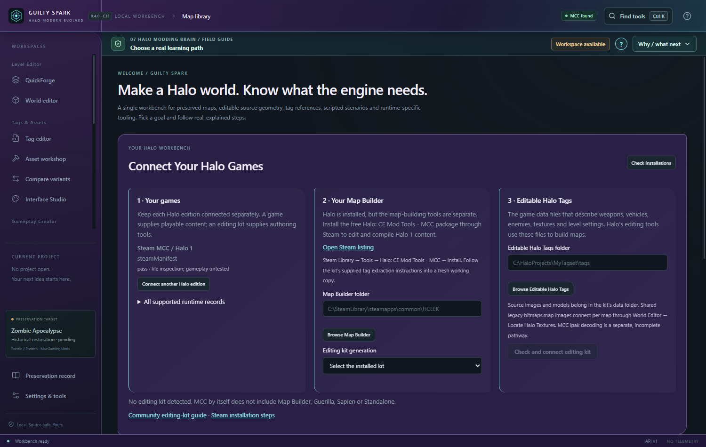
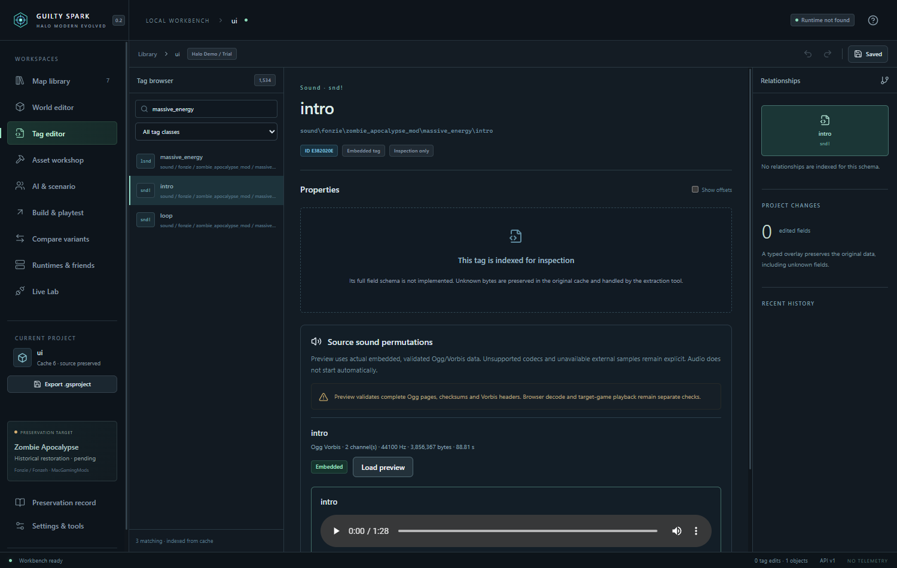

# Project Guilty Spark

**A modern Halo 1 creation and preservation workbench.** Tauri 2 / Rust / React. Windows is the currently verified native development platform. **0.4.0 · Continuation 36 dev** continues C35 R12; compiler and game acceptance remain separate from editor previews.

> Project Guilty Spark stands on more than twenty years of research, experimentation, documentation, tools, discoveries, and shared knowledge from the Halo modding community. This project would not exist without the people who explored the Blam engine, created the original editors, reverse-engineered file formats, preserved old maps, documented workflows, and helped generations of modders learn.

[Community credits](COMMUNITY_CREDITS.md) · [Get started](docs/GETTING_STARTED.md) · [Build on Windows](docs/BUILD_WINDOWS.md) · [Contribute](CONTRIBUTING.md) · [Roadmap](ROADMAP.md) · [Report a problem](https://github.com/LeftoverProductionsTeam/Project-Guilty-Spark/issues/new/choose)

## What works today

The [C36 native-preservation pass](docs/CONTINUATION_36_ENGINEERING.md) adds **Build & playtest → Portability Lab**, source-bound Engine Preflight findings, exact untouched-byte checks and readable/JSON semantic build comparisons. Native tags stay standard files; Spark metadata stays outside them. A real CE-to-MCC build and native tag no-op/edit/rebuild workflow have separate evidence. Painted-detail BSP audio changes stop before an unverified save. Protected Chupathingy invitations route to the matching game's password prompt; they do not add MCC cross-play. [Native portability policy](docs/NATIVE_PORTABILITY.md).

Separate [native community trials](docs/C36_COMMUNITY_NATIVE_TESTS.md) run original Xbox data in real OpenCE/Chupathingy processes: same-runtime sessions and OpenCE-host/Chupathingy-client simulate together, while the opposite direction is version-refused. Reproducible private QA retains sampled state differences. Human combat, full replication/AI parity, Spark's listing-to-client flow and MCC protocol translation remain open.

The focused [One Halo MCC H1 investigation](docs/research/ONE_HALO_MCC_H1_INVESTIGATION.md) verifies private native discovery and inspects the owned MCC engine boundary. Actual MCC session admission remains unimplemented; the tested community release also rejects MCC-only cache-13 startup. Its evidence, prototype and next engine-integration experiment are available for review.

The [C35 r12 sound and workflow pass](docs/C35_MCC_AUDIO_AND_WORKFLOW.md) automatically finds matching classic sound resources or MCC's installed classic ADPCM bank. Looping sounds retain all authored main tracks in one undoable import, with saved BSP ambience available to Director audio. Sound controls load their own styles, keep visible labels and fit narrow drawers without overlapping mute/solo controls. MCC CELT music/dialogue and complete engine audio parity remain open.

The [C35 r11 rendering and workflow pass](docs/C35_RENDERING_AND_WORKFLOW.md) corrects cached model face winding, transparent shader routing and decal orientation/blending. MCC's exact shared bitmap spans supply legacy teleporter textures missing from imeta. The title and map tabs share one compact header with lowered upper-right window actions. One fullscreen mode keeps map tabs, editing tools, runtime actions and drawers available; narrow tool strips have a More menu. Existing sources and per-map edits stay preserved.

The [C35 r10 viewport pass](docs/C35_VIEWPORT_WORKFLOW.md) adds direct object-tag drawers, a shared open-map model/sound library and custom OBJ/WAV/OGG imports. Assigned ambience plays automatically with remembered per-map mute/volume. The latest workbench header and fullscreen behavior are described in the r11 pass above. Imported-cache model additions and custom meshes remain previews until supported native compilation. Tag Editor now groups matching tags in collapsible classes, keeps editable fields first and provides native tag-editor handoff for complete source schemas.

The [hosting and workflow pass](docs/HOSTING_COLLISION_AND_CONTROLS.md) fixes the onboarding save path, compacts the sidebar, moves Interface Studio into Settings, retains shared editor sessions and adds a separately built Spacewar test module. A four-map dogleg tunnel passes native compilation and compiled collision checks. The [native gameplay, tag and audio pass](docs/NATIVE_GAMEPLAY_AND_AUDIO.md) adds working MCC Shift sprint, an editable shoulder camera with a dedicated first/third-person button and saved F6 shortcut, native power-up recipes, spatial sound rehearsal with linked segments, safe campaign tag duplication through rebuilding, and audited UI-widget fields. Dual-wield firing, player sword/lunge, third-person aim correction and complete rendering/audio parity remain open; compiler checks alone do not establish game loading.

- Preserve owned maps, inspect real classic tag data, stage supported field/placement edits, and compare variants.
- Render actual classic/MCC BSP geometry, object models, source materials, detail layers, lightmaps, decals, sky and atmospheric fog. Textures stream from verified owned resources, including supported MCC texture packs. Open a player-start view or use the map overview.
- Browse map sounds in World or Tag editor. Automatically connect supported installed resources, preview verified embedded/shared Vorbis and PCM/Xbox ADPCM, rehearse spatial events and preserve every authored main track with intro/loop/end clips. MCC classic ADPCM banks are supported; CELT music/dialogue and native event/acoustic parity still need engine work.
- Author original QuickForge geometry and game-mode source; retain separate MCC/CE target configurations; use managed isolated compiler jobs and explicit compatibility gates.
- Connect compatible BSPs with a rebuilt tunnel, native collision, portals and lightmaps. Optionally retain single-BSP [donor scenery](docs/DONOR_SCENERY.md) with source-bound model dependencies and compiled placement readback.
- Continue from compiled revisions with matching per-map tags, inspect optional viewport performance metrics, and review the [three-map/performance pass](docs/THREE_MAP_WORLD_AND_PERFORMANCE.md).
- Rotate a connected section around its entrance, retain clear donor/draft context, and recheck earlier routes in the [four-map challenge](docs/FOUR_MAP_CHALLENGE.md).
- Connect games separately from editing kits; inspect tool files; keep manual/periodic/pre-build project snapshots and preview a restore.
- Use the curved native window, custom window controls, middle-button pan and world-axis translation of rotated Forge selections.
- Keep each map's camera, active workspace, tag selection, editor settings and build targets while moving between tools. The searchable Features page explains the available workflows and their limits.
- Drop supported Halo animation sources onto compatible bipeds; rehearse their real skeletons and compile an SDK camera/actor take with a clean game HUD and player input enabled.



## C35 living workbench

The latest [BSP audio and window pass](docs/C35_BSP_AUDIO.md) restores the existing theme in nonmodal drawers, removes the extra header X and keeps app controls visible in fullscreen, including entry from maximized mode. Validated working maps can assign native background loops and sound environments to actual BSP clusters, then compile/open a separate verified MCC revision. Game acoustics remain an independent acceptance gate.

The latest [thread-release pass](docs/C35_THREAD_RELEASE.md) reports failed releases from the experimental live adapter, retains only outstanding owned increments for retry and blocks new edits in that connection. Recovery stays reachable after a failed snapshot or unavailable local journal. Windows child-process and UI checks pass; engine-owned timing, abnormal-exit recovery and a new MCC gameplay test remain open.

The latest [looping audio pass](docs/C35_LOOPING_AUDIO.md) preserves source main-track intro, repeat and end clips in rehearsal and saved Director audio. Choose a looping sound and track in Map sounds. **Finish sound end clips** and Director's **Finish sound & save** play the authored ending; existing Stop controls cut immediately. Native event, alternate/detail and acoustic parity remain separate gates.

The latest [live-session recovery pass](docs/C35_LIVE_SESSION_RECOVERY.md) keeps cleanup available after the game snapshot fails, distinguishes restoration from obsolete-record retirement and protects live object edits from stale connections. Pending cleanup pauses new edits; reconnecting resets old bindings and undo. Windows lifecycle, desktop API and browser tests pass; full MCC transition/recovery acceptance remains open.

The [Director audio pass](docs/C35_DIRECTOR_AUDIO.md) adds an optional saved map sound mix to Editor Render takes. Enable **Recording output → Include saved map audio** after saving Ambient or Map start emitters in Map sounds. Actual native recordings verify an encoded real map sample and camera-distance silence; game audio/capture remains a separate acceptance gate.

The earlier [Director recording pass](docs/C35_DIRECTOR_RECORDING.md) adds remembered folders and named takes, fixes preference loss across native windows, cleans empty cancelled reservations and keeps exported frame dimensions stable when the interface changes. Recording and game/OS capture acceptance remain separately documented.

The latest [classic bitmap repair and conversion pass](docs/C35_CONVERSION_RESOURCE_REPAIR.md) checks exact missing CE bitmap tags before staging, reviews matching source files and creates a separate repaired SDK tagset. Alpine now passes native MCC compilation with these files and an explicit MCC multiplayer UI compatibility option; gameplay acceptance remains pending.

The [saved tool-edit follow-through](docs/C35_TOOL_EDIT_FOLLOW_THROUGH.md) adds stable-save monitoring of derived tag folders, a compact changed-files review and the separate native rebuild/open-result workflow. It fixes a desktop pre-build snapshot refusal. A real external scenario edit compiled through the desktop into an MCC cache, with the changed player start read back from the new map; original tags/cache and Spark authoring remained intact.

**Menu** opens the remembered navigation drawer. The title and map tabs share one 40-pixel row (34 in fullscreen); window actions sit centrally at the upper right. **F11** enters native fullscreen with a 30-pixel drawer strip and visible map/edit/build controls. There is no separate Focus mode or header-hiding step. Project setup, Changes, Help, Objects, Inspector, construction and game connection use edge/floating drawers; the sliders icon contains drawer placement/size/pinning. **Escape** closes a popup or drawer first, then exits fullscreen. Camera flight supports configurable WASD/Q/E, Shift boost, middle-button pan and right-button wheel speed.

Open **Recording Director ↗** from a prepared Level editor view to detach a native camera/recording window, then dock it back with the same revision-checked session. Camera keys, tracking, lens and monitor controls are included. Editor Render can record the saved spatial sound scene. Explicitly shared Live Game Capture is a separate route; an independent MCC engine spectator adapter is not implemented. Native named takes pass picture/audio decoding and source-preservation checks; application OS pickers, actual game audio/capture and long takes remain acceptance gates.

The visual Community maps catalog uses real releases, publisher screenshots and published credits/dependencies. Alpine downloads and opens as Custom Edition; its source-complete MCC conversion is now structurally validated. Actual Zombie Demo resource recovery loads original shader/lightmap/detail previews without unrelated MCC substitution. See the [C35 engineering evidence](docs/CONTINUATION_35_ENGINEERING.md), [owner test card](docs/CONTINUATION_35_TEST_CARD.md) and [push summary/description](docs/GITHUB_HANDOFF.md). All earlier engine goals remain in the [319-row cumulative ledger](docs/MASTER_FEATURE_LEDGER.md).

## C34 internal engineering continuation

C34 continues the existing project and keeps the full feature set as the alpha target. The bottom Runtime & Tools Dock keeps map-specific runtime selection, opens verified derived source in the matching native tools, and provides setup paths. A separate working-tags compiler preserves saved Sapien/Guerilla edits in a new compiled map.

**Settings → Dependencies & setup** checks missing tools and source data, offers remembered folder selection and official guides, and can open a reviewed Steam install page for Halo CE Mod Tools. **Community maps** accepts direct HTTPS map/ZIP downloads and routes preserved imports into Level editor, Tags or conversion. Open maps detect stable external saves every two seconds, retaining conflicting Spark edits in a separate tab. Combined maps support editable tunnel visibility zones with native portal/cluster/PVS readback; editor bounds and independent region streaming remain distinct.

Play & Servers reads the real Delta List service, filters advertised OpenCE/Chupathingy/web-compatible games, checks local runtime/content prerequisites and prepares a pinned, expiring game invitation handoff. Paste supported community, official web or MCC Steam lobby links in **Join by invitation**. MCC-to-community gameplay protocol translation remains unimplemented. Private host profiles and authenticated loopback server observations are available; server launch, eight-player campaign/Firefight and 128-player game acceptance remain separate gates. A process launch is not reported as a successful game connection.

The current Windows manifest regression is fixed with drive/UNC path tests. Idle native controllers avoid unnecessary transport/lock work. The four-map audit confirms one combined BSP and preserves the three passing automated routes; gameplay, two-client AI/co-op and 128-player acceptance remain open. See the [C34 engineering record](docs/CONTINUATION_34_ENGINEERING.md) and [current compatibility matrix](docs/COMPATIBILITY_MATRIX.md).

## Experimental and unverified

C33 adds an [experimental MCC live adapter and two-editor private sessions](docs/LIVE_ADAPTER.md). The running Blood Gulch session verified object moves/restoration and shared vehicle scaling with contact spheres, mass, inertia and suspension coupled. The owner confirmed correct 2× Warthog tires and driving after the suspension fix. Other vehicle types and two-computer replication still need game acceptance. The original room compiled with H1A Tool and passed cache checks. Remembered Halo/tool onboarding, a how-to/glossary and whole-window transparency/tint are included.

The [workspace extension](docs/LIVE_EDITOR_WORKSPACES.md) unifies World Edit, QuickForge and Live mode; adds multiple map tabs/windows, source-linked asset transfers, a Machinima workspace and Dark Glow. MCC v13 render vertices, models, verified texture packs, lightmaps and authored sky lighting/fog now load through the shared renderer. Live dragging, resizing and keyboard undo operate on existing game objects.

The editor is not a replacement Halo engine. Complete shader/animation parity, arbitrary runtime spawning or BSP replacement, arbitrary binary tag/map conversion, rebuilt Zombie Apocalypse gameplay, Firefight engine behavior and multiplayer AI synchronization remain incomplete. Co-op, expanded player counts, split-screen, VR, PowerPC export and native Mac/Linux acceptance remain roadmap work. An exported source file, a simulated wave or a passed parser test is not proof of game loading.

See [edition compatibility](docs/COMPATIBILITY_MATRIX.md), the [C33 engineering/test report](docs/CONTINUATION_33_ENGINEERING.md) and [Reclamation and workflow polish](docs/RECLAMATION_AND_WORKFLOW_POLISH.md) for measured results and limitations. Earlier requirements remain in the [full ledger](docs/MASTER_FEATURE_LEDGER.md).

## Install or build

Follow [Windows prerequisites and build instructions](docs/BUILD_WINDOWS.md). Public releases, when published by the maintainer, appear in [GitHub Releases](https://github.com/LeftoverProductionsTeam/Project-Guilty-Spark/releases). C33 local artifact verification is not a claim that a public release or pull request exists.

~~~powershell
pnpm install --frozen-lockfile
pnpm check
pnpm test
node scripts/cargo.mjs test --workspace --locked
node scripts/desktop.mjs build
~~~

## Connect your own Halo files

Start here → **Connect Your Halo Games** distinguishes an installed game from its authoring kit. MCC does not include Map Builder automatically: install the separate free [Halo: CE Mod Tools - MCC](https://store.steampowered.com/app/1532190/) via Steam Library → Tools, then select the kit generation and legal editable tags. [Microsoft's overview](https://learn.microsoft.com/en-us/halo-master-chief-collection/general/overview-tools) explains the supplied extraction workflow.

Import an owned map and open Level Editor. If needed, **Locate Halo Textures** accepts its original bitmaps.map or resource folder and checks exact image provenance. Internal images need no shared file. Supported MCC packs load through the dedicated reader; matching local kit/source DDS or image exports remain available as a fallback. Read [Getting Started](docs/GETTING_STARTED.md) before compiling.

## Join the work

Beginners can help with documentation, attribution, keyboard usability and minimal synthetic reproducers. Use the issue templates for bugs, map/render/BSP compatibility, tools, research, history or usability. Read [conduct](CODE_OF_CONDUCT.md), [support](SUPPORT.md), [security reporting](SECURITY.md) and the [asset policy](docs/ASSET_AND_COPYRIGHT_POLICY.md). Do not upload proprietary maps/tags/textures, tool binaries, credentials or private paths/logs.

Original code is [MIT](LICENSE). Dependencies and documentation keep their own terms: [third-party notices](THIRD_PARTY_NOTICES.md). Halo names and content belong to their rights holders. This is an unofficial community project, unaffiliated with Microsoft, Xbox, Halo Studios/343 Industries, Bungie or Gearbox.

<details>
<summary>Historical continuation notes — preserved development record</summary>

# Continuation 32 — Windows build verified (0.3.1)

Your Continuation 31 source was preserved and repaired in place. C32 fixes native/frontend compilation, Windows palette dragging, unsafe outside-room drops, material-inspector overlap, shader-name ambiguity and tag-transfer integrity checks. The original workspaces and historical requirements remain intact.

**First manual test: open `releases/GuiltySpark-C32-0.3.1.exe`.** Expect `0.3.1 · C32` in the header. The cumulative source archive is supplied separately under `releases/` with SHA-256 checksums.

Historical C32 verification: **154 Rust tests, 41 frontend tests, 59 offline scripts and 9 browser tests passed** at that checkpoint. Its kit discovery, compiler and label-cleanup gaps were investigated during C33; current results are in the [C33 test card](docs/CONTINUATION_33_TEST_CARD.md).

Read the [C32 engineering report](docs/CONTINUATION_32_ENGINEERING.md), [living requirements ledger](docs/MASTER_FEATURE_LEDGER.md), [test card](docs/CONTINUATION_32_TEST_CARD.md) and [machine-readable evidence](docs/fixtures/continuation32-verification.json). Earlier continuation notes below retain their historical evidence and limitations.

---

# Project Guilty Spark — 07 Halo Modding Brain — Continuation 31 (SOURCE ONLY)

**Current release: Continuation 31 (2026-10-26).** Built on the exact SHA-256-pinned C30 source. Adds a collapsed-by-default, **evidence-aware Field Guide** in all 19 workspaces, descriptive help for available vs unproven operations, keyboard/touch/escape-aware tooltips, better Ctrl/Cmd+K intent search, and a source-to-engine lesson inspired by HMT/Eschaton/SwordEdit/Tool's iterative build process. Owner-owned Halo bitmaps, optional legacy companions and Community Maps archive discovery remain as before.

**No Halo map compiler, playable .map, compiled EXE, stock game assets, bundled third-party tool or automatic remote map download is provided in this source ZIP.** No native Windows/Rust build, actual Halo Tool compile or in-game gameplay was completed in this release. Always keep original game sources and past ZIP releases separate; build only in isolated, authorized workspaces.

See [C31 engineering](docs/CONTINUATION_31_ENGINEERING.md), [original Halo lore and UI design](docs/CONTINUATION_31_ORIGINAL_HALO_LORE_AND_DESIGN.md), [remaining requirements](docs/CONTINUATION_31_REQUIREMENT_TRACE.md), and [Windows test card](docs/CONTINUATION_31_TEST_CARD.md).

---

# Historical Continuation 30 notes (superseded by C31)

# Project Guilty Spark — 07 Halo Modding Brain — Continuation 30 (SOURCE ONLY)

**Current release: Continuation 30 (2026-10-26).** Cumulative source based on the exact, SHA-256-verified Continuation 29 release. This pass adds **Community Maps** for HaloMods Classic (correct Halo CE/PC download categories), HaloMaps, CE3 and HaloMD archive discovery; a distinct browser-download → guarded local import workflow; a Ctrl+K searchable workbench switcher; keyboard-visible, accessible tooltips; Library/onboarding improvements, and extended original modding lore. The archive contains **no remote map download service, EXE, playable Halo map, copied game assets or bundled third-party tools**.

Browse/archive links are externally maintained and may be unavailable; local file integrity and target edition still must be checked. Native Windows/Rust/Tauri execution, external link behavior, live Halo Tool builds, BSP collision/portals and gameplay remain **unverified**. Do not overwrite earlier versions or installed game maps.

See [C30 engineering](docs/CONTINUATION_30_ENGINEERING.md), [Halo modding lore and usability](docs/CONTINUATION_30_ORIGINAL_HALO_LORE_AND_USABILITY.md), [remaining requirements](docs/CONTINUATION_30_REQUIREMENT_TRACE.md) and [Windows test card](docs/CONTINUATION_30_TEST_CARD.md).

---

# Historical Continuation 29 notes (superseded by C30)

# Project Guilty Spark — 07 Halo Modding Brain — Continuation 29 (SOURCE ONLY)

**Current release: Continuation 29 (2026-10-26).** A complete cumulative source continuation of SHA-256-verified Continuation 28. **New:** bounded, read-only Cross-map Tag Migration Preview integrated in Tags, strict source manifest validation, class/path matching instead of nonportable cache IDs, conflict/missing dependency diagnostics, path-free review export, a new original-Eschaton transplant Academy lesson, and expanded original Halo modding lore research. Existing QuickForge, Halo bitmap-inspired theme, Tag Lineage Inspector and optional Legacy Companion Tools remain intact.

**No native EXE, ready-to-play map, Halo art/audio, source tag bytes, external legacy programs or automatic cache patching is included.** The migration review is metadata-only; matching tag names do not establish identical bytes or compilable dependencies. Native Windows/Tauri, Halo Tool, full BSP/collision/portal restoration and gameplay still need testing. Extract to a new empty folder and preserve original maps.

See [C29 engineering](docs/CONTINUATION_29_ENGINEERING.md), [original lore/philosophy](docs/CONTINUATION_29_ORIGINAL_HALO_LORE_AND_PHILOSOPHY.md), [remaining requirements](docs/CONTINUATION_29_REQUIREMENT_TRACE.md), and [Windows test card](docs/CONTINUATION_29_TEST_CARD.md).

---

# Historical Continuation 28 notes (superseded by C29)

# Project Guilty Spark — 07 Halo Modding Brain — Continuation 28 (SOURCE ONLY)

**Current release: Continuation 28 (2026-10-26).** Complete cumulative source built from the SHA-256-verified Continuation 27 archive. The optional **Legacy Companion Tools** panel in Modding Academy catalogs original Halo editors (Eschaton, HMT, SwordEdit, SparkEdit, Guerilla, Sapien and more), detects **runtime candidates** (Windows, Wine in standard locations, future macOS), remembers user-selected binary fingerprints, and requires a separate confirmation to launch a separately installed application alongside Spark. It does not automatically download tools, search the user's entire disk, launch apps, pass original maps or claim old-program compatibility. Windows remains the current packaged target; native Mac/Wine behavior is untested.

The existing **Tag Lineage Inspector** is now integrated into Tags and a tag-reference export with over 256 indexed dependencies is refused rather than silently truncated. The earlier modern Halo-style UI, owner-supplied bitmap header preview, geometry, build safety, scenario, historical research and 92-requirement reconstruction are preserved.

**This ZIP contains only source**, no compiled Windows executable, playable Halo map, third-party tools, copyrighted artwork or audio. Do not overwrite your prior project/game files. Read [C28 engineering](docs/CONTINUATION_28_ENGINEERING.md), [original lore and optional companion design](docs/CONTINUATION_28_ORIGINAL_HALO_LORE_AND_COMPANIONS.md), [missing feature requirements](docs/CONTINUATION_28_REQUIREMENT_TRACE.md) and [Windows test card](docs/CONTINUATION_28_TEST_CARD.md). Rust/Tauri and real Halo gameplay need testing on a Windows owner installation; Node tests alone cannot establish native correctness.

---

# Historical Continuation 27 notes (superseded by C28)

# Project Guilty Spark - 07 Halo Modding Brain - Continuation 27 (SOURCE ONLY)

**Current release: Continuation 27 (2026-10-26).** This full-source continuation of the verified C26 ZIP adds a **Legacy Workflow Lab** integrated into Modding Academy, connecting Eschaton, HMT, SparkEdit/SwordEdit, log mods, BSP/tunnel work, Halo UI art and Zombie Apocalypse to the workbench's real, read-only source evidence. Users can navigate to the correct editor, see source-hash and inspection checks, and export a private path-free workflow plan. Research and named credits have been updated with verified original-community sources.

**This ZIP contains no prebuilt Windows EXE, compiler-ready Halo game map, modified stock map, third-party binaries or Halo copyrighted art/audio.** The historical workflows do not promise collision repair, cross-engine compatibility or gameplay proof. Windows/Rust/HEK tests remain open. Extract into a NEW empty folder. Start with [original modding lore](docs/CONTINUATION_27_ORIGINAL_HALO_LORE.md), [C27 engineering](docs/CONTINUATION_27_ENGINEERING.md), [current requirement trace](docs/CONTINUATION_27_REQUIREMENT_TRACE.md), and [C27 test card](docs/CONTINUATION_27_TEST_CARD.md).

---

# Historical Continuation 26 notes (superseded by C27)

**Earlier release: Continuation 26.** Recovered and checksum-verified from C25. Source-only seam correction, read-only collision/build error triage, precision-guarded OBJ/JMS interchange, independent OBJ output verification, and opt-in **source-pinned user-owned Halo bitmap header art** are new. Game assets are never bundled or written into the project. **No compiled Halo BSP, genuine playable Halo map, Windows EXE, universal collision repair, or generic binary tag/BSP roundtrip is included.** The Windows/native Rust/Halo Tool acceptance gate is still open. Start with [C26 engineering details](docs/CONTINUATION_26_ENGINEERING.md), [complete requirement trace](docs/CONTINUATION_26_REQUIREMENT_TRACE.md) and [C26 test card](docs/CONTINUATION_26_TEST_CARD.md). Extract into an empty folder; preserve previous versions and installed game assets untouched.

---

# Project Guilty Spark — 07 Halo Modding Brain / Continuation 25

> **HISTORICAL RELEASE: Continuation 25 (2026-10-26), COMPLETE SOURCE ONLY.** This ZIP contains **no** compiled Windows EXE, installer, playable Halo cache, copyrighted Halo art or bundled Halo Editing Kit/Invader binaries. Extract into a fresh folder and use a separately installed, verified toolchain. Original maps and installed games stay untouched. **A source preflight, an imported compiler log and a WRL overlay do not prove a valid BSP or gameplay.**

**C25 improvement:** Halo Tool text logs now become stale after QuickForge source edits, just as WRL overlays do. QuickForge can export a **sanitized compiler triage JSON** tied to the current source hash (by the user's file association), with bounded error codes and WRL totals but without paths, raw logs or map assets. All real Tool/native/gameplay acceptance gates remain OPEN.

Start with [C25 engineering notes](docs/CONTINUATION_25_ENGINEERING.md), [recovered requirements and missing features](docs/CONTINUATION_25_REQUIREMENT_TRACE.md), and the [Windows test card](docs/CONTINUATION_25_TEST_CARD.md). The detailed historical README below documents earlier work; older claims about locally built EXEs and an old test PC **do not apply to this source ZIP**.

---

## Continuation 23: source-shell topology and safer BSP preflight (source-only)

- **BSP source topology** in QuickForge → Geometry & Build now analyzes the source mesh's geometric edge graph: boundary leaks, non-manifold edges, inconsistent face winding, degenerate triangles, separate and edge-closed candidate shells. It handles flat-shaded duplicate vertex IDs without changing authored vertices. Hard structural faults block source JMS export; open edges warn because documented Halo material exceptions exist.
- Select the editable brush associated with a representative problem triangle or export a **SHA-256-bound, coordinate-free BSP source review JSON**. The exporter does not include game files or declare compiled collision, portals, PVS or gameplay verified.
- **Source quality only:** the earliest playable Test Arena, full shader/bitmap recovery, BSP rebuild/portals/lightmaps, zombie/Firefight/First Contact and multiplayer AI all still require real installed editing kits, compiled maps and gameplay tests.
- See [C23 engineering notes](docs/CONTINUATION_23_ENGINEERING.md), [C23 test card](docs/CONTINUATION_23_TEST_CARD.md), and [continuing prompt/feature trace](docs/CONTINUATION_23_REQUIREMENT_TRACE.md). This is a **full SOURCE ZIP, not an executable or playable map**.

## Continuation 22: safer native write cancellation and Halo CE spawning (source-only)

- The five-mode Test Arena now authors **32 editable starts (16 per CTF team)**, four Race vehicle start netgame markers, and all prior flags, hills, checkpoint and teleporter entries. The historic 16/team recommendation is NOT a mandatory engine limit; 32 points in an editor are not collision/game proof.
- QuickForge's **Spawn layout · source review** offers a bounded, non-executable JSON audit of CTF wrong-base starts, missing team coverage, close start points, and cross-team spawn pressure. This is source-only; `Sapien`, `Tool` and live two-client tests are still required.
- Native Runner treats `structure`, `scenario`, and `lightmaps` as **non-interruptible write-sensitive phases**: UI cancellation and the ten-minute soft limit defer later work until the tool exits naturally, rather than killing it mid-write. This prevents one known corruption trigger, not OS crashes or Tool bugs. A hung writer may remain running; never force-close it without safeguarding the isolated workspace.
- [Online research gap audit](docs/ONLINE_RESEARCH_GAP_AUDIT_C22.md) distinguishes real tag/BSP build and netcode gates from preview-only features; 92 reconstructed creator requirements remain tracked. **No Rust/Tauri/native Halo tests could run in this environment.**

# Project Guilty Spark

> **HISTORICAL C23 NOTE (superseded by the C25 source release): 07 Halo Modding Brain / Continuation 23 — SOURCE ONLY (2026-10-26).** The historical README below describes earlier Windows build/testing, but this cumulative archive does **not** contain a compiled `GuiltySpark.exe`, playable Halo `.map`, installer, Halo art, or an automatic setup program. Its new Five-mode Test Arena is editable SOURCE, and its material/engine QA reports are diagnostic. Read [C23 engineering notes](docs/CONTINUATION_23_ENGINEERING.md), [the online gap audit](docs/ONLINE_RESEARCH_GAP_AUDIT_C22.md), [the prompt/feature ledger](docs/PROMPT_AND_FEATURE_RECONCILIATION_C21.md) and [the C23 test card](docs/CONTINUATION_23_TEST_CARD.md). Begin by extracting into a clean directory, not by following the historical EXE instruction in an older local build.

**Halo Modern Evolved · desktop workbench 0.2.0**

A running Tauri 2 / Rust / React application for preserving and inspecting Halo 1 maps, editing audited fields and scenario transforms, previewing real collision geometry, and preparing source-safe builds.

**Zombie Apocalypse is preserved and editable in the workbench, but not yet restored to playable MCC content.** Phase 2 adds runtime adapters, semantic comparison, bounded ZIP import, real embedded audio preview and friends compatibility manifests. The restoration experiment reaches compilation after explicitly omitting two absent sounds, then stops on damaged placements and incompatible legacy tag relationships. No game or two-computer AI test has passed.



## Open the application

**Historical earlier Windows build instruction only:** `target/release/GuiltySpark.exe` is **NOT INCLUDED** in Continuation 25. Do not assume this source-only archive provides an executable; build and verify separately.

The build also produces a Windows installer under `target/release/bundle/nsis/` when packaging succeeds. The app uses the installed WebView2 runtime. Normal use does not require administrator privileges.

The project’s local QA library is isolated under `.local/qa-data`; the normal application uses its own per-user app data directory. No game assets are bundled into the executable or repository.

## Implemented

- Steam discovery through the registry/default locations, `libraryfolders.vdf`, and app manifests, including other drives.
- An independent per-user `Inbox` for maps and ZIPs, with stable-file detection and optional automatic builds. MCC discovery is read-only; its additional owned Inbox/Mods folders require the explicit initialization action.
- Bounded classic ZIP inventory, hash-preserved read-only originals, selective map/resource extraction and recorded archive provenance. Executables, DLLs and nested archives are never unpacked or executed.
- Header detection for Xbox 5, reordered Demo/Trial 6, PC/Mac/HaloMD-family 7, MCC 13, and Custom Edition 609. Xbox zlib decompression has bounds limits. OpenSauce/extended maps are read-only or rejected when structures cannot be safely interpreted.
- Actual tag indexes, audited weapon/projectile fields, class-checked projectile reference swaps, selected dependency links, scenario placements, encounters/squads, and compiled script names.
- Real BSP collision meshes, per-BSP selection, perspective/orthographic cameras, orbit/free flight, selection/gizmos, snap, visibility, duplication, undo/redo and persistent transforms. Markers represent scenario placements; full object models and textured BSP rendering are not decoded.
- SQLite library, SHA-256 identity/deduplication, preserved source copies, versioned `.gsproject` descriptors, autosave, exact backups, edit history and creator/provenance records.
- OBJ ingestion, bounded triangulation, mesh previews, material-name and UV-presence indexing, and persistent workshop scenes.
- A real separately installed Invader extraction → rebuild → output inspection/CRC pipeline, with cancellation, timeouts, isolated job directories and structured logs. Incomplete extraction is rejected even when the tool exits with code zero.
- An unchanged-MCC-cache validation path: tag/index, protection, stub count, CRC and SHA checks followed by a byte-identical output copy. This is explicitly not legacy conversion.
- MCC packaging using **an unpublished, exact-scenario Excession metadata template**. Official map metadata is preserved; unknown schemas are not invented. Owned package receipts, hash verification, safe removal, manifest preservation/backups and registration rollback are implemented. Full schema validation and in-game package enumeration remain unverified.
- Steam’s normal `-applaunch 976730` workflow with clear instructions to select the official anti-cheat-disabled launch option. The app does not assert that it selected or verified that mode.
- Versioned runtime adapters for MCC, ChupathingyCE, OpenCE and legacy/preservation profiles. Every capability separates implementation/documentation evidence from actual test status. Registered native executables are inspected without execution; the explicit open action starts the application only. Native deployment, direct-map launch and gameplay are unverified.
- Semantic comparison by normalized tag class/path, audited fields and resolved references, placement slots, collision geometry, script indexes and resource flags. Undecoded payloads remain UNKNOWN.
- Read-only embedded Ogg/Vorbis inspection and preview, including source identity, range, page sequence and CRC validation. Corrupt or external samples remain unavailable.
- Privacy-allowlisted peer manifests and local comparison. “Manifests agree” never means a network session or synchronized AI was verified. No peer computer or Steam account is accessed.

## Verified on this machine

Windows x64 builds and automated tests were run. An owner-installed MCC `a10.map` was inspected read-only: 3,747 tags, 506 placements, 39 encounters, 189 scripts and 367,004 collision triangles. Actual native UI interactions and screenshots were captured.

All supplied Zombie Apocalypse variants were inspected, including real reordered Demo cache 6 and PC/HaloMD cache 7 files. Seven distinct source hashes are in the local application library. The Demo map has 2,825 tags, 197 placements and 5,940 collision triangles. Its automatic Inbox conversion attempt extracts 2,823 tags, then stops on two referenced sound records with out-of-bounds data. The other gameplay variants stop on 196 or 237 resource extraction errors with the supplied resource set. Originals remain unchanged. See the [restoration report](docs/RESTORATION_REPORT.md).

Existing-cache validation passed for the owner-installed MCC `a10.map`, not for Zombie Apocalypse. Rebuilding that installed MCC map correctly failed because 1,471 tags lacked extractable resources. No successful rebuilt or playable cache was claimed from that attempt. The original and preserved source checksums were unchanged.

Phase 2 inventories **67 historical files**, including eight scenario files / seven distinct map hashes and two shared resource caches. All eight import, save/reload and collision bounds checks pass. All seven distinct faithful MCC conversion attempts fail honestly; the three menu caches also contain a corrupt `zamenumusic` asset. Three other intact menu streams decode in the actual Windows WebView. No original EXE/DLL was run.

See the [engineering audit](docs/ENGINEERING_AUDIT.md), [archaeology](docs/ZOMBIE_APOCALYPSE_ARCHAEOLOGY.md), [source/runtime regression matrix](docs/ZOMBIE_REGRESSION_MATRIX.md), [audio and spawner evidence](docs/ZOMBIE_AUDIO_AND_SPAWN_EVIDENCE.md), [runtime compatibility](docs/RUNTIME_COMPATIBILITY.md), [MCC multiplayer feasibility](docs/MCC_MULTIPLAYER_AI_FEASIBILITY.md), [two-computer test plan](docs/MULTIPLAYER_TEST_PLAN.md), and [remaining work](docs/REMAINING_WORK.md).

Further references: [verification](docs/TESTING.md), [limitations](docs/KNOWN_LIMITATIONS.md), [architecture](docs/ARCHITECTURE.md), [build](docs/BUILD.md), [research](docs/RESEARCH.md), [third-party provenance](docs/THIRD_PARTY.md).

## Development

Requires Node 22.12+ (tested with Node 24), pnpm, stable Rust, and [Tauri platform prerequisites](https://v2.tauri.app/start/prerequisites/).

```powershell
pnpm install --frozen-lockfile
pnpm test
cargo test -p spark-core
pnpm desktop
```

The optional `scripts/bootstrap-rust.mjs` installs Rust only under `.toolchain/`, without changing system PATH. `node scripts/cargo.mjs ...` and `node scripts/desktop.mjs ...` use that installation when present. The optional Invader development installer writes a separate tool copy under `.local/tools/`; that tool is not bundled or redistributed by the release build.

Spark sends no automatic usage analytics or public uploads. The opt-in MCC adapter changes reviewed, temporary game data for supported live controls; source maps, installed maps and SDK master tags remain outside its output paths. It does not patch executable code or modify anti-cheat configuration. See [native gameplay and audio status](docs/NATIVE_GAMEPLAY_AND_AUDIO.md) for current acceptance results and open limits.

## 07 Halo Modding Brain continuation (source-only)

This snapshot also includes a **Material Lens**, opt-in Interface Studio and project-backed **Creator Studio** for mission beats, cinematic keyframes, stock Halo CE dedicated server configuration drafts and manually reported playtest evidence. None of those authoring plans imply a compiled playable map or a live server. The old Halo game data remains read-only.

See [`docs/07_HALO_MODDING_BRAIN_HANDOFF.md`](docs/07_HALO_MODDING_BRAIN_HANDOFF.md) for verified scope, blocked features and owner tests. Run the dependency-free baseline smoke test with `npm run test:offline` (Node 22+, TypeScript strip-types support).


## 07 Halo Modding Brain — Source continuation 2 (October 25/26, 2026)

This source snapshot continues the prior 07-brain ZIP. Added a strictly bounded DXT1/3/5 DDS decoder, opt-in local shader texture assignment in the 3D BSP preview, QuickForge sculptable heightfields and hollow source cave tubes, Halo CE `.hsc` source-only mission/cinematic/finite-wave exporters, and a deterministic single-click ZIP of the generated HSC/dependency files. `npm run test:offline` now runs the combined new offline suites.

**Not a verified playable Halo release.** Automatic game-cache texture/lightmap/sky decoding, compiled-BSP editing/CSG, playable First Contact, multiplayer and in-engine AI/Zombie Apocalypse are not complete. Rust and app full builds have not been run in this environment. Please read [`docs/PHASE_01_TO_10_ACCEPTANCE.md`](docs/PHASE_01_TO_10_ACCEPTANCE.md) and [`docs/CONTINUATION_2_CHANGELOG.md`](docs/CONTINUATION_2_CHANGELOG.md) before attempting any source build.


## Continuation 3 - legacy forum gap review and authoring safeguards

This full-source snapshot uses **Continuation 2** as its baseline. It adds opt-in exact-match local shader image batches, cave-mouth alignment diagnostics, scenario AI encounter/squad binding preflight, and corrected dormant H1 mission/Firefight script activation and shader-material refresh. Also included: [historical forum findings and the ten-phase unfinished work](docs/LEGACY_FORUM_RESEARCH_AND_GAP_RECONCILIATION.md) and [continuation 3 release truth](docs/CONTINUATION_3_CHANGELOG.md). `npm run test:offline` includes the additional regression suites. No original Halo caches, game binaries or copyrighted art are packaged. **Not a completed ten-phase gameplay product or Windows installer.**


## Continuation 4 — engineering source, not a 10-phase completion claim

This snapshot builds on Continuation 3 with exact QuickForge cave-to-cave **source mesh** seams (not room CSG or game-ready caves), bounded 32-bit DDS decode and DDS-to-uncompressed RGBA TIFF preparation, and a safe HCEEK singleplayer `.hsc` **source-tree** ZIP. It adds a fail-closed cave gameplay-build blocker and expanded offline tests. **This is not a playable Zombie Apocalypse or 2-client multiplayer build.** Do not replace stock game files or bypass anti-cheat.

Read [`docs/CONTINUATION_4_ENGINEERING.md`](docs/CONTINUATION_4_ENGINEERING.md) and [`docs/CONTINUATION_4_FIRST_TEST.md`](docs/CONTINUATION_4_FIRST_TEST.md) before testing. The complete feature-gap matrix is in [`docs/PHASE_01_TO_10_ACCEPTANCE.md`](docs/PHASE_01_TO_10_ACCEPTANCE.md). The package keeps its `0.3.0` developer version because release-level Windows, engine and platform acceptance has not occurred.

## Continuation 5 — optional snapping and safe map interchange

This complete source ZIP builds on **Continuation 4**. In QuickForge, grid snapping (G) and authored source-mesh snapping (M) are **independently toggleable**. Exact cave-tunnel rims can align to trigger the previously implemented source-cap seam; rectangular source-brush faces align for editing only and are **not automatically welded**. In Tag Browser and QuickForge, reference/dependency JSON exchanges are accepted only from the exact preserved source cache by SHA-256/version/class/path/ID. These are **not extracted tag binaries**. World and Asset Workshop now provide read-only real indexed OBJ geometry downloads with UV/normals/material-ID groups, suitable for import into another Asset Workshop. No Halo installation files are modified.

`npm run test:offline` runs thirteen suites including these new features; **this does not validate a Windows/Tauri build, Rust compilation, compiled gameplay or networking**. See [`docs/CONTINUATION_5_ENGINEERING.md`](docs/CONTINUATION_5_ENGINEERING.md) and [`docs/PHASE_01_TO_10_ACCEPTANCE.md`](docs/PHASE_01_TO_10_ACCEPTANCE.md). The package retains its original developer version pending engine acceptance.


## Continuation 6 — mesh assembly and real tag exchange staging

Built directly from the delivered **Continuation 5** source ZIP.  Asset Workshop now supports explicit face/vertex alignment of two OBJ meshes, optional validated welding of *open* boundary seams, visual preview, and real OBJ/JMS 8200 source export.  QuickForge's independent G (grid) and M (mesh) placement snapping toggles remain available.  Tag Browser now includes opt-in **actual Invader `.tag` extraction** and isolated, checksum-verified **staged import between compatible maps**; extracted tags are **not** automatically merged, compiled or installed.  This is a developer source snapshot only: Rust, Windows/Tauri and game runtime verification remain outstanding, and **all ten Codex phases are NOT complete**.

Start with [`docs/CONTINUATION_6_ENGINEERING.md`](docs/CONTINUATION_6_ENGINEERING.md) and the ten-phase matrix. Never replace stock Halo map files.

## Continuation 7 - source walk sandbox, terrain seams, native tools, Modding Academy

Built on exact Continuation 6 ZIP. QuickForge now supports First-person **source collision simulation** based on regenerating world triangles (not Halo physics), optional source-mesh alignment of equal-height terrain tile borders in addition to exact cave-rim joining, independent Grid Snap (G) and Mesh Snap (M), and bounded validation. A nine-lesson Modding Academy with contextual help and glossary explains the actual Halo workflow. Runtimes has an explicit legacy HEK vs H1A kit choice, native external tool inventory/consented GUI launch and CLI managed-only routing. The QuickForge build runner now avoids applying H1A content-path switches to classic HEK; mismatched runtime/tool choices are blocked. No third-party executables or Halo assets are bundled.

For *this* continuation's actual verification and unimplemented features, read [`docs/CONTINUATION_7_ENGINEERING.md`](docs/CONTINUATION_7_ENGINEERING.md), [`docs/HALO_MODDING_PHILOSOPHY_AND_ACADEMY.md`](docs/HALO_MODDING_PHILOSOPHY_AND_ACADEMY.md) and [`docs/CONTINUATION_7_TEST_CARD.md`](docs/CONTINUATION_7_TEST_CARD.md). Offline checks: `npm run test:offline`. **The complete ten-phase game editor is not yet finished or engine-tested.**

## Continuation 8 — RMB editor flight, XYZ handles and fail-closed source export

Based on the exact Continuation 7 source ZIP. QuickForge and World Editor now share **hold right mouse + move to look; hold RMB + WASD to fly; R/F up/down; Shift boost**, including when orbit mode is active. Selected editable objects expose the existing Three.js **red X / green Y / blue Z** translation gizmo with new axis legends/tooltips. First-person walk retains its separate source-mesh collision sandbox. A new export preflight refuses **stale** Rust validation reports, malformed source buffers and invalid identities; mesh OBJ export now rejects corrupt UV/normal arrays and repeated-index triangles. The Modding Academy includes a tenth guided lesson.

Run `npm run test:offline` and consult [`docs/CONTINUATION_8_ENGINEERING.md`](docs/CONTINUATION_8_ENGINEERING.md) and [`docs/CONTINUATION_8_TEST_CARD.md`](docs/CONTINUATION_8_TEST_CARD.md). This **is not** a completed ten-phase Halo modding suite, native game live editor or verified playable map builder. Do not overwrite game installations.

## Continuation 9 — compiler diagnostics and collision integrity (source only)

- QuickForge can now import **Halo 1 Tool VRML 1.0 `.wrl` error geometry** and display colored problem edges/faces directly in the editor viewport. Frame the errors, toggle visibility or source-coordinate scaling, and import an optional Tool `.log`/`.txt` for conservative diagnostic explanations. Old evidence becomes stale when geometry changes.
- A second source-triangle audit blocks exact duplicate solid faces and warns about unusually short collision edges before JMS export. The native Rust geometry validator includes the equivalent duplicate-face gate (native build/test still pending).
- Academy adds a hands-on Tool WRL debugging lesson and glossary guidance. Synthetic fixtures under `tests/fixtures/` allow a UI smoke test without proprietary content.

Read [`docs/CONTINUATION_9_ENGINEERING.md`](docs/CONTINUATION_9_ENGINEERING.md) for implementation details, safety, exact UI steps, unverified dependencies, and links to original HEK/c20 documentation. **This source-only continuation does not complete the ten Codex phases or establish playable Halo BSP/campaign/multiplayer behavior.**


## Continuation 10 — tool integration, historical community, first-run, lightmaps

This source-only continuation adds a new **Start Here** goal-based tour (five paths),
**Community Thanks** with curated linked credits and private nominations,
and accessible descriptions and hover hints across the 18 workspaces.

**Runtimes** includes tool selection per target and bounded integrated inspection:
Windows can SHA-256-audit a configured supported executable without running it;
Invader's documented `-i` credits/version information can run in an embedded
bounded-output console when the user explicitly requests it. Existing managed
Invader extraction and Tool/Invader build workflows still run from the respective
Tag/QuickForge/Build workspaces. Sapien, Guerilla, Invader Qt and H1A standalone
remain **separate GUI processes** launched only with explicit consent; they are
not secretly reparented into Spark or connected to an in-game live-edit API.

The classic PC-family read-only render parser now attempts to preserve **real
secondary BSP lightmap UVs**, independently bounded by the material data stream.
World Editor can preview *user-selected* local lightmap-page images, including
exact filename batch pairing. It does not yet automatically decode authentic
Halo bitmap resources, replicate full shader/radiosity effects, edit cache BSPs,
or claim playable game-engine collision.

See `docs/CONTINUATION_10_ENGINEERING.md` and
`docs/COMMUNITY_RESEARCH_AND_CREDITS.md`; run `npm run test:offline` with Node 22+.
Do not substitute offline tests for Rust compilation, a real Halo Tool build, or
a two-machine gameplay/network test. `package.json` stays at 0.3.0 because this
continuation has not earned a compiled Windows release version.

## Continuation 11 - BSP lightmap safety / Modding Academy

The next source continuation builds on Continuation 10 without replacing existing functionality. Local lightmap image previews are now **BSP-specific** (`bsp_0_page_0.png` is separate from `bsp_1_page_0.png`), and page-only image names are rejected when ambiguous. Shader matching refuses ambiguous tag basenames and bump/detail-only references. The Academy has a new practical lightmap lesson. See [`docs/CONTINUATION_11_ENGINEERING.md`](docs/CONTINUATION_11_ENGINEERING.md) before testing.

This is still **source code, not a tested Windows game build**. The automatic Halo bitmap extraction, compiled BSP/collision/portals, First Contact, in-engine Firefight/Zombie Apocalypse and multiplayer goals remain unfinished. The source map is never edited to enable texture previews.


### Continuation 12 — scenario integrity and live environment authoring

`QuickForge > Properties > Materials & world settings > Environment lighting & fog` now saves bounded sun/ambient/fog preview intent with the project. `World Editor > Inspector > Environment` previews locally for the current session. Real Halo sky/fog tags and radiosity are **not** modified by these sliders. Native QuickForge source export also stages and verifies output before publishing it. See [`docs/CONTINUATION_12_ENGINEERING.md`](docs/CONTINUATION_12_ENGINEERING.md) and [`docs/LEGACY_SCENARIO_FAILURES.md`](docs/LEGACY_SCENARIO_FAILURES.md). The original ten Codex phases remain a roadmap, **not a completed feature set**.

## Continuation 13 — private multiplayer and original tutorial writers

Creator Studio now includes a **Multiplayer Session Setup / Game Type Workshop**. Select the stock Halo Custom Edition runtime, scan a registered installation for hashed version-609 multiplayer maps, choose a stock gametype or save a **design-only** custom variant, and export a review-only `init.txt`, session JSON or private session ZIP. No RCON passwords, native game files, map binaries, server startup or network configuration changes are made. Native game-type designs must be manually created in Halo CE and marked as user declarations; changing rules invalidates that declaration. Zombie Apocalypse remains a design, not synchronized multiplayer AI.

Modding Academy links to **actual named historical tutorial writers** from CE3 and Halo Maps, while keeping original-authored tutorials distinct from Guilty Spark's lesson text. Read [Continuation 13 engineering details](docs/CONTINUATION_13_ENGINEERING.md) and [original forum tutorial attribution](docs/ORIGINAL_FORUM_TUTORIAL_AUTHORS.md). The project remains incomplete pending native compilation, authentic resource decoding and Halo gameplay tests.

## Continuation 14 — Blam multiplayer game-type authoring and King hill placement

QuickForge's scenario palette supports the five classic Halo CE modes: **Slayer, CTF, Oddball, King of the Hill, and Race**. Drag the **Add four-corner hill** tool onto the 3D map, move its individual hill corner markers with the XYZ gizmo, and optionally show the translucent convex hull preview. A native source-export guard blocks the Halo engine's dangerous two-marker hill configuration, invalid hill polygons, duplicate flag/ball/race IDs and nonsequential numbered objectives. The editor also checks source player-start eligibility and documents how to test the five game types in a real Halo runtime. The Academy includes a credited, guided lesson with original HEK and Xzzy material linked separately.

Read [Continuation 14 engineering](docs/CONTINUATION_14_ENGINEERING.md) and the [Blam CE multiplayer field guide](docs/BLAM_H1_MULTIPLAYER_SCENARIO_FIELD_GUIDE.md). This is **source authoring**, not a compiled Windows app or a validated playable Halo map. No original Halo cache, system installation, custom game-type binary, server or firewall is modified by these changes. Most original Codex phase goals remain open as documented in `docs/REMAINING_WORK.md`.

## Continuation 15 — Blam netgame marker completeness and source safety

QuickForge now supports Race vehicle starting markers and paired teleporter entrance/exit channels, with independent route overlays and native CE scenario-plan type mapping. Improved CTF spawn eligibility and Race checkpoint gap repair reduce common multiplayer authoring failures. See [Continuation 15 engineering](docs/CONTINUATION_15_ENGINEERING.md) and the [Halo CE multiplayer field guide](docs/BLAM_H1_MULTIPLAYER_SCENARIO_FIELD_GUIDE.md). This is a **source-only** continuation; Windows/Rust and game-runtime validation remain required.


## Continuation 16 - verified shader-to-bitmap tag provenance

For classic Halo Demo, PC and Custom Edition cache inspection, `shader_environment`
base-map and `shader_model` diffuse-map dependencies are now looked up by **actual
bitmap tag datum/class**, not guessed filenames. Details, bump and multipurpose
channels are recorded separately. World Editor's Material Lens can export a
read-only JSON Material Audit and safely pair user-selected images by exact
primary bitmap identity. This does not yet decode bitmap pixels from `.map` or
`bitmaps.map`, emulate Halo shaders or prove a playable BSP.

Start with `docs/CONTINUATION_16_ENGINEERING.md` for new coverage, limitations,
original authors' format references, tests and next acceptance gates.

## Continuation 17 — verified internal bitmap-pixel preview (source-only)

World Editor > Material Lens now offers an opt-in **Preview bitmap from map (internal)**
action for supported classic Demo/PC/Custom Edition shaders whose primary bitmap ID
is verified. The native reader checks the preserved source SHA-256, selects only a
bounded first-mipmap image and feeds the existing DXT/32-bit DDS decoder into a
**temporary** Three.js texture. It does not alter any Halo `.map` or `.tag` file.

This first native path does **not** read external `bitmaps.map` resources, MCC,
3D/cube/sprite formats, other pixel encodings, shader blending or game radiosity.
Manual local-image previews remain available. See
[`docs/CONTINUATION_17_ENGINEERING.md`](docs/CONTINUATION_17_ENGINEERING.md).
Rust compilation, original-cache tests and in-game visual comparison are still
required, and the ten original Codex phases are still incomplete.

## Continuation 18 — classic shared bitmap resource audit and guarded top-mip bridge

The World Editor can validate a project-selected original `bitmaps.map` resource index against its recorded SHA-256 and report exact matching bitmap paths without copying assets. Its native first-mip preview supports one **strictly proven** external-raw range when classic PC/CE `bitm` metadata remains internal, the resource name is unique, and the byte range lies wholly inside that exact indexed resource. External tag bodies, ambiguous entries, unsupported formats and MCC ipaks fail closed. No game/resource file is written. See [`docs/CONTINUATION_18_ENGINEERING.md`](docs/CONTINUATION_18_ENGINEERING.md). Full Rust compilation and real-Halo resource validation are still required.


## Continuation 19 — exact BSP lightmap identity and bounded automatic previews

World Editor > Material Lens can now preview the next **six verified** source-cache
shader diffuse images or BSP-specific lightmap pages with a button. The classic
`sbsp` lightmap tag dependency is extracted read-only from each BSP header, and
its page numbers are validated against the *same BSP* and a matching actual
`bitm` tag. Distinct BSPs may use the same page index without sharing an
unrelated texture. Manual images always win; invalid, external-metadata and
unsupported assets fail closed. Cancel discards any in-flight result, and
switching projects invalidates the queue. All operations are read-only; no
source textures or local paths enter saved projects or release archives.

This adds **preview functionality**, not finished Halo shader emulation. The
original engine's radiosity, portals, BSP collision and gameplay builds remain
unverified. Read [`docs/CONTINUATION_19_ENGINEERING.md`](docs/CONTINUATION_19_ENGINEERING.md)
and run `npm run test:offline` / `cargo test -p spark-core` where installed.

## Continuation 20 — read-only 24-image classic material preview batch

C20 is built **on the exact C19 complete source**, not a replacement prototype. World Editor > Material Lens adds **Auto-preview verified materials** in one native read-only request for up to 24 exact shader base-map or BSP-scoped lightmap top-mip candidates. This avoids repeated map/resource scans, hash-verifies any selected original `bitmaps.map` at index opening and again after the batch using the same file handle, fails closed on unknown/ambiguous layouts and never writes a map or persists copyrighted pixels. Client-side order, pin and 16 MiB raw / 64 MiB RGBA budgets also guard against untrusted responses. Existing manual textures are never intentionally overwritten; cancellation discards late results. Both dedicated preview buttons remain.

**Reality check:** offline Node regression tests passed; Rust/Cargo and Windows/Tauri/gameplay were NOT available to execute here. This ZIP is **full source, not a compiled app or playable Halo map**. Read `docs/CONTINUATION_20_ENGINEERING.md`, `docs/CONTINUATION_20_TEST_CARD.md` and `docs/07_HALO_MODDING_BRAIN_HANDOFF.md`. Always unpack into a NEW folder. Do not overwrite a previous working tree or installed Halo files.


### Continuation 24 — bounded T-junction and WRL source-brush diagnostics (2026-10-26)

- QuickForge's existing source-only edge graph now also screens for vertices strictly inside an authored edge (possible T-junctions), using sorted-axis candidate windows and a strict 2,000,000-comparison ceiling. Incomplete scans visibly say **INCOMPLETE**; a zero-count partial scan is never presented as proof of valid BSP geometry. Findings are warnings rather than automatic repairs or compiler outcomes.
- A user-imported Halo 1 Tool `.wrl` can now be **approximately** associated with current editable brush bounds, with sampled primitives, overlap/ambiguity refusal, and a click-to-select candidate brush. The bridge does not touch a map/tag, assume a WRL has a verifiable hash, or claim which triangle Halo Tool rejected. Import fresh WRL evidence after each edit.
- The privacy-limited BSP source report is now version 2 and records candidate T-junction counts, capped triangle examples and whether its scan completed. Original URLs, tag contents, source positions, and installed game files are not serialized.
- Still not shipped as playable: valid compiled BSP collision/portals/PVS, lightmaps, First Contact, Firefight/Zombies gameplay, synchronized online AI, signed release binaries. A real Windows Rust/Tauri+Halo Tool / Invader build and in-game evidence are required.

See `docs/CONTINUATION_24_ENGINEERING.md`, `docs/CONTINUATION_24_REQUIREMENT_TRACE.md` and `docs/CONTINUATION_24_TEST_CARD.md`.


</details>
