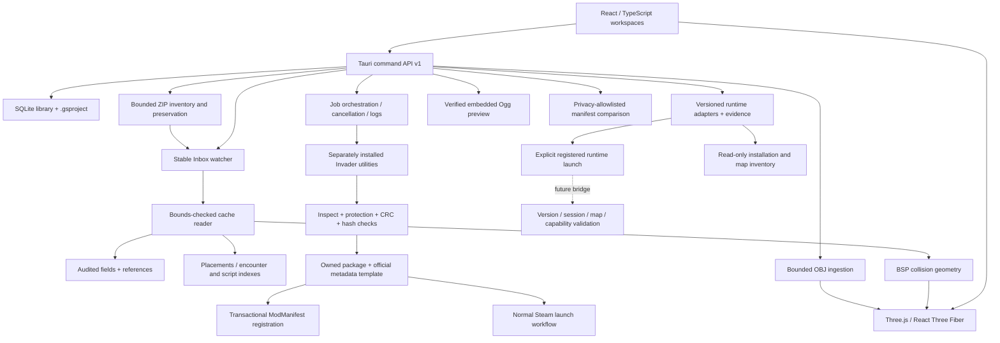

# Architecture

The desktop host is the authority for filesystem and process operations. React sends semantic edits over a versioned application API; it does not supply writable binary offsets or run shell commands.

## Modules

| Boundary                    | Implementation                                                                                                             |
| --------------------------- | -------------------------------------------------------------------------------------------------------------------------- |
| Desktop / typed API         | `src-tauri/src/app.rs`, `src/types.ts`, `src/api.ts`; API version 1, commands and progress events                          |
| Core / legacy compatibility | `crates/spark-core/src/binary.rs`, `maps.rs`; header discrimination, pointer spaces, reflexive limits, collision traversal |
| Map library                 | `library.rs`; SQLite WAL, indexed summaries/settings and immutable source identity                                         |
| Tag system                  | Audited tag fields and known dependency relationships in `maps.rs`; semantic overlays in `project.rs`                      |
| Asset pipeline              | `assets.rs`; OBJ parsing, indexing and bounded triangulation; raw copies plus generated mesh JSON                          |
| World editor                | `src/components/World.tsx`; Z-up Halo coordinates, yaw/pitch/roll conversion, per-BSP visibility and transform tools       |
| Scenario / AI               | `maps.rs` index extraction and `Workspaces.tsx`; source inspection only                                                    |
| Build system                | `build.rs`; explicit executable names, argument arrays, process polling/cancellation, output caps, timeouts and receipts   |
| MCC adapter                 | `steam.rs`, `mcc.rs`; library discovery, owned roots, template checks, packaging and manifest transactions                 |
| Runtime adapters            | `runtime.rs`; versioned trait, ten profiles, read-only registration/inventory, evidence/test status, explicit argument-free launch plans |
| Archive preservation        | `archive.rs`; bounded classic ZIP central/local validation, selective data extraction, immutable originals, receipts and native import reports |
| Audio inspection            | `audio.rs`; source-bound sound ranges, complete Ogg/Vorbis/CRC checks, bounded bytes; `Sound.tsx` creates revocable Blob previews |
| Semantic comparison         | `src/compare.ts`; class/path identity, resolved references, audited fields, placements and collision data; explicit unknown coverage |
| Friends preflight           | `multiplayer.rs`; strict versioned privacy allowlist and local manifest comparison; no transport or gameplay attestation |
| Live protocol               | `protocol.rs`; a pure command-validation model with tests; no transport or runtime bridge                                  |
| Diagnostics                 | Structured Rust errors and JSONL build logs, compatibility/readiness reports and UI status                                 |

## Data ownership and editing

The `.gsproject` schema stores source path/hash/family, preserved copy location, optional archive origin, selected resource folder and resource hashes, scene instances, asset metadata, audited tag edits, provenance, history and build records. Additive source fields deserialize with defaults for older projects. Build fingerprints now include resource provenance, intentionally invalidating earlier receipts. Source/resource checks occur before extraction; source cache parsing and hashing use the same bounded snapshot. Imported descriptors re-ingest referenced OBJ files and verify their hashes. The descriptor is not a portable archive of game resources.

The source cache is inspected again before build. Numeric fields must remain finite and within the audited range. References must point to a tag of the expected class in that cache. Offsets are re-derived in Rust rather than accepted from the renderer. Patches are applied only to a job-local copy, then extracted and rebuilt through Invader.

Halo placements retain actual data offsets internally, but export resolves them against the original inspection. Additional instances, deletion and per-instance scale require reflexive reconstruction and are blocked for game builds. Workshop edits persist independently.

## Filesystem transactions

The local Inbox exists independently from Steam. Startup/configuration only discovers an already owned MCC root; it never creates game folders. Explicit initialization, package installation/removal and launch remain separate actions. Missing optional tool paths do not prevent local Inbox startup. ZIP extraction commits a new owned directory; native full-parser results are retained separately from the extraction receipt. Archive/import operations never execute members.

Project/config writes use a new sibling temporary file, flush, and rename, with an exact backup before replacement. Manifest registration preserves encoding (UTF-8/BOM or UTF-16LE) and existing lines, checks for concurrent changes, and uses an exclusive Guilty Spark lock. Registration verification failure restores the backup. Package installation stages in an owned root, then renames into place. Failure to register removes only the new owned package.

Removal validates the ownership receipt, every file checksum and every actual file before deleting anything. Unknown/changed files stop removal. Reparse points, symlinks, traversal, stream paths and reserved Windows device names are rejected. MCC-running checks gate install/removal/launch-sensitive operations. The manifest root entry is retained after removing an individual package.

## Explicit boundaries

There is no OS-level sandbox around Invader: it is a trusted, user-selected external tool. Jobs constrain paths and working directories and never execute content from map packages. Single-process termination is implemented; killing arbitrary descendant process trees is not. The initial reader caps whole-cache memory use at 768 MiB, while larger caches can be handled by a future streaming adapter.

New runtimes should implement a separately versioned adapter. Successful protocol negotiation must bind capabilities to a particular runtime session and map checksum before any live operation. A disconnected preview never represents live game state.
