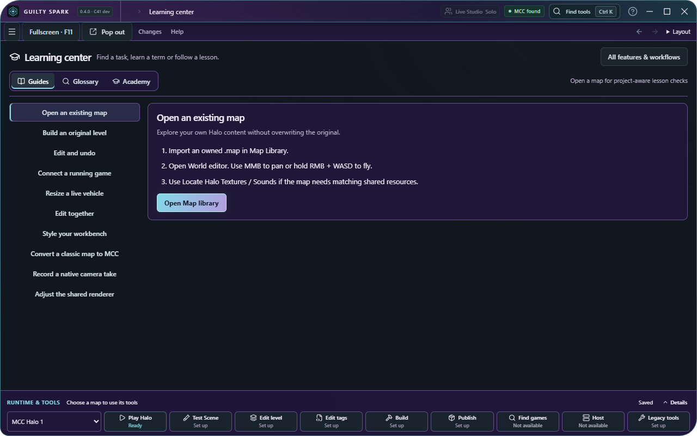

# C41 learning and multi-window follow-through

This extends the existing workbench. Earlier source, regression receipts, native tool workflows, releases and unsuccessful runtime experiments remain preserved. No remote publication is implied.

## One Learning center

The sidebar now has one **Learning center** workspace with **Guides**, **Glossary** and **Academy** sections. Existing How-to and Academy links still open the corresponding section, including lesson-specific pop-outs.

- Guides show ten task choices and the selected task's instructions. Action labels now name the workspace they actually open.
- One searchable glossary retains all 50 definitions, including the Academy's 22 specialist entries.
- The selected guide, glossary search, lesson and classic technique are remembered. Back/Forward restores the Learning section without changing map undo history.
- Academy keeps project-derived checkpoints and separate manual compiler/game requirements. Classic workflows and companion tools expand on demand. Their code and native probes are deferred until first opened; collapsing them afterward retains the mounted controls.
- The existing palette, editor renderer, tag transactions and source validation are unchanged by this layout pass.

## Workspace windows

The common toolbar exposes **Pop out** in every workspace. Native local routes cover all 23 current and compatibility route names. Windows are resizable and retain normal titlebar controls; users can drag them to another display.

Learning pop-outs retain their section, glossary search and selected lesson. Settings pop-outs retain their selected section. Explicit Start here windows no longer get redirected to Library merely because onboarding was completed.

Map-linked editors save a focused edit before transferring the project to the new window. The native single-writer ownership check remains enforced. A map's saved project and workspace move; this is not simultaneous unsupervised editing of the same local document. The transferred window starts its own in-memory edit-history session; pre-transfer undo stacks are not migrated. Separate maps and global workspaces can remain open together. Use SparkLink for supported collaborative project editing.

## Actual verification

The native check uses a fresh library/profile and the built Windows application, without mocked IPC, game execution or third-party tool execution.

| Check | Result |
| --- | --- |
| Native workspace routes | 23 opened and closed successfully; actual page routes checked |
| Concurrent native pop-outs | Three stayed open together, alongside the main window |
| Native resizing | A pop-out resized to 1000 × 720 |
| Learning / Settings state | Glossary search, exact lesson and Dependencies section retained |
| Native project transfer | QuickForge content and requested Tag editor workspace retained; duplicate writer refused |
| Physical second-monitor dragging | Not exercised by this automated run |

At the same **1280 × 800** viewport, the old How-to page occupied **1,471 px** of vertical space and the combined guide page occupies **641 px**, a **56.4% reduction**. All ten task choices remain available and the selected guide fits without page scrolling. This is a layout measurement, not a new startup, GPU or memory benchmark. Earlier measured rendering/loading results retain their separate evidence.

Fresh checks pass **609 locked Windows Rust tests** (seven opt-in cases ignored), **275 frontend tests**, **134 browser checks**, **59 offline scripts**, two interface-probe tests and TypeScript. Browser coverage includes retained map edits, Back/Forward, legacy help links, explicit startup routes, one pop-out per workspace and save-before-transfer. The Windows executable and NSIS installer build; a clean-machine installer test remains open.

Reproduce the native check after building:

~~~powershell
node scripts/test-workspace-popouts-native.mjs --output .local/fresh-workspace-window-check
~~~

The output directory must be new. The harness copies the selected executable, uses an isolated profile, records its hash and closes only its own process/windows. [Exact evidence summary](fixtures/c41-learning-and-windows.json).

## Runtime connections and retained gameplay research

Home now shows MCC, OpenCE, Chupathingy and Custom Edition. Read-only detection finds the reviewed installed clients; an explicit Connect action rechecks their exact executable/content identity before storing paths. It refuses stale identities and never overwrites an existing registration. A genuine native check detected and connected all three additional clients in an isolated profile; connection is distinct from a running game or live adapter.

The separate Zombie recovery investigation now has a real CE map load and joined client for cache `d1d1ddb96ca6093231b65c72918c2d61625bc81e27022ee46150517823b7e2b8`. The owner reported **“Map loads, but no zombies.”** AI restoration therefore remains failed. The experimental typed projectile/effect wrappers retain the original vehicle dependencies; they are not shipped as a completed universal converter. OpenCE also loaded that cache in two private same-runtime engine processes with clean exits, but complete inventory/state parity, AI, human visuals/audio and mixed-runtime compatibility are not established.

Non-MCC live-link, cross-runtime co-op/game-peer replication, complete audiovisual parity and the unfinished structural direct compiled-map workflow remain in the backlog. Native sound-emitter compiler/readback results remain separate from unverified in-game listening. See the [preceding native and workbench evidence](C41_WORKBENCH_FOLLOW_THROUGH.md).
