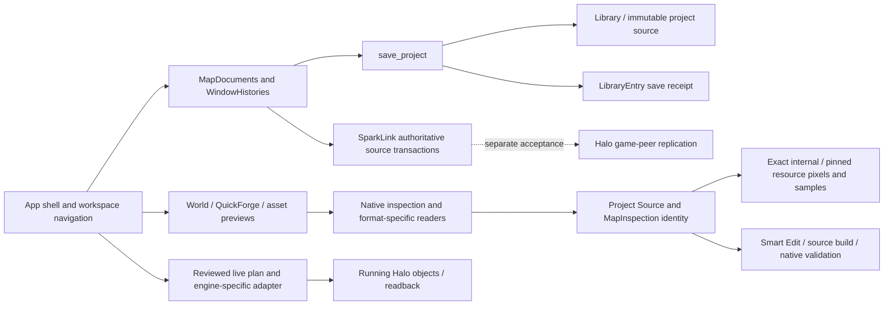

# C51 system repair — current-source architectural inventory

Starting checkpoint: **8055d0033fc2be2e7b1dd9ff70fef66133793b06**, clean local master in the C39 integration worktree. The older root checkout is separately dirty and is not reset or switched. The accepted C49 packages and the C51 development executable are preserved separately. This continues the native engineering and gameplay evidence; it does not replace it.

## Inventory before changes

The run-specific inventory covers **878 tracked code/configuration files**, **3,845 named function declarations**, **3,421 import/use references**, **1,059 literal IPC call sites**, and **245 annotated/registered Tauri commands**. The complete file/import/command/reference index and its generator are retained under `.local/c51-system-repair-20261102/`. TypeScript 7.0.2 in this checkout exposes version metadata rather than the former compiler AST API; the attempted AST inventory is retained as a failed diagnostic. The completed index is explicitly **lexical**, with manual boundary/caller review below. It is not proof of exhaustive dynamic reachability, external consumers or semantic deadness.

| Owner / modules | Responsibility, callers and protected boundary | Classification and current action |
| --- | --- | --- |
| `src/App.tsx`, `mapDocuments.ts`, `windowHistory.ts` | Shell, project-bound documents, queued saves, focused drafts, writer leases and revision notifications. World/Tags/QuickForge use the same document reducer. Native contracts cover cross-project Ctrl+S, close failures, history handoff and late receipts. | **Repair / Reuse / Modularize.** Save already receives a `LibraryEntry` but ignores it and calls full bootstrap. Reuse that exact receipt; retain identity-checked dirty clearing. Extract only the bounded receipt-update responsibility. |
| `RetainedLevelView`, `WorkspaceActivity`, `EditorAudio`, `App.retainedLevels` | Stable portal hosts preserve each map's editor; inactive input/audio/clocks pause; explicit close disposes. C50 native retention and browser activity tests exist. | **Retain / Repair.** Editor unmounting was already repaired. This pass additionally bounds warm map graphics to the two most recent maps per window, retiring only older Canvas trees. Documents, editor/UI owners, native payloads, selection, camera sessions and author history stay. CPU payload retention is a separate remaining budget. |
| `project.rs`, `library.rs`, `snapshots.rs` | Immutable source references, atomic saves, SQLite library summaries, versioned project metadata snapshots and restore validation. All persistence/build/shared-source paths depend on them. | **Repair / Reuse.** Periodic snapshots always write and retain another copy; compare complete metadata, ignoring only save timestamp. Manual/before-build/recovery snapshots keep their explicit preservation semantics. |
| `maps.rs`, `render.rs`, `appearance.rs`, `bitmap_preview.rs`, `resource_map.rs` | Header/source hash, per-cache BSP/model/bitmap layouts, lightmaps, shader references and exact resource spans. Shared by World, model previews, assets, audio and builds. | **Retain.** Xbox version 5 is already implemented and C51 native a10 decoding passes; older blanket exclusion is stale. Keep Xbox/classic/MCC layouts separate, fresh source hashes and negative bounds tests. |
| `runtimeTexturePreview.ts`, `textureResourceScope.ts`, `default_materials_native.rs`, `texture_resources_native.rs` | Original pixels first, exact-map resource recovery, verified compatible preview fallback; never a compiler resource substitution. Both world and asset/model material loaders consume this path. | **Repair / Consolidate.** Hosting preference still selects preview source and can mislabel fallback provenance. Source ownership must determine the preview plan. Preserve native path/layout/hash compatibility checks. |
| `runtime_connections.rs`, `asset_sources_native.rs`, `app.rs::auto_connect_sound_resources`, `ce_setup.rs`, `mcc_audio.rs` | Bounded installation/content discovery, registered roots, exact community binary identities, adjacent/pinned classic resources and MCC banks. | **Reuse / Consolidate.** These are useful engine-specific adapters. Default-material selection previously rescanned all roots per fallback attempt; now one bounded inventory selects an ordered source. Bitmap and classic sound discovery share candidate folders, with separate payload admission. No drive crawl or universal parser. |
| `runtime.rs`, `runtime_adapters.rs`, `tool_ecosystem_native.rs`, `featureCatalog.ts` | Installation facts, operation-specific evidence/gates, source-aware tool assessments and human workflow guidance. Native handlers remain authoritative. | **Retain / Modularize.** Capability cards are not write permits. Do not collapse renderer support, launch readiness, conversion and gameplay into one Boolean. Reuse typed backend reports; descriptive feature text remains documentation. |
| `smart_edit.rs`, `smart_edit_native.rs`, `working_tags.rs`, `build.rs` | Distinct bounded compiled-cache edits and native source reconstruction. Plans pin fingerprints, source/tool identities and supported intents. | **Retain.** Supported cache writes do not complete structural compiled-map editing; source transactions do not permit arbitrary cache patches. Preserve plan/execute validation, native checks and prior-good outputs. |
| `QuickForge.tsx`, `World.tsx`, `quickforge.rs`, `BspWorkshop`, `bsp_*` | Source geometry, four-view editing, gizmos/selection, assembly, collision/portals and native export. Callers include standalone editor, machinima previews and shared BSP edits. | **Retain / Modularize.** Large files have working interaction ownership; avoid moving geometry semantics during resource/save repairs. Reuse existing Workshop/Atlas builders for future seams and traversal. |
| `ownedBitmapBatch`, `decodedBitmapCache`, `useOwnedForgeModels`, `native_asset_imports.rs`, `tag_exchange.rs` | Exact source/pin keyed decoding and model/material reuse; recursive tag staging/import, native closure checks and asset placement. | **Retain / Reuse.** Bounded caches, immutable payloads and staged dependency validation already exist. Catalogue/open IPC regressions are measured C51 leads, not permission to omit previews. |
| `audio.rs`, `audio_pcm.rs`, `mcc_audio.rs`, `looping_audio.rs`, `bsp_audio.rs`, spatial audio/UI | Original codec/bank samples, native loop/emitter dependencies, positional editor audition and separate authored sound properties. | **Retain / Repair.** C50 native emitter compilation/readback passes; actual MCC listening remains open. Keep sound-class conflicts and stream-completeness refusals. |
| `animations.rs`, `useNativeModelAnimations`, `AnimatedBiped`, `NativeModelPreview` | Native skeletal data, playback, owned model/textures/reflections and presentation controls. | **Retain.** C51 native animation/left-right tracking is accepted within its exact source scope. Additional codecs/models retain explicit unsupported outcomes. |
| `build.rs`, `forge_build.rs`, `working_tags.rs`, conversion/model/BSP builders | Stage exact inputs, run appropriate tools, parse both output streams, inspect real output, validate closure/audio/geometry and retain previous-good builds. | **Retain / Reuse.** Zero exit or a success footer is insufficient. Preserve the C46 sound omission checks and source/build identity receipts. Target-specific validators must remain distinct. |
| `live_mcc.rs`, `live_adapter.rs`, `scaling`, `smart_edit_native`, `LiveObjectInspector` | Exact-build/session/object-checked live movement, scaling/physics and receipts. Smart Edit and direct inspector have distinct validated workflows. | **Repair / Retain.** The raw `live_mcc_apply` helper is also exposed over IPC although its sole caller is Rust Smart Edit. Remove only unused IPC exposure; keep validated inspector APIs and internal helper. Standalone exploitability is unproven. |
| `forge_session.rs`, `shared_editing.rs`, `studio_session.rs`, `studio_native.rs`, `studio_workshop.rs`, `studio_tls.rs`, `studio_journal.rs`, `studio_network.rs`, `studio_native_source.rs` | TLS/permissions, authoritative ordering, native tags/assets/BSP revisions, per-author history, conflicts/offline recovery and frozen builds. | **Retain.** Reuse one transaction engine. One-PC multi-process proof remains separate from two-computer LAN/VPN and actual game-peer replication. No raw patch broadcast or remote tools. |
| `baboon_native`, `working_tag_changes_native.rs`, `native_tag_integrity.rs`, external map sync | Isolated tool sessions, tool attribution, semantic reconciliation, conflict/admission and corrupt-save recovery. | **Retain / Reuse.** Harmless rewrites are distinct from semantic faults. No source reset or second collaboration engine. |
| `ce_host_native`, `community_host_native`, invitations/runtime networking | Managed private native host/client processes and runtime-specific lobby/protocol/content checks. | **Retain.** Official MCC handoff and community protocols remain separate; installation is not Live Link or cross-engine gameplay proof. |
| `firefight.rs`, `haloScript.ts`, `qa_opence_ai`, original Zombie recovery | Rules simulation, finite native round controller and exact-build diagnostic readback. | **Retain / Repair / Research.** Reuse the C51 controller/census; actual actor ground/AI placement, automatic original carrier release and player combat are still blocking. No new parallel AI protocol. |
| `startup_native`, `profiling`, process-tree/native UI scripts, release workflow | Branded initialization, actual timings/readiness, native QA and draft-only package/asset verification. | **Retain.** Build artifacts are not public assets. Keep C49 byte identity; process-cold is not disk-cache cold. Native opt-ins/failed research are valuable evidence. |
| `styles.css`, compact component styles | Shared theme and responsive rendering; multiple later selectors intentionally refine prior layouts. | **Retain / Consolidate only with evidence.** Do not delete selectors by duplicate spelling alone; native/browser screenshots and specificity matter. No new styling framework or dependency. |

## Dead-code candidates and security-sensitive calls

`LiveLab`, `dragWindow` and `Breadcrumb` have no tracked consumers in direct imports, default/dynamic loading, re-exports or command registration. They are application-local exports, not a published package API. Their removal is limited to obsolete presentation helpers; production `LiveObjectInspector`, window controls and current breadcrumbs stay.

`hosting_plan`, `read_cache`, `parse_maps` and `pair_recipe` are **public Rust APIs**. Lack of an in-repository call does not establish absence of downstream consumers. Retain them. `launch_native` is a **registered compatibility stub** returning an explicit refusal; it no longer executes the legacy arbitrary executable preference. Retain that error contract rather than reintroducing execution or deleting it as dead code.

Independent read-only review confirms `live_mcc_apply` has one Rust caller and no tracked frontend/script/example invocation. The sink retains exact process/session/map/salted-object/position/readback checks. Direct IPC skips the Smart Edit owner-bound single-use plan, expiry, saved fingerprint and prepared journal. Removing just the command annotation/handler entry preserves the Rust caller and supported direct inspector move/scale APIs. This is a confirmed unnecessary entrypoint, **not a demonstrated remote exploit or arbitrary-address write**. Negative IPC acceptance and legitimate Smart Edit/inspector controls must be tested.

## Prioritized bounded repairs

1. Source-bound texture resolution and shared identity checks, preserving real decoder and compiler boundaries.
2. Consume native save receipts instead of full bootstrap, with focused cross-map save/history regressions and native timings.
3. Suppress duplicate unchanged periodic metadata snapshots while retaining explicit recovery/manual/build snapshots.
4. Retire only the unused live IPC registration and proven obsolete local UI helpers; no public Rust API or experimental research deletion.
5. Bound warm map graphics without unmounting editor owners; include the separate BSP perspective canvas and guard inactive Workshop hotkeys.

Each repair gets a coherent commit, focused negative/positive controls and the relevant combined regressions. Final measurements, changed-file manifest, package/source preservation, runtime matrix and remaining owned blockers will be appended after implementation and native verification. [Preserved gameplay/presentation evidence](CONTINUATION_51_ENGINEERING.md).

## Implemented relationships and regression boundaries

| Change / code owner | Previous problem and reused implementation | Result and verification |
| --- | --- | --- |
| `libraryReceipts.ts`, `App.save`, `mapDocuments.ts` | Native `save_project` already returned a library row; the shell discarded it and bootstrapped the entire application. | Validate the receipt against the captured project's ID/source/cache version, upsert that row, and invalidate only that map's saved revision. Preserve save serialization, focused input flush, writer leases, history and pointer-checked dirty clearing when a newer edit arrives. Before/after browser reproduction, receipt/reducer unit controls and actual native UI saves cover this. Other explicit import/settings/build refreshes remain intentional. |
| `snapshots.rs::create` | Unchanged periodic saves produced new copies of identical project metadata. Build fingerprints omit metadata and cannot safely decide snapshot equality. | Compare the full, validated latest project snapshot, normalizing only `modified_at`. Reuse that verified checkpoint on equality. Manual/build/restore/shared-recovery reasons remain explicit copies. Metadata edits, A→B→A transitions and unreadable checkpoint controls remain protected. These are project metadata checkpoints, not a replacement for native-file transaction journals. |
| `source_identity.rs`, `sourceIdentity.ts`, `app::inspect`, `build::compatibility` | Consumers could bind a map to inconsistent inspection metadata and let a hosting preference choose its preview source. | One read-only source projection checks SHA/cache version/scenario and exposes native readback facts, dependencies, proven installation origin and configured targets. Native inspection reuse and build preflight share the validation. Payload readers still hash actual bytes and enforce their own layouts/pins. Per-operation capability/permission reports remain authoritative; this projection is not a universal conversion or write permit. |
| `runtimeTexturePreview.ts`, `default_materials_native.rs`, `asset_sources_native.rs` | `hosting.runtime` controlled map preview discovery. After partial original recovery, the fallback could request and replace those recovered images again. | Native source identity chooses the bounded candidate order and reports the actual selected source. Recompute missing images after original recovery. Preserve original pixels and allow fallback only for unresolved IDs with existing native path/layout/image checks. The frontend cache holds at most sixteen source/pin-scoped plans and removes failed entries for retry. New-level material authoring still intentionally uses its chosen target. |
| `texture_resources_native::resource_roots`, `app::auto_connect_sound_resources` | Bitmap and classic-sound folder searches overlapped while sound discovery ignored registered/data roots. | Reuse bounded, local, link-checked, canonically deduplicated folder candidates, retaining recorded path spelling for existing pin guards. Each format keeps its own bank/index/image/sample/span validation. A found directory is not proof that every contained asset can be decoded. |
| `RetainedLevelView`, `World`, `ForgeViewport`, `BspWorkshop` | Parked maps stopped drawing but every map kept a GPU canvas; hidden Workshop W/E/R handlers could follow another map's input. | Keep two warm map graphics owners per window. Retire only older GPU Canvas subtrees, keeping the actual editor components mounted. Reuse `ViewportSession` restore/cleanup and existing native/decoded data rather than reconstructing documents. Workshop SVG views and tool state survive; inactive Workshop hotkeys return immediately. Real WebGL browser checks cover context loss, a new restored canvas, the same editor, camera, four views, and retained author undo. |
| `WorkspacePanels`, `MapTabs`, `workbenchCompact.css` | Portal relocation could leave overflow observation attached to the old toolbar. Tabs shrank into actions and long flex text clipped at both ends. | Observe the mounted toolbar, reserve tab space, reveal the complete active tab on resize, and truncate names at the end. Prioritize Inspector/Tags/Camera/Objects in a bounded shortcut strip; all other drawers stay in More. One native window-control group remains. The owned Spark emblem is a 64 px corner control with adjacent headings and navigation offset clear of it. Five-width browser checks cover tab/action geometry and drawer reachability. |
| `WindowFrame.dragWindow`, `ui.Breadcrumb`, `Runtimes.LiveLab` | Superseded local UI helpers had no direct, re-export, dynamic, registration or documented external application consumer. | Remove those three helpers and their dead imports only. Active controls/inspectors/current breadcrumbs and public Rust APIs stay. No research script, source snapshot, old build, branch, tag or native experiment was removed. |

The live batch helper remains a Rust-only Smart Edit implementation detail. Both the actual baseline and repaired desktop entrypoints were exercised with no running game or attached session. The removed command is unknown; the intentional plan and inspector controls reject invalid/no-session requests. Successful live game movement was not retested here. Scoped findings, independent candidate review and native receipts are retained through the managed Codex Security artifact store; this is removal of unnecessary IPC exposure, not a demonstrated arbitrary-memory exploit.

## Actual installed sources and the newly exposed CE gate

Fresh native app IPC verified all four installation origins against original file bytes and existing installation validation. Hosting preference was MCC throughout; it did not relabel the other source formats.

| Installed source | Cache / native readback | Resource result and limits |
| --- | --- | --- |
| MCC Blood Gulch | 13; 5,503 render / 5,940 collision triangles; 68 model types; 2,425 tags | Matching texture pins and classic audio-bank binding. Source, inspection and installation origin agree. |
| Custom Edition Blood Gulch | 609; 5,503 render / 5,940 collision triangles; 68 model types; 2,455 tags | Original `bitmaps.map`, `sounds.map` and `loc.map` found/pinned. A subsequent native renderer trial still failed to produce source shaders: this cache uses external **bitmap-tag bodies**, which the current bounded preview reader explicitly refuses. File discovery is proven; complete CE pixel preview is not. This failure is preserved, not replaced by unrelated stock pixels. |
| OpenCE owned Xbox `b40` | 5; 235,145 render / 217,650 collision triangles; 63 model types; 3,647 tags | Correct OpenCE installation origin and native Xbox layout; no fabricated shared-resource file requirement. This source-identity run is not full game/render/audio acceptance. |
| Chupathingy owned Xbox `a10` | 5; 364,774 render / 367,004 collision triangles; 70 model types; 3,357 tags | Correct Chupathingy origin; native internal resources retained. Repeated textured native app runs preserve the existing Xbox reader. Prior C51 decoder acceptance additionally covers 425 requested images, 17 cubes and three decoded sound samples. |

All four original and preserved map hashes stayed unchanged. The CE failure distinguishes unsupported indexed tag metadata from a missing bitmap file. Supporting it requires a bounded, hash-pinned resource-index/tag-body decoder or a validated existing native extraction route, followed by exact metadata/pixel comparison. It must not be implemented as another version allowlist or a path-only MCC substitution.

The Demo Zombie Apocalypse source remains a separate cache-6/raw-resource case. Legacy Xbox and HaloMD import/export remain format-specific: actual Xbox reading does not certify native Xbox output, HaloMD gameplay or universal runtime conversion. Supported scalar/cache-copy editing, loose-tag builds, BSP authoring, Live Link, SparkLink source revision delivery and Halo game-peer replication remain separate acceptance paths.

## Technically owned remaining gates

| Rank | Owner and minimum remaining implementation | Acceptance that closes it |
| --- | --- | --- |
| 1 | `bitmap_preview.rs`, `resource_map.rs`, original-resource binding: recover CE external bitmap-tag bodies with exact index/path/hash/span validation; reuse native extraction if its output can prove the same original metadata. | Actual installed CE Blood Gulch first-open textures/lightmaps/models, corruption/foreign-pack refusals and exact source pixels, then regression of Demo/raw, Xbox and MCC readers. Finding the folder alone does not close this. |
| 2 | `haloScript.ts`, `firefight.rs`, existing native controller/encounter generation: fix native actor placement/collision/navigation and connect the existing rules to the source/build path. | A player fights two waves with proper score/progression, defeat/restart, supplies/HUD and no QA-forced kills. Prior controlled script waves remain scoped evidence. |
| 3 | Original Zombie source, `qa_opence_ai`, animation/weapon/projectile/effect/carrier dependencies: trace automatic release without replacing the original invisible-carrier design. | Uncommanded weapon-driven healthy exit, navigation, combat, damage/death and cleanup in repeated native sessions; retain the successful explicit-exit and failing no-exit controls. |
| 4 | `RetainedLevelView`, `mapDocuments`, native/decoded caches: measure and bound aggregate CPU inspection/texture payloads independently of the new GPU-map budget. | Long-session many-map/multi-window memory plateau, recoverable draft/history and complete restored resources. The per-window GPU bound is not a whole-process RAM or VRAM-byte cap. |
| 5 | `bsp_assembly`, `bsp_clearance`, Workshop/Atlas compiler: reuse the existing Timberland–Sidewinder build and marked entrances before adding regions. | Human two-way tunnel traversal with both entrances, floor/head clearance and materials. The owner currently cannot test; the gate remains unverified. Four-region/all-map streaming is later work. |
| 6 | `mcc_audio`, `looping_audio`, `bsp_audio`, existing emitter builder: retain exact source samples, class conflicts, placement and native readback; add actual target-game listening. | Audible intended MCC loop at the compiled emitter and correct authored behavior. Editor audition or a nonzero decoded waveform cannot establish it. |
| 7 | `studio_session`, `studio_native`, `studio_workshop`, TLS/journal/network and existing exact-build adapters: reuse the authoritative editor transaction engine and existing AI diagnostics. | Two-computer LAN/VPN reconnect/recovery, then independent fault-free game AI combat/death/late-join agreement. No second computer is available; one-PC processes and editor revisions do not certify peer gameplay or Steam production transport. |
| 8 | `smart_edit`, native readers/writers and target-specific runtime adapters: finish only supported structural compiled-cache transactions and exact-build live adapters. | Native cache structural edit/restore/build/load proof; separate live spawning/BSP and non-MCC write acceptance. Native loose-tag tests do not complete either workflow. |
| 9 | Existing draft-only release workflow and sealed C49 candidate: owner-controlled source push, exact asset upload/download verification and publication approval; Linux stays separate. | Actual downloadable verified Windows installer on an approved public Release. Local builds/Actions artifacts are not publication; no rules or history may be bypassed. |

Native gameplay results from the preceding C51 work remain in [the preserved engineering record](CONTINUATION_51_ENGINEERING.md): commanded original-carrier lifecycle and controlled native Firefight rounds pass within their stated boundaries; unforced placement/automatic release/full shared AI remain open. No new game playback, combat, peer parity or human tunnel walkthrough is inferred from this application repair pass.

## Native audio repeated through the real toolchain

The isolated MCC emitter test passed on the application from `1d463c6`, SHA `e589a6152cddc027204bc13eca042051d2c006e9fc1362e1792a91aa6120dc3e`. It recovered **21 exact pinned classic ADPCM samples / 1,167,696 encoded bytes**, staged complete source sound/loop/scenery dependencies and built with the installed Invader/H1A toolchain. Native compile took **26,123 ms**. The validated cache, SHA **`17642e70d32709cc7b330a8e85b53f7983ebf0ebadb62990818a26358d7128b5`**, contains the intended sound-scenery loop attachment at **[2, 3, 1]**, with the complete source loop/sample bytes preserved.

The same actual desktop flow retains editor mute independently of authored audio, including its explicit native inclusion and single undo/redo. Deliberately changed managed import bytes are refused before a replacement build; the previous accepted cache and **2,249 owned native input files** remain unchanged. That injected fault has **no attributed external tool**; it is not evidence that Baboon or Invader caused corruption. Existing native sound-class/background/music conflict regressions remain required. A decoded waveform and native placement are proven; **MCC in-game hearing remains unverified**.

Private receipts: `native-audio-final/acceptance.json`, native source/output and streams under the run evidence directory. The later corner/alpha changes do not alter the Rust audio/build pipeline.

## Real monitor, model opacity and usable corner placement

The screenshot's generic fallback was removed: `SparkEmblem` independently reuses the bounded owned-model preload, selects the exact monitor path and captures the existing native renderer. Leaving Home before its model is ready, or selecting Chief there, no longer strands the corner menu on a generic circle. Home keeps its normal authored animation; the corner image is a disposable static render of the real owned model, not generated artwork or bundled Halo content.

The subsequent see-through report exposed a separate renderer error. Three's `ShaderPass` clones initial uniforms and clears render-target textures. Passing the coverage texture into its constructor therefore left `tAlpha` null; opaque body pixels ended up with only the **45%** halo alpha. The repair binds the live coverage texture after cloning. A real WebGL regression first reproduced **115/255** alpha, then verifies **255/255** solid coverage with bloom on/off and after resize; empty background remains transparent with bloom off. It does not flatten the model onto an opaque rectangle or change authored material transparency.

Only the visual is portalled above the optional window opacity/tint and curved application clip. The original menu button owns layout, hit testing and accessibility. The visual has no pointer events. Reusing the existing navigation-toggle identity also fixes click-to-close and Escape focus; the legacy 8-pixel hamburger margin is explicitly cleared. An intermediate x = -4, y = -9 position protruded beyond the actual WebView and cut the silhouette off. The final 64-pixel image clamps to **x = 8, y = 8**, entirely inside the drawable window while overlapping the application's curved corner. This preserves the full outline without adding an outer rectangular border.

Final standalone native acceptance resolves **`characters\\monitor\\monitor`**, tag **3785621552**, from exact owned c40 SHA **`879707dace9bd7facaeb2d61adf640af9178384c2417fcd5b4145d520a9a71ca`**. The captured image has **7,017 fully opaque pixels** and **2,131 pixels below half alpha** at 96×96 internal resolution. Under 35% window opacity and 50% tint its visual ancestor stays at full opacity, above the glass. The test leaves Home with zero ready showcase models, verifies the actual model/textures/reflections, clicks the menu open/closed and returns Home without page errors. Tab space and full active-tab actions are tested from 880 to 1920 pixels.

Private proof: `corner-no-clip-native-final/acceptance.json`, original PNG, normal/stress screenshots and a native corner crop checked for the complete silhouette. The wrong development-server build trial and clipped intermediate position remain preserved separately; they were not counted as final acceptance. The accepted standalone executable was built through **`pnpm exec tauri build --no-bundle`**.

## Original textures and tool-free defaults

The settled native test on `be56e13` uses the exact Demo Zombie Apocalypse source; subsequent `6386404` only clamps the corner position. First-open original/internal recovery plus reviewed compatible previews works without configured compiler tools and without changing compiler resource pins. Connecting the genuine original pack produces **135 exact shader bindings, zero compatible base bindings, 15 lightmaps, 177 detail slots and 57 reflection cubes**, with no pending materials. One original bottle-glass reflection has no exact index match and remains refused; no fuzzy resource was substituted. All original and preserved map hashes remain unchanged.

The existing test's fixed **132** expectation failed after recovery returned 135. The failure is retained. The test now independently audits every relevant native material, decodes **100 exact original images** through the full source/pin/bounds validators, and compares the complete expected shader-ID set against the renderer. It retains 132 as the historical minimum and waits for all material work to settle. This is stronger than changing a count or accepting any larger number. Native metal and grass defaults also render in a fresh QuickForge arena with **two owned source materials**, no extraction tools configured and no synthetic native import record.

## Measured performance and quality

Two complete fresh-library/WebView runs per executable were compared at 1440×900/DPR 1 and an identical map work area/canvas. Process-cold means a new process/profile, **not** a flushed Windows disk cache. Both sources, geometry/model counts, actual shader/lightmap/detail/reflection bindings, decals, environment/effects, canvas workload and settled readiness must match. The initial unmatched-viewport baseline was rejected and retained; it was not averaged into these results.

| Median measurement | Before | After | Assessment |
| --- | ---: | ---: | --- |
| Process-cold shell | 1,122.3 ms | 1,069.8 ms | Small observed change; two runs per side |
| Warm-process shell | 855.1 ms | 867.7 ms | Slightly slower |
| Process-cold Home showcase | 3,905.6 ms | 3,840.3 ms | Small observed change |
| Warm-process Home showcase | 2,867.5 ms | 2,884.9 ms | Slightly slower |
| First fully textured map 1 | 8,208.7 ms | 8,172.2 ms | Essentially unchanged |
| First fully textured map 2 | 14,767.8 ms | 13,964.7 ms | About 5.4% faster in these runs |
| Main-thread bitmap decode, map 1 | 710.3 ms | 701.1 ms | Sum of measured decode calls per run, then median |
| Main-thread bitmap decode, map 2 | 1,268.6 ms | 1,264.2 ms | Essentially unchanged |
| Repeat map switch | 1,018.8 ms | 1,003.8 ms | About 1.5% observed change |
| Repeat bitmap decode / cube requests | 0 / 0 | 0 / 0 | Existing validated reuse retained |
| Polling IPC | 1.89 ms | 2.16 ms | Small absolute increase |
| `open_project` IPC | 109.5 ms | 110.4 ms | Essentially unchanged |
| Large asset catalogue | 3,115.1 ms | 3,426.1 ms | Slower; not claimed optimized |
| Last settled render sample | 59.7 FPS | 59.7 FPS | Equal workload, not a game-FPS benchmark |

The comparison above is specifically the save/resource checkpoint **d732667** (`4afa59ad…`) against the preserved baseline (`ca80a3cd…`), before the later GPU budget/corner fixes. Raw phases include actual native IPC, decode, catalogue, CPU, GPU and memory samples. Repeated-map settled CPU was **8.03% → 7.51%** of the machine, GPU 3D **12% → 11.5%**, dedicated GPU memory **427.3 → 425.2 MiB**, but process-tree resident RAM was **2,381.1 → 2,730.5 MiB**. These are short settled observations, not peak/isolated device benchmarks or proof of a long-session plateau. **RAM did not improve.**

The targeted native save trial independently performs twenty genuine UI saves per side across two new libraries. Median completion falls **34.50 → 23.15 ms (32.9%)**, with **20 → 0** full bootstrap calls. Ten unchanged periodic requests per run produce **10 → 1** distinct verified checkpoints. Manual and changed-metadata snapshots remain distinct/recoverable; title/source/count receipts, the real map editor/canvas and undo/redo are retained.

The separate three-map GPU test uses actual MCC Blood Gulch, Demo Zombie Apocalypse and Chupathingy Xbox a10. With the later **7a43be7** executable (`341eb07c…`), the oldest context is lost/released after the third map while its exact editor remains. Returning reconstructs only the canvas, preserving camera, source bindings, metadata edit and undo/redo. Dedicated GPU allocation after three maps was **565,841,920 → 406,159,360 bytes (28.2% lower)**; after six more visits it was **601,583,616 → 434,778,112 bytes**. Restore time rises **1,061.4 → 1,565.0 ms**, including the same 800-ms harness settle. Resident RAM after those repeats was **2,954,489,856 → 3,401,928,704 bytes**: no RAM reduction is claimed. The test keeps the old GL reference only to prove its identity/loss; it does not force garbage collection. Total CPU payloads and multiple-window budgets remain open.

Raw matched profiles, rejected runs, save/GPU receipts and complete aggregates remain under `.local/c51-system-repair-20261102/`. [Public metadata-only summary](fixtures/c51-system-repair.json) identifies each measured executable separately; it does not mislabel earlier measurements as final-corner timings.

## Regression, history and artifacts

- **Rust:** `cargo test --workspace --locked -j 4`: **640 passed, 8 ignored, 44 suites** on the final Rust changes. The eight explicit owner/native-dependent cases are not counted as passes. They require reviewed game/installation/network inputs; later changes are frontend/UI/test documentation only.
- **Frontend:** **318 passed in 72 files**; TypeScript passes.
- **Browser:** **149 passed**, including actual WebGL alpha readback, retained editor/BSP activity, all workspace contracts and window/layout behavior. Three focused WebGL/header/full-silhouette tests pass again after the final corner clamp.
- **Offline:** **59 chains passed**, including retained source, shader/material, collaboration, script and archive safeguards.
- **Native:** four installed source identities, exact original-pixel/default-material recovery, retained three-map GPU/history, incremental real UI save/checkpoint recovery, actual monitor/opacity and MCC source-emitter build/readback all pass within their stated scopes. Native audio has not been heard in MCC; no new gameplay acceptance is inferred.

The final standalone executable is **`target/release/GuiltySpark.exe`**, **42,268,160 bytes**, SHA-256 **`fea8e1906a011303932f2faf41351e28bb9a006a87fc7fb5edc86fecbff7efe2`**, application source **`638640454fa92ec7b105acf65cb755b4d319e10c`**. Later report/ledger commits do not replace its source identity. It is a tested local executable, not a new installer or public release. Native PNGs and Halo payloads remain private and are not public package assets.

The clean starting commit remains an ancestor. All **22 pre-existing non-master branch/tag references** are unchanged, including experimental branches and `alpha`. The separately dirty root remains on `codex/c41-smart-edit-routing` and was not reset, staged, switched or committed. The historical ledger prefix and the original 92 reconstruction remain preserved. No research/native failure evidence was removed. This pass retires only the proven-dead helpers listed above.

All five sealed C49 files were rehashed unchanged under `.local/releases/C49-preview-cb07581/`, source **`cb07581597de11e83d1c10bafad526e8b031f27e`**:

| Protected C49 asset | Bytes | SHA-256 |
| --- | ---: | --- |
| `Project_Guilty_Spark_0.4.1_windows_x64_Setup.exe` | 10,107,686 | `6e0c3efb53ced11dde522492ea341a019c93976d3ca0c16ae28ae180da334749` |
| `Project_Guilty_Spark_0.4.1_windows_x64_Portable.zip` | 13,941,863 | `ff6c9e4dea48126680c2a9b8536dfb2185fab5ac445c7d4f306b9bed52e07069` |
| `Project_Guilty_Spark_0.4.1_cb07581597de_Source.zip` | 26,186,072 | `c6ea81b25bfae352d76df58557a82daef44b72ba11bf778d0e2eee9f56ae03f0` |
| `Project_Guilty_Spark_0.4.1_windows_x64_manifest.json` | 4,879 | `c00f7afc9b1d57963bbe0234ef4c3c992a574136a27cbf34dca83354fe2a0b52` |
| `SHA256SUMS-windows-x64.txt` | 469 | `ea47e113b4613c59eea87521a4600bf4a950db1b73e0d51559cee86f0f3cce69` |

No new C51 NSIS/portable/source release bundle or verified Linux package was created. No GitHub push, merge, remote metadata write or publication was attempted, and no protection/rules setting was changed. The owner controls source push and the existing draft-only release/asset verification/publication flow. [Combined descriptive push notes](C51_PUSH_NOTES.md) retain the prior native engineering history and this repair extension.
