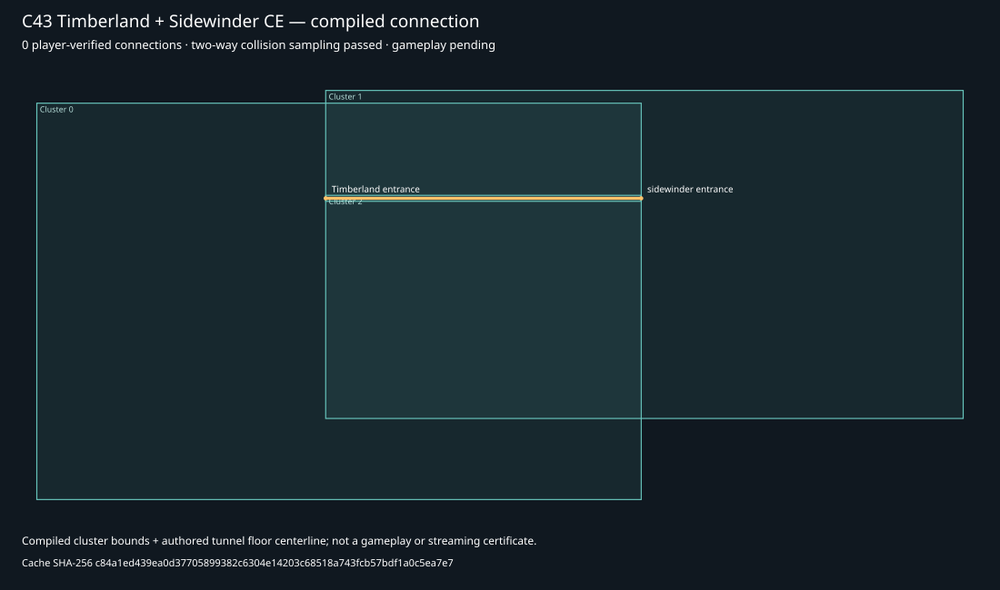

# C57 — Native surface editing and the Timberland–Sidewinder traversal gate

Continues local master `e49e3c6ed7af5e43fa41d217f9942db50a9dbdde`. Original maps, C43/C50 source, the four-region research, previous-good builds, C35–C56 history and the separate dirty checkout are preserved.

**Verified physically traversable region connections: 0.** The Timberland–Sidewinder cache compiles, its static collision route passes in both directions, and a real CE client joined its private server. No two-way player walkthrough was returned during this test. The four-region expansion remains gated; this continuation does not declare Megaworld complete.

## Exact two-region result

| Gate | Evidence and limit |
| --- | --- |
| Reproducible cache build | Current Invader rebuilt the retained connected BSP/scenario tags into a 77,711,328-byte CE v609 cache, byte-identical to the C50 test cache: `c84a1ed439ea0d37705899382c6304e14203c68518a743fcb57bdf1a0c5ea7e7`. This repeats cache compilation using the previously compiled structure tag; it is not a new structure-source reconstruction. |
| Floor and body clearance | The actual cache has 16,196 collision triangles. The existing route checker passes 423 samples forward and 423 back. All 68 native test starts pass supporting-floor and standing-body checks. This excludes scenery, dynamic objects and native player movement. The dense test-start layout is for one player, not certified multiplayer spawn occupancy. |
| Portals and visibility | Independent Invader extraction/readback finds one BSP, three clusters and portals `2 ↔ 1` and `0 ↔ 2`. All three clusters are connected in that graph. PVS/PAS data identities are retained. Correct runtime visibility, culling and transitions still need the walkthrough; a connected graph alone does not prove them. |
| Materials and scenery | Six native lightmap records contain 25 material records (`9,2,5,8,1,0`). Scenario readback retains 210 scenery placements, 27 scenery palette entries, 24 vehicles, 42 sound-scenery placements and 68 starts. Counts do not certify original appearance or object collision. |
| Atmosphere | Clusters select sky zero; fog/weather/background-sound/sound-environment indices are unassigned. Background/environment palettes are empty. Placed emitters do not establish original donor ambience, reverb or complete audio parity. |
| Actual CE session | The production private-host/client path loaded `c50tunnel`; the native server reported one joined player, version `01.00.10.0621`. The isolated 45-minute observation ended without a player report. Owned game/server processes were no longer running afterward. No public listing or original installation change. |
| Human traversal | **Pending.** The requested test was: walk from the metal corridor into Sidewinder, turn around and walk through to Timberland, then return, checking entrances, floor/walls and materials. Computer control failed to initialize with `helper_unknown_error: setup refresh had errors`; no automated player input occurred. |



The diagram shows compiled cluster bounds and the authored floor centerline. Bounding rectangles can overlap; they are not exact original region outlines or a streaming map. The amber connection is **compiled and geometrically checked, player-unverified**.

## Direct source-surface workflow

In a QuickForge project containing Workshop source, choose **Objects & gameplay**, click a visible source wall or floor, then choose **Edit geometry…**. Spark carries the exact source brush and face into the existing Workshop. Available contextual entries select the existing face/extrusion, vertex, edge, clipping, room/passage, solid slab and material/UV tools. The selected surface is highlighted; clicking an object or empty space clears it. Camera drags do not select a surface. Per-map selection survives view changes without modifying authored history.

The native Windows acceptance test clicks an actual rendered wall (`room-a / face-5`), resolves its original brush/face, opens the face tool, extrudes it into a fifth source volume, saves, builds with H1A Tool/Invader, imports the resulting MCC cache, loads two native material previews, undoes the extrusion in one action and reopens the preserved topology. The source, compiled collision and compiled render bounds all match `X [-10,36], Y [-6,6], Z [0,5]`; the extended wall is present in the actual cache. The MCC output SHA-256 is `47d76d8d38036ce3c6d6cf05a7e071b0345ded5555709718afb26eeb5dd8cc61`. Native build time in the final trial was 67,322 ms, not a controlled performance comparison. No mocked IPC or injected editor selection is used. See the [receipt](fixtures/c57-megaworld.json) for exact identities and regression counts.

One negative trial selected the entire room floor: lowering it detached the example's solid ramp, and `WORKSHOP_DISCONNECTED` correctly blocked native export. That diagnostic was retained; the gate was not bypassed. The accepted trial extends a wall while preserving the ramp and corridor. Another failed trial exposed the selection-object initialization bug; it was fixed before native acceptance. A stale test expectation of exactly one preview image was corrected because the existing runtime defaults now supply two materials.

These operations use `bspWorkshop.ts`, `BspSurfaces`, `BspWorkshop`, `bsp_workshop.rs`, QuickForge history and the existing compiler. No second geometry engine was introduced.

## Existing imported landscapes remain a separate gate

Native map triangles still retain cache/BSP/triangle/shader identity and open their shader or existing Construction → Connect/tunnel flow. Selecting an imported triangle does **not** manufacture an editable convex brush. Arbitrary imported-landscape extrusion/sculpting, general vertex/edge reconstruction, terrain cuts, automatic seam repair and unrestricted BSP joining still need source reconstruction with material/collision/cluster provenance and independent compilation/gameplay tests. Freehand terrain sculpting and general portal authoring are not implemented by the new context menu.

The existing room/passage/solid tools support bounded source construction; passages must overlap adjoining playable air and slabs must lie inside it. Native collision and portals come from the compiler. Preview walk mode remains separate from Halo player physics.

## Reproduce the native checks

From the current worktree, using owner-installed Invader and matching source tags:

```powershell
node scripts/prepare-megaworld-walkthrough.mjs <Invader-folder> <accepted-C43-tags> <fresh-build-folder> <matching-dependency-tags> [...]
node scripts/check-megaworld-connection.mjs <Invader-folder> <built-c50tunnel.map> <C43-connection.gsproject> <fresh-audit-folder>
node scripts/test-bsp-workshop-native.mjs <built-Spark.exe> <fresh-UI-test-folder> <H1A-kit> <owned-H1A-tags> <Invader-folder>
```

The first script retains its pinned 68-start/C43 input checks and produces `walkthrough.json` with native commands/tool/input hashes. The new second script calls the production Rust reader/checker, independently extracts native structure/scenario tags with Invader, checks the portal graph and counts, records logs and SHA-256 identities, rehashes the unchanged inputs, and produces `connection-audit.json` plus `connection-map.svg`. It refuses an existing output directory and never grants gameplay acceptance.

Private C57 evidence is under `.local/c57-megaworld-20261103`; the held-game receipt is under `D:/Project Guilty Spark/.local/C57-Walk`. Original source tags and old cache remain in their existing C43/C50 folders. No Halo cache, texture or proprietary SDK resource is added to the repository or release packages.

## Next gates

1. Return a successful two-way Timberland–Sidewinder player result for the exact cache above, or diagnose a precise failing entrance/location. Inspect scenery obstruction, light/material presentation and portal visibility in that same run.
2. Only then advance the preserved Timberland–Sidewinder–Blood Gulch–Battle Creek challenge, recording each connection independently. The earlier native four-region compile and C34 portal/PVS audit remain historical evidence, not fresh traversal passes.
3. Continue imported-surface source reconstruction and bounded operations; retain current native limits for BSPs, clusters, resources, objects, navigation and audio. No map switching is described as seamless streaming.

The separately unfinished direct compiled-map editing, non-MCC live editing, game-peer AI/Firefight and original Zombie mechanism gates are unchanged. This is a Windows development build, not a new installer/portable release or remote publication.
