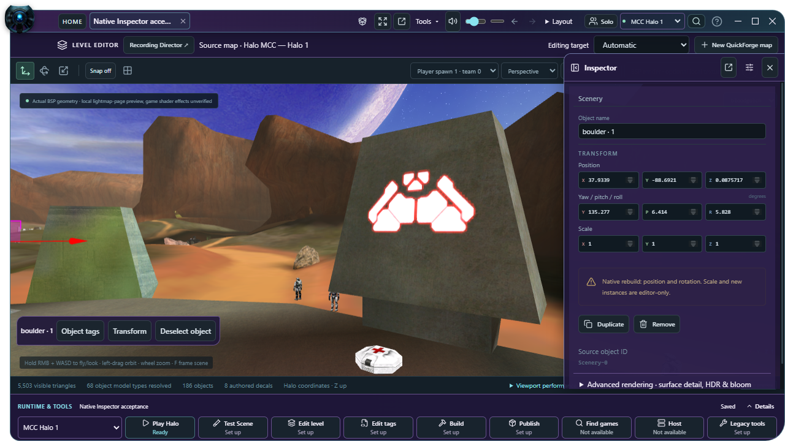
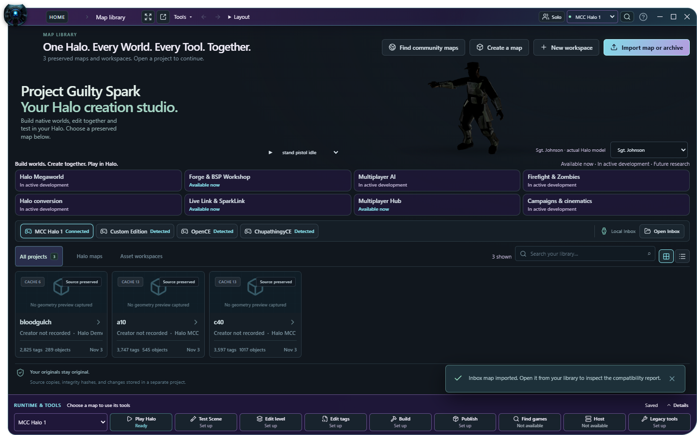
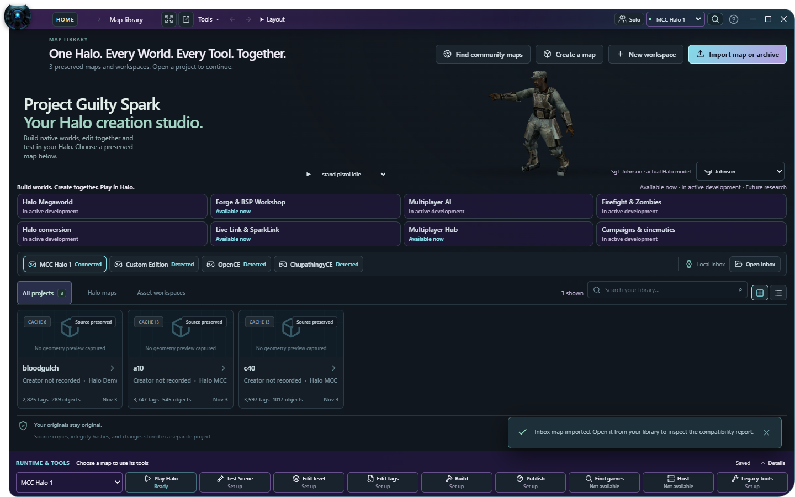

# C61 — Lighter status updates, compact inspection and native gameplay evidence

C61 continues local master from `cd73fae00c122ee8d59c5553e376d457fa99be13`. Existing source, the separate dirty C41 checkout, all 472 requirements, native transactions, Baboon/Invader reconciliation, recovery, BSP tooling, unfinished research and the sealed C49 release are preserved. [Machine-readable receipt](fixtures/c61-workflow-native.json) records exact source/build hashes and the limits of each result.

## Repairs and current executable

- Build notifications read `project_build_history`, containing project ID, immutable source SHA and build records. `App.tsx` applies only matching-source build metadata, retaining the current authored scene, tags, assets, history and unsaved draft. Latest-request ordering from C60 remains. Native source admission remains the same as `open_project`; this status projection does not hash all payloads again, migrate a scene, grant build readiness or authorize a launch. Actual payload/build/launch paths keep their independent validation.
- All **255 previous native command names remain**. One read-only command brings the total to **256**. The C38 native transaction and integrity implementations are unchanged.
- Inspector starts with the selected object, its name and transforms. Scene-wide visibility, renderer and environment settings follow. Repeated Inspector headings, default fieldset framing and large margins are reduced. The shared renderer group retains all 11 ranges and two selectors across World, QuickForge and Machinima. It measures **1019.2 → 682.6 px** at the same 322-pixel content width, a **33.0%** reduction. Scroll remains available where all controls cannot fit, including 800×600.
- Native selected-object controls stay above the fold at 800×600, 1280×720 and 1920×1080. Parameter Undo and name-edit Undo pass; the map canvas stays resident.

Verified development executable: `target/release/GuiltySpark.exe`, **42,968,064 bytes**, SHA-256 `d5aa90b439e7663315b213156ced095f5d3e9b5b09917534f400f7683ed9f5d9`. An identical previous-good copy is retained at `.local/c61-workflow-native-20261103/GuiltySpark-C61-verified.exe`. Version remains **0.4.1**. This is a development executable, not a newly sealed installer/portable release.

## Johnson's Home lighting

The reported dark Johnson is reproduced with his actual MCC `a10` source. The source-derived preview environment has **zero ambient intensity**, azimuth **100°** and elevation **−30°**. Applying that map sky at a detached character's origin leaves most of him unlit; it does not supply the game's local BSP-cluster actor lighting.

Home now passes the existing `sourceSurfaceEnvironment()` neutral inspection rig to the existing native preview: ambient **0.5**, directional **0.65**, azimuth **−35°**, elevation **50°**, fog off. No exposure increase, replacement material, pixel recoloring, tag mutation, bone change or animation replacement is used. Normal map/asset previews retain their current source/custom lighting; the source-derived corner portrait is unchanged. Home's caption explains its studio lighting.

At a matched paused pose and view, Johnson's mean visible opaque-pixel luminance changes **11.89 → 55.11 / 255**. Pixels below luminance 16 fall from **66.8% → 10.2%**; neither sample has highlights above 250. Native identity remains exact: source SHA `08cd04eb76fbd61e57016fb592d95491905c61e021702a45e1359a4551abe15b`, tag `3809935779`, variation `sgt_johnson-100`, **1,330 triangles, six textures, three reflection bindings and 16 clips**, with zero material gaps. These pixel measurements describe Home, not game lighting fidelity.

**16 real native cases** cover Johnson, campaign Chief, Cortana and the monitor under MCC, Custom Edition, OpenCE and Chupathingy selections. Model/resource presence, exact owned source hashes, variation and saved choice pass. A selected runtime may use a linked compatible campaign source; Custom Edition does not acquire campaign files through a selector. Each case's actual source version is recorded. These results do not establish complete animation/shader parity or game audio playback.

| Before | After |
| --- | --- |
|  |  |

## Measured performance

The status workload uses a real owned MCC Blood Gulch, independent fresh libraries and WebViews, the same source SHA and identical empty build-record arrays. Ten round trips include two warmups and eight measured samples. The editor is parked in Preservation record during notification measurements.

| Workload | C60 | Final C61 |
| --- | --- | --- |
| Build-history response | **8,192,319 bytes** | **146 bytes** |
| Median native read round trip | **113.95 ms** | **1.45 ms** |
| Forty-notification burst, three trials | 2 library reads + 2 full project reads | 2 library reads + 2 metadata reads; **0 full project reads** |

The response is small for an **empty build history**; populated histories scale with their records. The old full inspection serialized 8.2 MB of map data unnecessarily. Rust tests also cover populated records, unchanged persisted source, cache-identity refusal, no scene migration and invalid project identifiers. Frontend/browser tests retain unsaved edits and reject wrong-source receipts. The burst's fixed quiet interval is not reported as a latency improvement.

Two final process-cold/warm runs use the same maps, render area and full rendering. Twelve final textured-map/switch states preserve original hashes, tags, placements, geometry, material IDs, lightmaps, authored decals, detail/reflection bindings and canvas resolution. Repeated bitmap/cube decoding remains zero in the matched earlier strict comparison. The generic strict quality comparator is unchanged. Its C60→early-C61 matched-lighting comparison is preserved; the final comparison explicitly records Home's intentional studio-lighting change.

| Measurement, median | C60, two runs | Final C61, two runs |
| --- | --- | --- |
| Process-cold shell | 1135.9 ms | 1159.9 ms |
| Warm-process shell | 924.3 ms | 867.0 ms |
| First Home model | 4493.5 ms | 4609.9 ms |
| First textured MCC map | 8860.1 ms | 9065.8 ms |
| First textured CE map | 5902.8 ms | 6340.5 ms |
| Repeat map switch | 1019.7 ms | 966.9 ms |
| 150-card asset catalog | 2680.4 ms | 3373.0 ms |
| Warm-process Home model | 2526.6 ms | 2512.0 ms |

These are process-cold runs with fresh profiles, **not flushed OS disk caches**. Home appearance changed intentionally, so Home/GPU timings are descriptive. General startup, first-load and catalog results are mixed; **no broad load-time or memory improvement is claimed**. Map switching improves modestly in these samples. After both maps, process-tree private memory is about **1,883.7 → 1,879.0 MiB** and dedicated GPU allocation about **361.6 → 362.2 MiB**; other phases use more memory. A whole-process RAM budget and longer endurance remain open.

An intermediate performance run timed out after its Home character/navigation changed; its screenshot and incomplete report remain preserved and excluded. It is not rewritten as a successful sample. All initial wrong-selector, scroll-measurement and tool-flag diagnostic failures are also retained alongside corrected runs.

## Source collaboration and native BSP compilation

The actual three-process Workshop regression uses three separate libraries, authenticated permissions and native WebViews on **one physical computer**. It verifies simultaneous brush edits, author-specific Undo/Redo, perspective/orthographic drag ghosts, conflicts, viewer/build restrictions, expired-lease recovery, process death, two retained offline UI edits, authoritative rollover, revocation and same-computer Radmin interface convergence.

A sustained interval commits **240 operations in 75.57 seconds**, with a bounded **100-entry history**, revision **247**, and **1,140,171-byte journal**. Sampled UI-to-convergence latencies are retained in the receipt; concurrent test load makes them unsuitable as an optimization comparison.

The real H1A toolchain freezes revision **247**, compiles it while a newer revision **248** is edited, and reads back a native cache 13 containing **58 collision triangles, two portals and 2,239 tags** in **131.979 seconds**. Output: **88,880,670 bytes**, SHA-256 `f94cbbbbf0643fb5accb2211f5930273e547891e48c1617ec285b706d8ca4b1e`, matching the previous accepted C60 result. Crash/offline recovery preserves exactly-once admission and the newer draft. The previous journal survives rollover.

Window/history/rollover/shared-build tests used the same C61 backend before the final Home-lighting/quality-spacing-only frontend revision; exact executable hashes are retained per gate. The final executable separately passes all 157 browser cases, the native 126-state workspace audit, selected-Inspector checks, 16 character cases, status benchmarks and full map-quality profiles. No two-computer, production Steam or game-peer replication claim follows from SparkLink.

## Native player/AI acceptance

A new isolated source kit copies the existing C56 native-round source, removes the allied `gs_defender` encounter, reuses Spark's existing exported Firefight controller and compiles with Invader script plus classic Halo Tool. Native extraction/readback confirms **exactly the two intended hostile encounters**. Cache 609, singleplayer scenario, **64,255,916 bytes**, SHA-256 `5bb403ec83bf63d3491d81b3b55a150dd3e5e8980108ea76797682a1a46412a4`. The prior source scenario and previous-good C56 cache remain unchanged. The first readback invocation used an unsupported flag; its failed receipt is preserved. The corrected `-s` extraction verifies the already-compiled cache.

OpenCE build 335 runs with its own deterministic `bot:1` player-input facility, real bullets and normal damage; synthetic impact/kill hooks and allied assistance are off. The read-only, exact-executable/PDB observer samples actual units and script globals. Two hostile actors move **3.95 / 5.23 world units**, animate, target the player and fire. The first player fires at **17 distinct observed ticks**, loses health, dies and later respawns normally. Both hostiles are removed by the controller's defeat cleanup. **Wave one ends in state 5 with score 0. No player-led round win is accepted.** This is a practice-infantry trial, not restoration of the original Zombie mechanism.

A separate real host + client + rejoined-client run loads the same candidate. The first client has **321 exact-tick frames**, two shared/moving actor identities and one shared firing identity. Its **408 paired actor observations** have zero sampled actor-health/shield difference; those hostiles remain undamaged in this trial, so that does not prove damage/death replication. World-position error is **0.0361 at p95, 0.0521 maximum**. The host's round is defeated at tick **673**; client round globals remain idle. The rejoined client has **232 tick-paired frames but zero surviving shared actors**, because the round has already cleaned up. **Complete AI lifecycle/score/vehicle/rejoin parity remains unaccepted.** No classified engine faults appear in this run; observer startup/read-boundary errors remain recorded, and snapshots are not atomic.

Research is pinned to the installed release's exact source commit `da8d455623cf50002e6a798b1980068fd3ca0292`. [Vehicle-exit handling](https://github.com/OpenCommunityEdition/OpenCE/blob/da8d455623cf50002e6a798b1980068fd3ca0292/source/ai/actions.c#L4185), [normal seat exit](https://github.com/OpenCommunityEdition/OpenCE/blob/da8d455623cf50002e6a798b1980068fd3ca0292/source/units/units.c#L4893) and [engine test input](https://github.com/OpenCommunityEdition/OpenCE/blob/da8d455623cf50002e6a798b1980068fd3ca0292/port/linux/src/xinput_sdl.c#L970) match the corresponding normalized functions in the existing research pin. The source declares AGPL-3.0 text; source is kept in private read-only research and no engine implementation is imported into Spark. Vehicle exit still requires actual eviction/danger/hostile-occupant conditions plus a valid exit animation. This trial does not generate the missing original Zombie release condition or alter upstream networking.

Chupathingy, MCC and stock CE keep their independent gameplay/AI limitations. Home selection/resource checks across four runtimes do not close those engine gates. No new human gameplay, two-way Timberland–Sidewinder walkthrough, game-audio listening or four-region expansion is accepted; **player-verified region connections remain zero**.

## Regression and preservation

| Gate | Result |
| --- | --- |
| Locked Rust workspace | **666 passed**, 8 explicitly opt-in ignored, 44 suites |
| Frontend / final browser suite | **366 / 157 passed** |
| Offline programs / native diagnostic tests | **59 / 37 passed** |
| Release package/draft contracts | **10 Python + 6 Node passed** |
| Native window lifecycle / history / rollover | **8 / 8 / 4 cases passed**; frame/maximize/fullscreen check retained |
| Final native layout audit | **23 routes + 2 geometry views, 126 states**, no clipping errors |
| Final Home / selected Inspector | **16 character/runtime cases**; three native window sizes, retained canvas and Undo |
| Research index | **6 exact projects, 36 source behaviors** verified |
| Original requirement CSV | **472 rows**, unchanged SHA-256 `aad57672fe87c3cd2077df325b18d353ddf573a0c73b7f7940142b2403794c51` |

The eight ignored gates are the live HTTPS listing, reviewed running MCC camera-disconnect, owned campaign audio/detail serialization, power-up native cache, campaign duplicate/UI build, native-emitter rename build and selected MCC installation inventory. They are not counted as passed. Existing native audio compilation evidence is preserved; no new in-game listening is claimed.

After every active build/game/profile/archive test stopped, cleanup verified the literal integration-worktree `target/debug/incremental` path, Git ignore/tracking, absence of reparse points, absence of active compilers/trials and generated file types. Only **27,630 compiler-cache files** were deleted: **8.50 GB logical size**. Observed D: free space increased **6.94 GB** (6.46 GiB); logical and physical storage are reported separately. Binaries, original installations, maps, source snapshots, all failed research, journals and release files remain. No source code was deleted without proof of redundancy.

## Release and next gates

All five sealed C49 assets match their starting SHA-256 values. Its original installer, portable and source archive remain upload-ready at `.local/c60-release-maintenance-20261103/upload-ready/C49-preview-cb07581`; [C60 upload instructions](C60_PUSH_NOTES.md) remain applicable. That candidate's exact source is `cb07581597de11e83d1c10bafad526e8b031f27e`, not C61.

Anonymous GitHub API checks at **2026-11-03 14:59 UTC** return public master **`cd73fae00c122ee8d59c5553e376d457fa99be13`** and **zero public releases**. Private drafts cannot be inspected anonymously. No remote write, push, metadata update, asset upload, publication, tag rewrite or rules change is attempted. The owner chose to upload. The existing workflow still prepares a verified draft pre-release against pushed source; publication needs owner approval and actual downloadable assets. Linux/macOS acceptance remains open.

Highest-impact next actions:

1. Complete the returned player-led Firefight win, shared round/lifecycle/vehicle behavior and automatic original Zombie carrier release with real engine evidence.
2. Return the two-way Timberland–Sidewinder walkthrough before four-region expansion; finish native imported-terrain editing/structural compiled-map work without substituting visual changes for collision/portal rebuilding.
3. Finish whole-process memory/endurance, separate-computer collaboration and non-MCC write-adapter/conversion/audio acceptance, while the owner attaches and publishes the preserved Windows release.

[Descriptive push and release handoff](C61_PUSH_NOTES.md).
