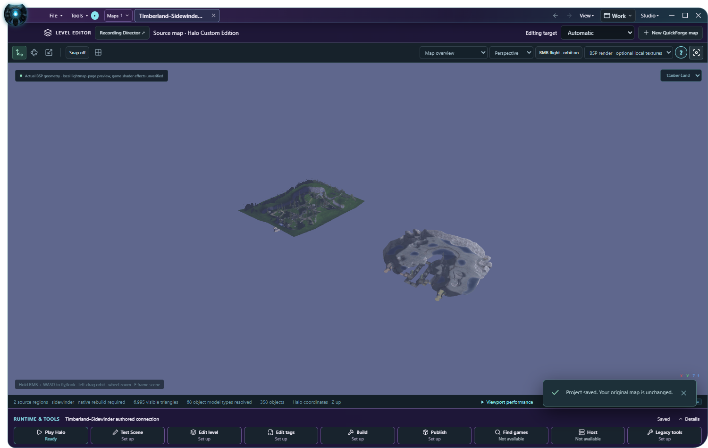
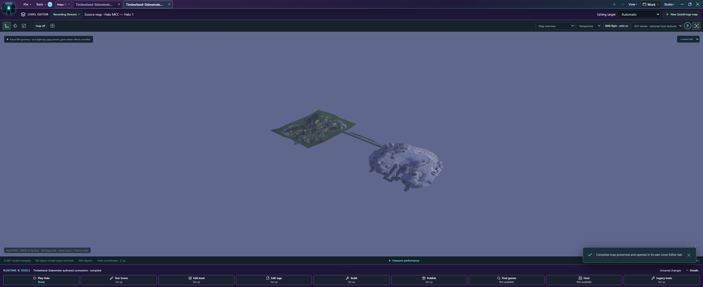
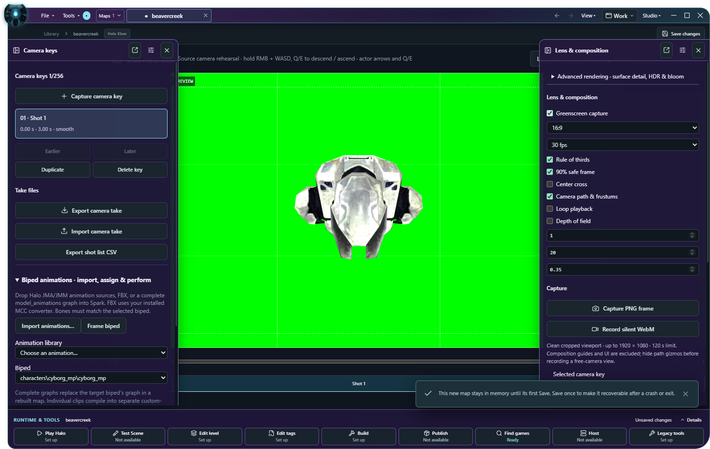

# Double Action: original map creation and connected-world source

Status: **implementation incomplete**. Source is local master based on `1a50bb53ba62403ee2fac5fbf92a7c543667f64b`; the exact runtime-source fingerprint and QA application hash identify each run below. No release, remote push or gameplay acceptance is implied.

The owner directive is preserved verbatim in [Double Action Engineering](Master%20Engineering%20Prompts/GS_2026-11-07_Double_Action_Engineering.md), SHA-256 `b4ebb76aae8586f178aa54d7d6624ec3c98757d106200fa8548b08c7f973934d`. Both tracks use the existing Level Editor, QuickForge, BSP Assembly/Workshop, Asset Library, durable history and native compiler. No second geometry editor, discovery system or build pipeline was introduced.

## Actual entrypoints and source ownership

**File → New → Multiplayer Map** opens the existing map wizard, starting with a blank editable template. Choose a target and name, then use the existing geometry palette, Asset Library, Inspector and Build & Playtest. **Asset Workspace** remains available in the same New submenu. Keyboard navigation enters/leaves the compact submenu without traversing hidden commands.

**File → New → MegaWorld** uses the existing connected-runtime source browser to choose a first region and donor. Creation allocates a distinct source document, retains original maps/projects, and opens the existing Construction connection controls. Current admission is a supported multiplayer base with one BSP and one selected donor section (cache6/7/13/609); it is not arbitrary simultaneous streaming or Xbox5 rebuilding. It requires matching editable donor tags and a supported native compiler. Original project overlays/history/build receipts are not silently copied into the new document. To include prior compiled changes, use the separately validated map copy as the selected source.

For an existing saved world, **Construction → Connect another map’s BSP** resolves the donor bound in that plan even when its temporary source tab is gone. Paths, link restrictions and original SHA-256 are checked; an unrelated ID or changed donor is refused. This repairs the real full-process restart failure reproduced in `double-action-reopen-red2`. The resolved donor is a read-only reference, not a second saved library project or a new map copy.

## Track A — scoped native authoring evidence

R1 used actual Windows controls: File/New → blank MCC source → connected CE asset preview → pointer drag/import → transform → copy/paste → Undo/Redo → immediate Save → normal process close/restart → native build → independent readback. Native calls used for prerequisite setup and readback assertions are distinguished from UI gestures.

- Blood Gulch boulder: five recursive tag dependencies, two independently verified placements and edited native radius. H1A build47.117seconds; MCC13 cache79,728,294bytes, SHA-256 `830f04ed035e8740a4d8acb0a0f5a414f45dce4f1767924228641bd46aa63ef0`. Independent Invader extraction and CRC mismatch0. One exact cache retained externally as the gameplay input.
- Sidewinder Warthog:285dependencies including model, physics, animations, shaders and audio. H1A build47.630seconds; MCC13 cache SHA-256 `cee028daaea13db5aa86c77d5feba5885266b77766c52c804c22a5824232754d`. Both placements, edited field and CRC0 independently read. This second generated cache was disposed rather than retaining duplicate QA maps.
- Original input map/resource hashes and original SDK archive remain unchanged. Separate authoring documents retain imported dependency identity and Undo heads after actual process restart.

These are small real native authoring fixtures. **The original two-base canyon/road/cave/bridge map, native weapon/objective configuration, two real game clients, fighting/death/respawn, driven Warthog, and separate Slayer/CTF/King of the Hill acceptance remain open.** A parsed vehicle tag does not prove vehicle gameplay.

## Track B — creation, restart, and native lightmap repair

Actual File/New/source-browser gestures select CE Timberland and Sidewinder. The new document has its own ID and the358original base placements. Save, full process restart, saved donor controls, width2→2.5, Apply, Undo/Redo and immediate Save pass in R2 and R4. Existing source reconstruction checks423capsule points against32,105triangles before the repair and32,117after bounded tunnel-wall refinement. Those source diagnostics do not accept compiled collision or player traversal.

Original source hashes:

| Source | SHA-256 |
| --- | --- |
| CE Timberland | `69d539409004bde866e3fb510d43fa9e155fb8dd0525fe6e2ffe1efe3664e0ea` |
| CE Sidewinder | `ac8580a914f96249fa10fd95ee10065a4513fd6147f1d1e2d768adae59407b4a` |

R4 stages only the selected donor BSP closure:69tags/18,034,422bytes, not a complete SDK. The source is created and edited through Spark; its Build controls invoke the existing H1A compiler. Structure compilation reaches2portals/3clusters, but lightmapping rejects a thin tunnel-wall triangle. The failed build is not adopted. R5 retains the exact blue native WRL diagnostic; R7 preserves bounded source-triangle/neighbor coordinates and UVs before disposable cleanup. The source has valid UV area but a poorly conditioned long fan; source clearance alone missed the native lightmapper constraint.

The generated-wall repair stays in `bsp_triangulate`, adds interior vertices and uses the existing coplanar diagonal improvement. It preserves original vertices/boundary edges, affine UVs and material seams, selects only the generated tunnel material, and keeps the existing triangle budget. A bounded unresolved-strip case is refused rather than moving source boundaries or masking a native error. R13 passes all seven focused triangulation checks. **R16 passes817Rust tests/nine ignored,425frontend tests,205browser tests and12actual Windows lifecycle cases. The fresh Windows app then completes native H1A lightmaps and cache compilation. Independent Invader readback verifies the scenario/BSP reference,16,196collision triangles and CRC mismatch0.** The native build takes282.099seconds and produces82,750,502bytes (SHA-256 `19d8005db91e0c380a7b2e0c2004c4feccb7a5c5e72e729561f8b224ef0ea36e`). The overall R16 run still fails: its test export omitted the explicit retention reason, so the ownership guard correctly refuses retention and disposes the cache. That test call is repaired without weakening the guard. R17 repeats the actual native workflow with that exact app: compilation and independent readback pass again in285.465seconds. Post-build source hashes remain unchanged. The corrected export retains one82,750,502-byte cache, SHA-256 `76745617b0466f6e361d1fc4c530b24de646ab263b85dbb6ee923be12e037dac`, at the external path below. The optional Standalone stage exits1, so the overall R17 run remains failed. Earlier failed conditioning attempts are retained as failed evidence, not accepted fixes. R14 also exposed an overly specific concurrent-save message assertion after the external descriptor remained intact. Thirty isolated repeats passed; the regression now requires exact external bytes and retention of the local dirty Undo selection. That strengthened case passes in the R16 full workspace. The production Save guards were not changed or weakened.

Actual shared-viewport donor reconstruction, distinct vehicle mountain road and infantry cave, donor gameplay-object preservation, compiled visibility/material review, two-way walking, vehicle driving and a cross-region sniper hit remain open. **Verified physically traversable region connections:0.** Do not expand four/19regions or describe region switching as seamless streaming on this evidence.

## Exact retained native artifact and open game gate

`C:\Users\patri\AppData\Local\Temp\GuiltySpark-Engineering-d49eb02588bf\double-action-r17-megaworld.map`

This is the actual generated MCC13 cache; file size and SHA-256 were rechecked after disposable-job cleanup. Independent Invader extraction confirms `levels\spark\assembly_9b729ad2\connected.scenario_structure_bsp`, one BSP,16,196collision triangles and CRC mismatch0. Both original CE maps and the SDK archive remain hash-identical. The matching exact-source QA app is identified below; no new installer was built.

The [Standalone documentation](https://c20.reclaimers.net/h1/h1-ek/h1-standalone-build/) distinguishes loose-tag scene tests from retail MCC cache testing. The existing Test Scene controls launch the selected installed H1A Standalone (`halo_tag_test.exe`, SHA-256 `fc9e2b6193c6f6d9ff988278b0d39a983747f3fdbdeca7cafadd28f1f0c53e73`) against the owned derived tags. Its log records `game_variant slayer`, the original scenario path and default vehicle spawning. It exits1 after about24seconds before visual scene acceptance. Its bounded debug log is preserved in `double-action-r17.json` (SHA-256 `8000c6df09a0cbedf4e827573e0b1459b0efb359b3b672e9ac629ca89edd801d`). It reports no fatal reason. Steam is running; no corresponding Application Error/Windows Error Reporting event was returned by the scoped read. Neither fact establishes the cause. Computer Use initializes, but no Halo frame was observed before that exit. **No game loading or gameplay is accepted.**

The pre-existing Standalone control in FEATURE_COMPLETION_20261106.md also exited1; do not assume this exit is caused by the new geometry. R18 performs a fresh small-scene comparison through the existing authoring/native workflow. Its actual CE boulder drag, edits, copy/Undo/Save, H1A build (59.964seconds) and independent placement/radius/CRC0 readback pass. The same Standalone executable then exits1 after about19seconds. Its log SHA-256 is `f042dca4736fe1d92501136b81923d035fb38624be78a5e04d7f3d169279ecb4`, with missing non-authored game-mode/equipment warnings; this is not a complete playable multiplayer fixture. **The two exits alone do not prove a common fatal cause.** Computer Use enumerates the real Standalone window, but inspection returns `Computer Use app approval timed out`; no visual game acceptance or input follows, and that approval is not bypassed. All six original map/resource inputs were separately rehashed after failure (`double-action-r18-originals.json`). The control retains no duplicate map/SDK. Keep the normal-exit assertion intact and resume the controlled diagnosis when native-window inspection can be authorized. All owned test processes and SDK/job trees are disposed; only the explicitly retained cache, bounded receipts/screenshots and source-pinned QA executable remain outside the repository. The game failure does not invalidate the separate compiler/readback evidence.

## Regression evidence and reproducibility

R16 QA app:47,428,096bytes, SHA-256 `86e4d7c1bd1c032a38fd1421521b4c0ea1e83c76a99f744c8e9ba7c0d4223e96`; runtime-source fingerprint `cb5e73e747c95c6320407597e46a4c604dd743fd30fe4c342a2d773803239e5f`. It is a source-pinned test executable built from the dirty worktree at1a50bb5, not an installer or released version.

Before the lightmapper repair, R2 passes813Rust tests/nine intentionally ignored,425frontend tests,205browser tests and12actual Windows multiwindow cases. Three new core tests cover independent source identity/RAM-until-Save, stale/unsupported source rejection and saved-donor restart resolution. Browser fixtures cover real menu gestures and saved-donor controls; synthetic browser state is not native acceptance. R4 separately passes12native lifecycle cases using the fresh R3 app, then correctly fails the combined native build.

R3 app:47,422,976bytes, SHA-256 `69bef2a6156dcc8727926baecee884555369ba7eea86bddb2df94d2be9f35d65`, runtime fingerprint `43794407e1874e575351880d60e3f42606c11dc96e1b90064fe0ff8e4d15a391`. It predates the lightmapper repair and must not be reused to claim that repair passed. R3’s combined-stage harness initially leaked logic options into workspace testing; R4 isolates them. R6 refused missing unrelated fixture inputs; prerequisites are now scoped to the selected test, and a MegaWorld-only run requires its actual two sources.

Extend the existing `scripts/verify-source-only.mjs`, not a parallel harness. Select installed original source files, H1A kit/verified archive and Invader; use an owned external receipt destination. `SPARK_VERIFY_STAGES=rust,frontend,browser,workspace,logic`, `SPARK_LOGIC_CROSS_RUNTIME=1`, `SPARK_QA_MEGAWORLD_ONLY=1`, `SPARK_QA_MEGAWORLD_COMPILE=1`, `SPARK_QA_RUNTIME_ROOT`, `SPARK_QA_MEGAWORLD_BASE` and `SPARK_QA_MEGAWORLD_DONOR` select the combined test. The wrapper extracts only hash-listed SDK inputs, keeps binary/source fingerprints, and cleans owned scratch/processes on pass or failure. Native WRL/numeric diagnostics are bounded, not a preserved SDK/archive.

Compact fixture: `docs/fixtures/double-action-20261107.json`. External receipts/screenshots live under the existing explicitly owned Engineering temp root with the names above. The475requirement identities and25numbered prompts remain intact. C49 release, original runtimes/maps/ISOs/mods, Git history and pre-existing stash remain protected. No public server, installer replacement, push or publication occurred.

## Shared prebuild viewport and additive runtime work

The additive vision directive is preserved verbatim in Master Engineering Prompts/GS_2026-11-07_Original_Vision_Arena_Evolved.md. Both earlier reattachments hash-match their existing instructions. All475 cumulative requirement IDs and25 numbered prompts remain; ALL THE TOOLS, AND THEN SOME is the primary product identity. This extension does not accept either flagship or retire prior native/runtime/Zombie/AI/editor goals.

File → New → MegaWorld still uses the existing creator, source browser, World and native assembly. The donor now joins the base in that same renderer before compilation. Construction retains the existing position/yaw/tunnel controls; Frame both regions includes both native source bounds. Source BSP geometry, source-specific materials, lightmap pages and supported donor scenery use the admitted donor's own hash/resource pins, not the hosting runtime or the base map's shader datum IDs. Model movement changes its group transform without replacing source vertices or UVs. Existing budgets remain in force; missing material/geometry remains an explicit incomplete preview.

The new native source-admission command is read-only and RAM-bound. It verifies the saved donor reference, preserves complete resource pins and creates/reuses its own preview identity; it cannot overwrite/adopt the editable donor's UUID. No map copy, SDK tree, extra renderer, runtime installation or new compiler was added. One enlarged native BSP and a displayed source group remain distinct: this preview does not change collision, rebuild lightmaps or certify a tunnel. Native compilation, game load, both-way travel, Warthog passage, cross-region combat and peers retain their separate gates.

Arena Evolved0.7.7-beta is an additional setup/profile/source-family target. Games & tools and Online explain its own provider and version/content boundaries. Without a verified installed executable, automatic launch/hosting, game acceptance and bots/stats/Live Link remain unavailable. See the additive Engine Source Atlas section and pinned fixture. No engine code, executable or proprietary content was downloaded/copied; current OpenCE/Faber/Chupathingy/CE/MCC registrations are preserved.

### Current native preview acceptance

The fresh R5 Windows application passes actual File/New, Save/full process restart, source-bound donor recovery, width and yaw edits, author Undo/Redo with immediate Save, and source clearance. Both source regions are visibly present in the same Canvas. The admitted Sidewinder source resolves21shader textures and26lightmap pages; first ready after reopened-document navigation was7415ms on this machine, with warm OS file caches and concurrent browser regressions. This is one measured sample, not a cold/warm performance comparison or stock-renderer parity claim. Its actual Three texture allocation stays identical through transform/Undo, rather than unloading and redecoding it.

The real native test first exposed generic render labels (BSP1) being mistaken for scenario BSP reference names. Binding now uses native collision-section names in scenario order, prefers exact paths and refuses missing/ambiguous identities. Eight targeted tests preserve source indices, UVs/material IDs/pages, transform immutability, scenery limits and this actual label pattern. Current full frontend433pass/98files; core Rust822pass/nineignored/55suite results; browser206pass. Direct native MCC tag edit/Undo/Save/export also passes independent Invader readback and original-hash checks. The same source-pinned application also passes all 12 real multiwindow lifecycle cases, including independent menus/navigation, tab tear-off, author history, offscreen recovery and full process restart. Inactive and minimized viewports issue zero GL clears during the measured 650 ms pause. Actual secondary-monitor placement is exercised; physically disconnecting a monitor and manually dragging between monitors remain untested. See the compact fixture follow-through record for the exact source fingerprint.

This is the prebuild source view. The generated connection is not shown by this overlay; native rebuilt collision/lighting and actual travel remain separate. R5 deliberately does not repeat the unchanged R17 compiler or failed Standalone experiment. The exact retained R17 cache and all original map/SDK/release hashes remain protected. No new Halo load, human traversal, vehicle/sniper test or peer acceptance occurred. Verified physically traversable connections remains0; the separate mountain road/infantry cave and full original multiplayer arena remain unfinished.

Implementation is committed locally as `c737e40b2076d7c346efd275b37861290371d1bb`. The current QA executable is 47,571,456 bytes, SHA-256 `6a264743a1e31753d8536cd51522c8f7ab3c3b14bfe84dd35cb139271657c18d`, with runtime source fingerprint `e82ba78224c4f62ac0b0064be10b81af995ac9454f9c18813745f397f3dd52b4`. It is a temporary validation application, not a new installer or published release. Owned native/browser/compiler scratch was disposed; no SDK or cache tree remains in the source checkout. Original maps, the retained R17 map, all three full directives, accepted C49 files and the pre-existing stash were reverified.

## Reversible prototype closure — current dirty master

The superseding [19-map/runtime directive](Master%20Engineering%20Prompts/GS_2026-11-07_Native_Runtime_19_Map_Megaworld_VR.md) and latest [OpenH1 VR Forge directive](Master%20Engineering%20Prompts/GS_2026-11-07_19_Map_Chupathingy_OpenH1_VR_Forge.md) preserve this work as a prototype. The long artificial connection is **not** the final MegaWorld layout. Natural side-by-side terrain, all19 source regions, real walking/Warthog/cross-region firing, and the new in-headset Forge slice remain incomplete. No streaming or game-peer acceptance is inferred.

The screenshot defect was a real material-selection error. Independent Invader readback shows Timberland ground and rock_walls both reference the whole-map timberland_ground.bitmap. That atlas fits original UVs but repeats map artwork on generated corridor UVs. New connection plans prefer an actual opaque source metal plate/flat shader. To repair an existing plan: **Level Editor → Construction → Connect another map’s BSP → Use source metal → Apply connection → Save → Build & playtest connection**. The shader field offers exact source identities and an optional native bitmap preview; intentional custom choices are not silently rewritten.

The same controls now author an optional open-sky4-unit road and separate2-unit infantry route with editable waypoints. Add/remove, Apply, per-map Undo/Redo, immediate Save and full process restart pass through actual Windows controls. Existing single-route schema1 projects still open; optional sidecars add no native tag fields/classes. Each route has independently guarded portal cuts and compiled collision checks. UV distances remain world-scaled.

Closure R6 completes five real creator/native cases. H1A/Invader compilation takes285363ms and produces MCC13 cache82,753,578bytes, SHA-2562611cac26411cea6197d72bfe691bc894c8d1920e8b6f209ccddd9ec39d067ae. Independent extraction reads both gstunnel and gsinfantry material aliases and their exact namespaced metal plate floor ext.bitmap references; CRC mismatch0,16,252collision triangles,859source capsule samples. The actual compiled viewport resolves123shader textures,6lightmap pages and17reflection cubes, with no pending material/reflection work. These counts and a rendered overview do not prove native game appearance or traversal.

**Machinima → Lens & composition → Greenscreen capture** is reversible editor capture using the existing renderer. BSP/environment/scenery become exact green with geometry depth retained; native weapons, vehicles and bipeds keep their source materials. Sky, decals and camera helpers are excluded; capture bloom/depth-of-field are bypassed without changing saved settings. No native map/tag is edited. Chupathingy’s real Xbox5 Beaver Creek source passes eight asset contexts,19-bone/16-clip biped animation, Play/Stop and Windows owned-session output peak0.4054885. Human hearing and in-game audio remain unaccepted.

The actual source biped is framed with ordinary camera-key controls. Greenscreen has823675green and11377colored pixels out of861042, zero source-preview IPC rereads on toggle, the same Canvas/material IDs, and two camera keys plus Undo/Redo/Save replay surviving a normal process restart. R1’s occluded camera and R2’s unrounded test coordinate remain failures; R3 is the corrected passing test. Normal occlusion was not disabled to force a visible subject. This is editor capture, not a Chupathingy game-camera adapter.

Chupathingy is now the fresh-setup preference. Existing explicit runtime/source/build choices remain authoritative. A real loading-placeholder race was repaired so saved MCC choices cannot be overwritten before bootstrap completes; no pre-bootstrap dock request selects the wrong engine. Header spacing moves File/Tools/Maps immediately beyond the permanent Monitor glow. New source passes828Rust tests/nine ignored,440frontend,209browser,TypeScript,59offline and35storage checks; all12 current-source Windows multiwindow cases also pass in34788ms: independent menus/navigation, shared author history, pointer tear-off, inactive/minimized rendering pause, secondary-monitor placement, offscreen recovery and full normal process restart. Physical monitor disconnect remains untested. The fixture records these separately from game acceptance.

Original map/SDK hashes, prior R17, four sealed C49 files and the pre-existing stash reverify. Native scratch is disposed; the bounded prototype cache and compact evidence remain external. The QA executable is source-fingerprinted and is not a new installer or published release. Chupathingy source inspection/capture does not accept Xbox rebuilding, general Live Link writes, SparkLink across physical peers or gameplay.
