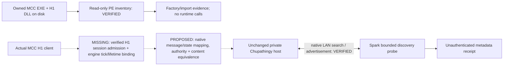

# One Halo: MCC Halo 1 ↔ Chupathingy investigation

2026-10-29 · Spark base `489443d7b892b14bda553ed5f4f8d33480ffe78c` · review branch `codex/one-halo-mcc-investigation`.

**Actual MCC-to-Chupathingy gameplay has not been established.** Gate 1 now has a real, independently implemented native discovery probe. Gate 2 cannot advance through the available interfaces: no supported, exact-build MCC H1 session/replication binding has been verified. The separate MCC-only content bootstrap experiment fails in unmodified Chupathingy v0.8.1c. No new join control, executable patch, public gateway or cross-play release is presented as working.

[Metadata-only evidence](../fixtures/one-halo-investigation.json) records hashes, source pins, native observations and gate results. [Native log excerpts](../fixtures/one-halo-native-observations.txt) retain the observed rejection and protocol identities. [Review description](../ONE_HALO_REVIEW.md). Existing [C36 two-community-client evidence](../C36_COMMUNITY_NATIVE_TESTS.md) remains a separate historical result.

## Builds and evidence classes

| Subject                       | Exact identity                                                                                                              | Evidence obtained this pass                                                           |
| ----------------------------- | --------------------------------------------------------------------------------------------------------------------------- | ------------------------------------------------------------------------------------- |
| Installed MCC shell           | `MCC-Win64-Shipping.exe`, SHA-256 `be70d6dcd1a884f10ceb342a7a2dcb35ee0fa43181b66a1d19c3d830e9834691`                        | Read-only file interfaces and OS process/module metadata                              |
| Installed MCC H1 engine       | `halo1.dll`, file version `1.3528.0.0`, SHA-256 `0a12dc561780f449d3f4d0df10bb8d3bc7be7840a5beb2b236f672eb6cd42e6c`          | Same existing reviewed Spark object-adapter profile; 21 named exports                 |
| Tested Chupathingy            | v0.8.1c, `880a933ec33b2ae2dbbeb4018a9090c528a075bc`; EXE `bd01e38996ec9787d8413ce84033d4cd3e1878099d3af27630a7d7ea493a1c4a` | Actual private native host discovery; separate actual bootstrap rejection             |
| Chupathingy source comparison | `68142e35f97c81308df2550729e5f0c783159ec3`                                                                                  | Source analysis; not a newly built/tested executable                                  |
| OpenCE                        | build-329 source `70c5e600ea345345db040ce1914903cc6746b46e`                                                                 | Source analysis and reference to prior C36 native tests; no new MCC/OpenCE join trial |
| libmcc                        | `d203900084d218aab338358738b402af06a01263`, `header_only`                                                                   | Community interface descriptions only                                                 |
| AlphaRing                     | `5b333d9424a77aac28418055d20ef74b76545f66`                                                                                  | Source analysis only; no binary loaded or hooks applied                               |

MCC and `halo1.dll` were running during inspection. OS process metadata showed the `-no-eac` launch flag, with no Easy Anti-Cheat process observed. Socket/module presence and that flag do not establish private LAN mode, map identity, an accepted session or a safe foreign-peer interface. The Windows UI-control helper failed to initialize, and the requested private-LAN/menu confirmation was not received during this pass. No MCC process-memory reads/writes, export calls, DLL loading, credentials or production matchmaking requests were performed by these experiments.

The classifications are **source analysis**, **static owned-file inspection**, **synthetic format/socket tests**, and **actual native host discovery/bootstrap**. There is no actual MCC game connection, successful MCC session join, verified MCC map load, two-client MCC gameplay or stable mixed-runtime match.

## Working experiments

### Native discovery

`community_lan.rs` implements the existing private LAN search/advertisement layout. Its CLI sends only to one explicitly selected loopback host on native port 5150. It checks the response endpoint, fresh echoed nonce, exact framing/version/length, bounded names and population fields. It discards native keys, machine identifiers and join tokens. Advertised names, population and map hints remain unauthenticated.

The final run launched the publisher-verified v0.8.1c host at `127.0.0.210`, with separate copied data/save/log roots. One query received a 280-byte Blood Gulch advertisement within one millisecond on loopback (the integer timer recorded `elapsedMs: 0`): packet format 1, discovery protocol 2, legacy network number 32, one machine/player, Slayer, native game port 5150. The host advertised a **pregame lobby**, not a map already verified running. Its own startup log identifies Delta major 1 / wire `chupa-39a`. The probe hashes opaque extension bytes; it does not turn them into a trusted compatibility decision.

The host exited 0 after 35.7 seconds through its timed-exit path, without watchdog termination. All three copied maps and their source files rehashed unchanged. The native fixture needs owned Xbox cache-5 UI, Blood Gulch and Carousel; Carousel is required by this release's fast-host setup. No MCC participant was admitted.

An earlier real-host test failed because the initial query omitted data-packet format byte 1. Unit fixtures had repeated that error. The engine's search-decode failure exposed it; the corrected 16-byte query then passed against the engine. That failure is retained and classified as a probe bug, not an MCC incompatibility. A further native run attempted a solo start but remained pregame; the final reproducible discovery test leaves the host in its lobby deliberately.

### Actual MCC file boundary

`probe-mcc-h1-interface.mjs` reads the installed files as bounded PE32+ data. It never loads the DLL or invokes its factory. The installed H1 DLL exports `CreateGameEngine`, `CreateDataAccess` and `SetLibrarySettings`; this verifies symbol presence, not callable ABI or session semantics. Both shell and H1 DLL import socket APIs. The shell also imports `HaloNetworkLayer_Ship.dll` and `SimpleNetworkLibrary-x64-Release.dll`. It would be incorrect to assume all H1 traffic goes through one community-described callback merely from those names.

The [pinned libmcc game manager](https://github.com/SpringContingency/libmcc/blob/d203900084d218aab338358738b402af06a01263/include/libmcc/game/game_manager.h) describes `network_sendto_unreliable`, `network_sendto_reliable`, `network_recvfrom` and a network identity type. Its [engine interface](https://github.com/SpringContingency/libmcc/blob/d203900084d218aab338358738b402af06a01263/include/libmcc/game/game_engine.h) describes initialization with a game manager and game options. These identify a candidate engine/shell boundary. Unknown virtual methods, build-sensitive tables and the absence of an H1 foreign-session implementation prevent using this header as a validated current-build adapter. Its Halo 3 session structures are not evidence for Halo 1.

[AlphaRing's module manager](https://github.com/WinterSquire/AlphaRing/blob/5b333d9424a77aac28418055d20ef74b76545f66/src/mcc/module_manager.cpp) hooks H1 presentation state and applies title-specific patches; its manager integration replaces a version-dependent vtable. Neither establishes Chupathingy session admission or distributed-object replication. Those patches were not reused.

### MCC-only content alternative

A fresh unmodified v0.8.1c copy received only the owner's installed MCC cache-13 `ui.map` and `bloodgulch.map`. It exited **1 in 349 ms**, without forced termination, at its native maps-folder preflight: UI version 13 is not Xbox maps. Both originals and copies stayed unchanged. The test was quiet/timed, so it did not open an importer, find Xbox fallback data or download assets. It reached no sound-bank or gameplay loading stage.

This agrees with the [release's bootstrap check](https://github.com/ChupathingyCE/chupathingyce/blob/880a933ec33b2ae2dbbeb4018a9090c528a075bc/port/linux/src/sdl_platform.c#L211) and its [explicit cache-13 unsupported classification](https://github.com/ChupathingyCE/chupathingyce/blob/880a933ec33b2ae2dbbeb4018a9090c528a075bc/port/linux/game/map_families.c#L393). Current analyzed source retains that classification. Supplying an Xbox UI to get past this check would introduce additional owned content and would not make the MCC gameplay map supported.

Path B is therefore **unavailable with this unmodified release**. A native MCC data loader or independently validated conversion/build route would need to resolve UI, tags, geometry/collision, resource indexing, models, shaders, sounds and gameplay equivalence. No complete MCC-only resource set or conversion route into this runtime has been verified. Renaming a map or changing cache 13 to 5 cannot supply it. The exact cache-5 and cache-13 map hashes are different and recorded; matching the name Blood Gulch does not prove collision or script equivalence.

## Source call paths

The following references use Chupathingy source `68142e35f97c81308df2550729e5f0c783159ec3`. The release-critical discovery/bootstrap files were also read at tested release `880a933e`; the evidence manifest binds each downloaded file to its own revision and digest.

| Stage                  | Actual producer, caller and consumer                                                                                                                                                                                                                                                                                                                                                                                                                 |
| ---------------------- | ---------------------------------------------------------------------------------------------------------------------------------------------------------------------------------------------------------------------------------------------------------------------------------------------------------------------------------------------------------------------------------------------------------------------------------------------------- |
| Find a host            | `network_game_client_join_first_available_game` and `network_game_client_join_invite_host` select advertisements; `network_game_server_handle_message_client_broadcast_game_search` in `network_server_message_handler.c:2009` creates the nonce-bound reply. The native port's `XNADDR` is 12 bytes.                                                                                                                                                |
| Connect and admit      | `network_game_client_initiate_join_game` (`network_client_manager.c:2116`) calls `network_connection_connect`; `network_game_client_idle_joining` (`:3012`) sends `_message_client_join_game_request` after connection. The server handler (`network_server_message_handler.c:2244`) validates state, token, capacity/open status and machine policy before emitting acceptance/settings. An accepted machine still needs a player and loaded state. |
| Decode traffic         | `network_connection_idle` (`network_connection.c:1713`) handles bounded reliable/unreliable queues. `network_client_message_handler.c:744` and `network_server_message_handler.c:1945` dispatch distributed messages to `network_distributed_handle_message` (`network_distributed.c:4590`). Stream dispatch is separate. `network_messages.c` and `data_packet_groups.c` define the native field encodings.                                         |
| Run simulation         | `game_time.c:486` calls `network_distributed_tick` after `game_tick` and clock advancement. `network_distributed.c:3755` applies predictions, object and damage updates and sends state in an intentional order; the client branch sends local input/prediction and updates objects/damage. An arbitrary UI-thread memory edit is not this consumer.                                                                                                 |
| Own object lifetime    | `network_objects_new_object_index` (`network_objects.c:577`) coordinates host-created identities and a client's local allocation range. `network_objects_may_delete`, `network_objects_handle_changes/states/inventories` and host/client ticks govern creation, deletion, transforms and carried items. Cache tag IDs and process object handles cannot be blindly shared.                                                                          |
| Resolve combat/results | `network_damage_deals` (`network_damage.c:685`) separates local effects/reports from authorized damage; distributed handlers route events/reports. Host state, death/statistics and game-over messages feed the game rather than merely changing a visible health number.                                                                                                                                                                            |

Primary paths: [client/session manager](https://github.com/ChupathingyCE/chupathingyce/blob/68142e35f97c81308df2550729e5f0c783159ec3/source/networking/network_client_manager.c), [connection](https://github.com/ChupathingyCE/chupathingyce/blob/68142e35f97c81308df2550729e5f0c783159ec3/source/networking/network_connection.c), [distributed tick/dispatch](https://github.com/ChupathingyCE/chupathingyce/blob/68142e35f97c81308df2550729e5f0c783159ec3/port/linux/game/network_distributed.c), [object lifetime](https://github.com/ChupathingyCE/chupathingyce/blob/68142e35f97c81308df2550729e5f0c783159ec3/port/linux/game/network_objects.c), [damage](https://github.com/ChupathingyCE/chupathingyce/blob/68142e35f97c81308df2550729e5f0c783159ec3/port/linux/game/network_damage.c).

## Protocol difference map

Unknown MCC wire details stay unknown. The existing reviewed object/camera adapter is not a session or network-simulation interface. Each row's engineering remains contingent on a verified game-side binding; none authorizes guessed hooks or service impersonation.

| Layer             | Chupathingy / shared community implementation                                                                                                                                                      | MCC H1 evidence and precise gap                                                                                                              | Required bridge work / available interface                                                                                                                      |
| ----------------- | -------------------------------------------------------------------------------------------------------------------------------------------------------------------------------------------------- | -------------------------------------------------------------------------------------------------------------------------------------------- | --------------------------------------------------------------------------------------------------------------------------------------------------------------- |
| Session discovery | Native UDP search/ad; optional Delta list/invites outside base gameplay. Real private ad obtained.                                                                                                 | MCC shell owns its own session UI. No evidence it consumes this advertisement.                                                               | Spark can inspect the native ad now. Passing it to a real MCC session needs the missing game-side interface. Discovery metadata is not authority.               |
| Authentication    | Native LAN nonce/token and host admission policy; XNet port uses plain IPv4 with unused random exchange keys. Internet peer security is a separate path.                                           | Exact MCC LAN identity/admission proof is unmeasured; account/service identities were untouched.                                             | Map only legitimate private session participants through an authorized endpoint. No service credential translation or forged identity is implemented.           |
| Transport         | Native reliable TCP plus unreliable UDP; server 5150/client 5151, with direct replies to alternate client source ports.                                                                            | Shell/H1 socket imports and community-described network callbacks exist; actual H1 channel contract/lifetime is unverified.                  | Gate 2 needs a verified H1 transport/session binding. A helper's working UDP socket does not meet that gate.                                                    |
| Establishment     | Connected stream → join request → machine acceptance/settings → player addition/readiness/load. Late join is state-dependent.                                                                      | No mapped current-build MCC machine-admission operation or accepted foreign session.                                                         | Bind real admission and teardown to engine-owned session phases before forwarding any gameplay. No arbitrary join-token replay.                                 |
| Game protocol     | Legacy OpenCE-derived base plus version-dependent distributed messages. Delta adds optional features and compatibility policy.                                                                     | No demonstrated MCC consumer for these message types.                                                                                        | Establish message semantics and a native receiver; changing an advertised number cannot install replication behavior.                                           |
| Serialization     | Packet format **1**, discovery protocol **2**, legacy number **32**, Delta major **1**/wire **`chupa-39a`** are separate. Search fields are big endian; advertised RAW structure is little endian. | Actual MCC payload layout has not been captured or decoded. Factory/socket symbols establish no byte compatibility.                          | The bounded discovery codec is implemented. A gameplay codec requires per-message proven layout and semantic conversions, not structure copying.                |
| Timing            | Community distributed ticks remain 30 Hz, with per-tick prediction/state ordering, versioned quantization and bounded sender-time windows.                                                         | Current H1 update boundary, prediction and acknowledgment semantics have not been instrumented. Rendering frame rate is not a network tick.  | Observe a supported engine callback at its actual update phase; preserve ordering, duplicate/replay rules and clock lifecycle. No speculative timing injection. |
| Object identity   | Host-created object IDs, salted datum indices and local allocation ranges; spawn/delete/inventory updates precede references.                                                                      | Spark can inspect reviewed local object handles. No foreign-machine-to-player/object-lifetime mapping is verified.                           | Explicit tag/content equivalence plus machine/player/object mapping and salt/lifetime validation. Local memory addresses cannot become peer IDs.                |
| Authority         | Local movement/vehicle prediction; host resolves shared objects, damage, spawns and results through source-defined reports/state.                                                                  | MCC H1's corresponding private-session authority operations are not mapped. Official server modes do not prove local H1 replication details. | Preserve host decisions and native correction behavior. Writing positions/health through the editor cannot substitute for them.                                 |
| Game state        | Input, player/unit state, inventories, objects, damage, vehicle prediction and statistics have dedicated handlers.                                                                                 | No verified way for actual MCC to consume a community snapshot as an admitted participant.                                                   | Prove remote spawn/despawn first, then input/movement, combat, vehicles and objectives one gate at a time. No placeholder players.                              |
| Content           | Cache-5 base UI required in tested runtime; MCC cache 13 explicitly unsupported. Map name/version hint travels in discovery/settings.                                                              | Owned installed maps are cache 13. No cross-runtime content-equivalence acceptance.                                                          | Validate a native build/loader route and resources, collision and gameplay. Keep conversion receipts outside native tags; no mandatory Spark format.            |
| Lifecycle         | Pregame/loading/ingame/postgame, keepalives/timeouts, settings, loaded acknowledgments and graceful exits are explicit states.                                                                     | MCC native join/load/leave/reconnect transition ownership remains unverified.                                                                | Bind cancellation, map changes, disconnect and restoration to the engine. A helper's normal exit proves only helper/host cleanup.                               |

[Microsoft's server description](https://www.halowaypoint.com/news/mcc-server-incident-summary) distinguishes dedicated matchmade/custom-browser sessions from peer-hosted other modes. Those protected services were not tested. The [official mod-tools overview](https://learn.microsoft.com/en-us/halo-master-chief-collection/general/overview-tools) documents content authoring and describes Standalone as a non-multiplayer development target; it supplies no foreign-session API in that documentation. This is an availability finding, not proof that no engine extension could ever be developed.

## Architecture decision

| Candidate                                 | Finding                                                                                                                                                                                                   | Decision                                                                                                                                                                         |
| ----------------------------------------- | --------------------------------------------------------------------------------------------------------------------------------------------------------------------------------------------------------- | -------------------------------------------------------------------------------------------------------------------------------------------------------------------------------- |
| A: actual MCC game-side adapter           | The engine factory and community-described shell callbacks identify a plausible boundary. Current-build admission, ownership, update/lifetime contract and community replication consumer are unverified. | Preferred research direction. No unsafe guessed adapter is installed. Viability remains unproven with available interfaces.                                                      |
| B: external gateway plus supported hooks  | A process can parse native discovery now, but it cannot create missing MCC machine/player state or enforce native update order.                                                                           | Defer gameplay gateway until A proves a supported consumer. Do not add another proprietary protocol or change community hosts.                                                   |
| C: community client using MCC-only assets | Unmodified tested release rejects MCC UI at startup; current source also rejects MCC maps.                                                                                                                | Not a usable MCC-only fallback today. A future content loader/build route requires separate acceptance and ownership/licensing review. It would still be a different executable. |



Solid paths were exercised. Dashed paths are required and unimplemented. The proposed state mapper cannot control MCC until the missing game-side binding exists.

[Project Reclaimer](https://projectreclaimer.dev/) documents an alternative host around owned Halo 3/ODST content and states that its source is private. It demonstrates an architectural possibility for those titles, not an available H1 ABI, implementation license or actual MCC-shell cross-play path. It was not downloaded or run here.

## Acceptance gates and next experiment

| Gate                           | Current result                                                                                      |
| ------------------------------ | --------------------------------------------------------------------------------------------------- |
| 1: actual discovery            | **Passed** against a real private v0.8.1c pregame host; exact version/map/port recorded.            |
| 2: supported MCC transport     | **Blocked**: no verified current-build engine/session binding. Helper UDP success does not pass it. |
| 3: actual MCC admission        | Not attempted.                                                                                      |
| 4: map loaded in both          | Not established. A selected community map and loaded MCC module are insufficient.                   |
| 5–7: spawn, movement, gameplay | Not attempted; no fake MCC player or health/position proxy.                                         |
| 8: match lifecycle             | Not attempted.                                                                                      |
| 9: stable mixed-runtime match  | Not attempted. Native host cleanup/input preservation alone passed.                                 |

The **single most important missing capability** is a verified, authorized entry point that makes the current MCC H1 engine an actual session participant and delivers peer state at its own simulation/lifetime boundary. Without this, neither native admission nor safe replication can be implemented by Spark's existing object editor or an external packet relay.

The smallest next experiment is a **passive current-build MCC LAN admission trace**, using a source-backed or maintainer-verified H1 binding in anti-cheat-disabled private mode and two matching owned MCC clients. Record callback ordering, channel/network-identity ownership, engine options, join acceptance, map-loaded transition and leave/destruction during one normal LAN join. Forward every callback unchanged; originate no foreign messages and modify no gameplay state. Accept the experiment only if the binding is tied to these exact binary hashes, function signatures/lifetimes are verified, and normal join/load/leave succeeds without hooks surviving destruction. The available libmcc header and factory name do not yet supply that validated binding; obtaining/verifying it is the prerequisite, not an invitation to call unknown slots.

If that trace establishes a usable title-owned endpoint, the next gated implementation can target one Chupathingy machine-acceptance/player lifecycle. If it shows the MCC shell requires a separate session contract, that exact contract becomes the adapter's responsibility before any state translation. This narrows the question beyond “reverse engineer networking” and prevents a working UDP helper from being mistaken for an engine adapter.

## OpenCE compatibility

The pinned OpenCE and Chupathingy sources share the connection/distributed-netcode lineage, message families and the community's own compatibility mechanisms. Their `network_format.txt` files differ: OpenCE declares 39; Chupathingy declares 32 and implements version-gated extensions. They are not globally byte-identical.

Chupathingy's [Delta compatibility document](https://github.com/ChupathingyCE/chupathingyce/blob/68142e35f97c81308df2550729e5f0c783159ec3/docs/delta-compatibility.md) mixes current behavior and design work. A signed legacy table can authorize compatible versions; it cannot teach an old executable new gameplay messages. Optional Delta capability agreement does not replace base-game admission.

Prior C36 native trials found **OpenCE build-329 host → Chupathingy v0.8.1c client** joined and simulated with retained sampled disagreements; the reverse host/client direction was explicitly version-refused. Neither direction is an MCC test or full human-gameplay acceptance. This pass changes no compatibility policy, server, community client or game message. Per the milestone order, no second OpenCE bridge or new mixed-game trial was added before a credible MCC-to-Chupathingy engine path exists.

## Reproduction and regression

Run from the repository with Node and the normal Rust workspace prerequisites. Native tests are opt-in Windows experiments. Supply the exact official v0.8.1c release whose files match [the publisher inventory](../fixtures/c36-community-client-files.json), lawfully owned maps, and fresh output directories. No script downloads or installs a client, imports an ISO, changes firewall/router settings or modifies installed MCC files.

```powershell
node scripts/cargo.mjs test --workspace --locked
node --test scripts/probe-mcc-h1-interface.test.mjs
node scripts/cargo.mjs build -p spark-core --example one_halo_discovery --locked
node scripts/test-one-halo-native.mjs --mode discovery --client-dir <verified-release-folder> --maps <owned-Xbox-maps-folder> --output <fresh-private-output>
node scripts/test-one-halo-native.mjs --mode mcc-content --client-dir <verified-release-folder> --maps <owned-MCC-root>/halo1/maps --output <another-fresh-output>
node scripts/probe-mcc-h1-interface.mjs --mcc <owned-MCC-root> --output <new-interface-json>
```

For an already running controlled host: `target/debug/examples/one_halo_discovery.exe 127.0.0.210:5150`. The probe refuses public/LAN addresses, port changes, the host's self-mapped `127.0.0.1` and unbounded timeouts. It sends at most one query per 500 ms and bounds ignored packets. Its synthetic real-socket test exercises foreign-source and stale-nonce replies; the separate native experiment proves the game accepts the actual encoding.

The `mcc-content` runner returns success when it observes the **expected native cache-13 rejection** and unchanged inputs. This is a successful negative experiment, not successful MCC-only play. `expectedResultObserved`, `cache13BootstrapRejected`, `mccClientJoined` and `crossPlayEstablished` remain distinct in its receipt.

This pass: **485 Rust tests passed, 0 failed, 7 existing opt-in tests ignored**; two new Node PE-parser tests passed. The example built. Native discovery and content rejection matched expectations, with normal exits and unchanged inputs. The parser's synthetic tests are added to CI. The UI, renderer, native tags, existing community launch paths and lockfiles are unchanged. Existing C36 source/release artifacts were not replaced.

## Provenance and distribution

- New Rust codec, static PE reader and QA harness are original implementations; no upstream game/crypto implementation or community runtime library was linked or copied into Spark. Wire-layout research and exact file hashes are attributed in code and metadata. This is not a claim of an independent clean-room process.
- The inspected Chupathingy source carries GPLv3; inspected OpenCE source carries AGPLv3. Future source reuse/modifications must honor the actual upstream terms. Process separation alone does not settle those obligations.
- The retrieved libmcc and AlphaRing trees contain no license file. Public visibility is not a reuse license. Their implementation/headers are not incorporated or shipped.
- MCC and original Xbox assets stay private. This change distributes metadata, short diagnostic excerpts, original tooling and documentation only. No MCC DLL, game client binary, map, native session keys, raw advertisements, credentials or raw network capture is included.
- The [official MCC modding FAQ](https://www.halowaypoint.com/news/mccs-eula-the-faq) and applicable terms still need review for a future deployable alternative runtime or network integration. Ownership, anti-cheat-disabled mode and another project's existence do not independently establish permission for every proposed deployment. This investigation makes no legal approval claim.

No push, merge, public package or cross-play release was performed.
